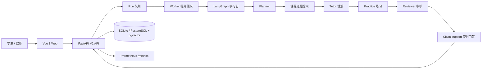

# 智学领航 · Evidence-First Learning Agent


> 面向课程学习的**证据优先多 Agent 平台**：每个结论尽量可回溯到课程证据，执行可恢复、可审计、可复核。

[](LICENSE)


## 项目简介

智学领航（Evidence-First Learning Agent）是一个面向真实课程场景的学习 Agent 平台。它不追求“通用自治 Agent”，而是把能力收敛到一条可验证的主线：

**目标 → 学习计划 → 课程证据检索 → 讲解/练习 → 教师审核 → 交付**

V2 旗舰链路基于 LangGraph，把 Planner、Tutor、Practice、Reviewer 做成有结构契约的角色；检索只允许课程内 `search_course`，引用必须落到证据 `chunk_id`，未完成/被中断的 Run 可以续跑，需要人工审核时停在明确状态。

## 核心能力

- **证据优先**：答案、讲解与练习都带来源引用；证据不足时拒答或返工，不用模型自由发挥掩盖缺口。
- **结构化学习包**：`Planner → Tutor → Practice → Reviewer` 固定契约；支持 `partial_completed` 部分成功、SSE 流式事件、检查点与教师 `resume`。
- **确认门控记忆**：模型只能 `propose`，落库 `confirm` 必须由 `student`/`teacher` 显式操作；partial/failed 的 Run 永不进入长期记忆；跨会话摘要只读已确认记忆且不回写。
- **有界重规划**：工具失败/重复检索无证据时才重规划；最多 1 轮、两版计划，超限停止并保留检查点。
- **统一工具目录**：工具元数据单一来源，运行时 deny-by-default 权限矩阵；越权、未知工具、非法参数一律拒绝并写审计。
- **Run 队列/Worker**：Run 创建与执行解耦，租约/心跳/取消/超时/崩溃重领；语义为 **at-least-once**，不声称 exactly-once。
- **安全与可观测**：注入红队回归、claim-support 交付门禁、配额/限流 429、Run 级指标与告警草案。
- **Prompt 注册表**：prompt 带 name/version/sha256/changelog，文件缺失或哈希失配回退到字节相同的内置默认；CI 用 `verify_registry()` 硬拦漂移。

## 架构概览



关键设计：

- **课程范围固定**：检索、工具、Run 都绑定课程与身份，不允许任意 URL/文件/系统命令。
- **执行可恢复**：检查点 + 租约；崩溃后租约过期可被重领；旧 Worker 被 fence。
- **人工在环**：高风险/低质量内容进入 `awaiting_approval`，教师审核后才交付。

## 技术栈

| 层 | 技术 |
|---|---|
| 后端 | Python 3.12、FastAPI、SQLAlchemy、Alembic、Pydantic |
| Agent | LangGraph、结构化 JSON 契约、证据检索/引用校验 |
| 数据 | SQLite（默认/演示）、PostgreSQL 16 + pgvector、Redis |
| 前端 | Vue 3、Vite、TypeScript |
| 工程 | pytest、ruff、mypy、GitHub Actions、nightly 分批、Docker Compose |
| 可选 | Celery、MCP 只读适配器、Manim/Mermaid/TTS 多模态产物 |

## 快速开始（离线预览）

离线模式不会调用付费模型 API。

```bash
git clone https://github.com/a142269/evidence-first-learning-agent.git
cd evidence-first-learning-agent
cp .env.example .env

python -m venv .venv
# Windows: .venv\Scripts\activate
# macOS/Linux: source .venv/bin/activate
pip install -r requirements.txt
python -m scripts.seed_demo
uvicorn backend.app.main:app --reload --port 8000
```

另开终端启动前端：

```bash
cd frontend
npm ci
npm run dev
```

打开 <http://localhost:5173>；演示学生账号 `demo-student-1`，密码 `123456`。

Windows / Python 3.12 可用 `requirements.lock.txt`；Linux 用带哈希的 `requirements.lock.linux.txt`：

```bash
python -m pip install --require-hashes -r requirements.lock.linux.txt
```

## 本地验证

```bash
# 全量离线测试（约 20–25 分钟）
export A3_OFFLINE_DEMO=true
export LLM_PROVIDER=none
export DATABASE_URL="sqlite:///./output/local/full.db"
python -c "from backend.app.core.database import init_db; init_db()"
pytest tests/ --basetemp output/local/base -o addopts= --benchmark-disable -q

# 静态检查
ruff check --select=F821,F823,E9 backend/app scripts/ tests/
git diff --check
```

当前本地基线（2026-10-25，Windows + Python 3.12.15，离线）：

- 全量：**2520 passed / 0 failed / 20 skipped**
- CI 快清单：**54 文件 / 649 passed / 1 skipped**
- Linux/不同环境可能有时长与条件 skip 差异；以实际日志为准。

## 目录结构

```
backend/           FastAPI 应用、V2 API、Agent runtime、服务层
  app/agent_runtime/   学习包图、队列、Worker、检查点、用法计量
  app/api/v2/          V2 路由、权限矩阵、生命周期
  app/services/        检索、工具目录、记忆、摘要、配额、指标
  app/evaluation/      claim-support 等离线校验
frontend/           Vue 3 前端
prompts/            版本化 Prompt 文件
alembic/            数据库迁移
tests/              pytest 测试（a/b/integration/regression）
evals/              评测集、结果与成本视图
docs/               架构、指南、台账、测试矩阵、发布材料
scripts/            数据/评测/运维脚本
```

## 文档索引

- [V2 十模块实现](docs/V2_TEN_MODULE_IMPLEMENTATION.md)
- [学习包指南](docs/LEARNING_PACKAGE_GUIDE.md)
- [企业架构指南](docs/ENTERPRISE_ARCHITECTURE_GUIDE.md)
- [声明台账](docs/CLAIMS_LEDGER.md) / [测试矩阵](docs/TEST_MATRIX.md)
- [评测说明](evals/README.md)
- [5 分钟演示脚本](docs/DEMO_5_MINUTES.md)
- [Release 草案](docs/RELEASE_DRAFT.md) / [生产 Runbook](docs/PRODUCTION_RUNBOOK.md)
- [变更记录](CHANGELOG.md)

## 项目状态与边界

- 当前是 **`v1.0.0-rc1` 候选**，不是 GA；**404 独立复核由用户豁免、未执行**，法务/素材/视频/截图/公网部署仍未完成。
- 完整测试与证据见 [TEST_MATRIX](docs/TEST_MATRIX.md)、[CLAIMS_LEDGER](docs/CLAIMS_LEDGER.md)；不把本地离线全量绿写成“公网已验证”。
- 不做通用浏览器/Shell/任意文件写入/任意代码执行/无限自主循环；V2 检索只允许课程内证据。
- 真实模型调用需用户自己的 API 配置；仓库不包含、不打印、不提交任何密钥或 `.env`。

## 安全说明

- 生产模式使用 fail-closed 安全边界：认证/课程授权/权限矩阵/配额/`/metrics` 角色限制。
- 不要提交 `.env`、API Key、数据库口令或真实学生数据；示例配置只使用空值/本地占位。
- 安全问题请通过仓库 Issue/私密渠道报告，不要在公开 Issue 贴密钥或利用细节。

## 许可证

[MIT](LICENSE)。第三方组件与素材许可见 [THIRD_PARTY_NOTICES.md](THIRD_PARTY_NOTICES.md)、[DIST_NOTICE_DRAFT.md](docs/DIST_NOTICE_DRAFT.md) 与 [RELEASE_LICENSE_REVIEW.md](docs/RELEASE_LICENSE_REVIEW.md)；素材 provenance 仍待人工补齐。
