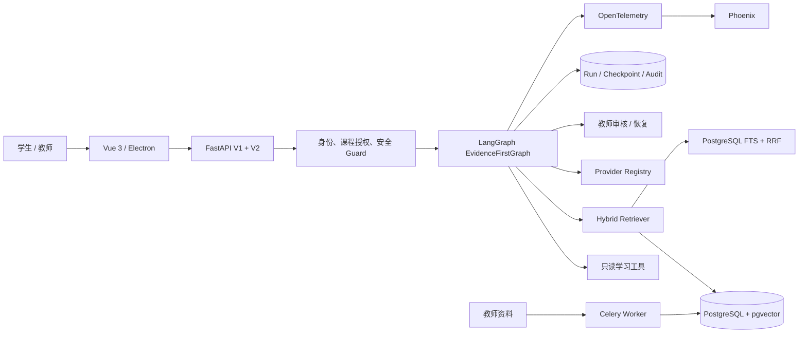

<p align="center">
  
</p>

<p align="center">
  <strong>面向高校课程的企业级、可追溯、可恢复学习 Agent</strong><br />
  LangGraph orchestration · Hybrid RAG · Human review · Durable execution
</p>

<p align="center">
  <a href="https://github.com/a142269/evidence-first-learning-agent/actions/workflows/ci.yml"></a>
  
  
  
  
  
</p>

---

## 项目概览

Triple-U 把课程问答、个性化讲解、练习生成与教师审核组织成一条可审计的学习工作流。每个回答都携带实际使用的来源；长任务通过 PostgreSQL 检查点和执行租约实现断线恢复；高风险内容在生成前拦截，需要人工确认的内容进入教师审核。

<p align="center">
  
</p>

| 核心能力 | 工程实现 | 可验证结果 |
| --- | --- | --- |
| Evidence-first RAG | pgvector + PostgreSQL FTS + RRF + 来源级去重 | 76 条新版 Golden Set 中 74 条通过 |
| Stateful Agent | LangGraph、PostgreSQL Checkpointer、SSE、执行租约 | 真实 PostgreSQL 恢复组合 15/15 |
| Tutor → Practice 学习包 | 受限检索决策循环、逐项引用、Reviewer 一次返工 | 13 个在线契约场景 13/13 |
| 生产权限边界 | 持久化令牌摘要、逐账号课程授权、V1 白名单 | SQLite / PostgreSQL 跨进程验证 |
| 异步知识摄取 | Celery、Redis、版本化文档、分块与向量重建 | 幂等、重投和租约接管测试 |
| 可观测与评测 | OpenTelemetry、Phoenix、预算守卫、数据集签名 | 可重放评测与用量审计 |

## 实测指标

以下结果来自 2026-10-16 的隔离测试环境。在线模型成绩与本地契约测试分开统计。

| 验证项 | 结果 |
| --- | ---: |
| 新版中文 Golden Set | **74 / 76（97.37%）** |
| 事实题 Hit@5 | **95.83%** |
| 事实题 Recall@5 | **94.79%** |
| 引用存在率 / 有效率 | **100% / 100%** |
| 本地离线测试 | **2153 passed, 18 skipped** |
| PostgreSQL 专项测试 | **15 / 15** |
| 学习包标准在线契约 | **13 / 13** |

评测口径、阈值和限制见 [evals/README.md](evals/README.md) 与 [实施状态](docs/UPGRADE_IMPLEMENTATION_STATUS.md)。

## 系统架构



### 学习问答状态机

```text
鉴权 → 安全判断 → 检索 → 画像上下文 → 生成 → 引用校验 → 持久化
```

学习包使用 Tutor → Practice 两步计划。模型只能选择 `search_course` 或 `finish`，最多检索三次；讲解和每道练习分别返回 `source_ids` 与结构化引用。

## 产品界面

<table>
  <tr>
    <td width="50%"></td>
    <td width="50%"></td>
  </tr>
  <tr>
    <td align="center">六智能体角色与演示登录</td>
    <td align="center">个性化学习工作台与新手引导</td>
  </tr>
</table>

## 技术栈

- **Backend:** Python, FastAPI, SQLAlchemy, Alembic, Celery, Redis
- **Agent:** LangChain, LangGraph, SSE, human-in-the-loop
- **RAG:** PostgreSQL, pgvector, HNSW, PostgreSQL FTS, RRF
- **Frontend:** Vue 3, TypeScript, Vite, Ant Design Vue, Electron
- **Observability:** OpenTelemetry, Phoenix, structured audit events
- **Delivery:** Docker Compose, GitHub Actions, Ruff, MyPy, Pytest

## 快速开始

### 1. 离线预览

离线模式不会调用付费模型 API。

```bash
git clone https://github.com/a142269/evidence-first-learning-agent.git
cd evidence-first-learning-agent
cp .env.example .env

python -m venv .venv
# Windows: .venv\Scripts\activate
# macOS/Linux: source .venv/bin/activate
pip install -r requirements.txt
python -m scripts.seed_demo
uvicorn backend.app.main:app --reload --port 8000
```

另开一个终端：

```bash
cd frontend
npm ci
npm run dev
```

打开 <http://localhost:5173>，演示学生账号为 `demo-student-1`，访问密码为 `123456`。

### 2. 企业本地栈

需要 Docker Desktop。示例配置中的所有密钥均为空或为本地占位值。

```bash
cp .env.example .env
cp .env.enterprise.example .env.enterprise
docker compose --env-file .env.enterprise \
  -f docker-compose.yml \
  -f docker-compose.enterprise.yml \
  up -d --build
```

服务入口：

- Web：<http://localhost:5173>
- OpenAPI：<http://localhost:8000/docs>
- Phoenix：<http://localhost:6006>

## 验证

```bash
# 后端关键检查
ruff check --select=E9,F63,F7,F82 backend/app scripts tests
pytest tests/ --no-cov --benchmark-disable -q

# 前端
cd frontend
npm ci
npm run build
```

在线评测和向量回填可能产生第三方 API 费用，相关脚本要求显式提供预算编号与上限。普通本地测试默认使用离线模式。

## 目录结构

```text
backend/app/
  agent_runtime/              # LangGraph、检查点、租约、学习包
  api/v2/                     # V2 认证、SSE、运行生命周期
  services/                   # 检索、摄取、向量重建、安全
  evaluation/                 # Golden Set 与学习包评测
frontend/src/                 # Vue 产品界面
alembic/versions/             # SQLite / PostgreSQL 数据迁移
evals/                        # 数据集、阈值和评测说明
scripts/                      # 回填、评测、运维与演示脚本
tests/                        # 单元、集成、PostgreSQL 恢复测试
docs/                         # 架构、权限、恢复与演示文档
```

## 深入阅读

- [企业架构实现指南](docs/ENTERPRISE_ARCHITECTURE_GUIDE.md)
- [V2 十模块实现说明](docs/V2_TEN_MODULE_IMPLEMENTATION.md)
- [学习包设计与使用](docs/LEARNING_PACKAGE_GUIDE.md)
- [持久化认证与课程权限](docs/AUTH_AND_COURSE_ACCESS.md)
- [运行状态修复与断线恢复](docs/RUN_RECONCILIATION.md)
- [PostgreSQL 检查点验收](docs/POSTGRES_CHECKPOINT_ACCEPTANCE.md)
- [5 分钟演示脚本](docs/DEMO_5_MINUTES.md)

## 安全说明

- 不提交 `.env`、API Key、访问令牌、供应商账单或在线评测原始输出。
- 生产模式默认要求身份认证和逐账号课程授权。
- V1 生产入口只开放经过审核的路由白名单。
- Agent 工具为只读集合；写入、发布、删除和外发操作会被拒绝。

---

<p align="center">Built as an auditable learning system where every answer can point back to evidence.</p>
