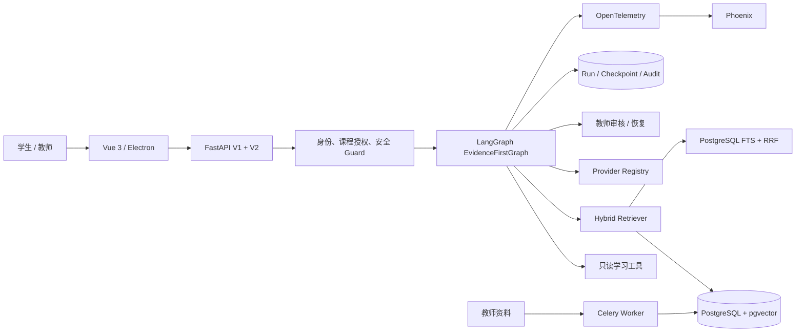

<p align="center">
  
</p>

# 智学领航——个性化学习多Agent平台

<p align="center">
  <strong>面向高校课程的企业级、可追溯、可恢复学习 Agent</strong><br />
  LangGraph orchestration · Hybrid RAG · Human review · Durable execution
</p>

<p align="center">
  <a href="https://github.com/a142269/evidence-first-learning-agent/actions/workflows/ci.yml"></a>
  
  
  
  
  
</p>

---

## 项目概览

智学领航把课程问答、个性化讲解、练习生成与教师审核组织成一条可审计的学习工作流。每个回答都携带实际使用的来源；长任务通过 PostgreSQL 检查点和执行租约实现断线恢复；高风险内容在生成前拦截，需要人工确认的内容进入教师审核。

**旗舰链路是 V2 证据优先学习包**：受限规划与课程检索 → Tutor 讲解 → Practice 练习 → Reviewer 审查与最多一次返工 → 按需教师审核。V1 多角色对话是兼容和演示能力；辩论、多模态等属于实验功能，不代表 V2 的生产工作流。

V1 调度器按优先级分组并行执行；`depends_on` 是未执行的兼容字段，不提供 DAG 依赖调度。早期项目设计文档中的任务 DAG 属于规划，并非当前实现。

引用 ID 有效只说明来源存在，不能证明结论得到来源支持。[三组固定证据对照报告](evals/results/ablation-fixed-evidence-20261017.md)已记录 72 次真实模型运行及失败原因；双人质量复核尚未完成，不能据此声称多 Agent 优于单 Agent。逐条事实复核方法见 [评测计划](evals/CLAIM_AND_ABLATION.md)。

<p align="center">
  
</p>

| 核心能力 | 工程实现 | 可验证结果 |
| --- | --- | --- |
| Evidence-first RAG | pgvector + PostgreSQL FTS + RRF + 来源级去重 | 76 条新版 Golden Set 中 74 条通过 |
| Stateful Agent | LangGraph、PostgreSQL Checkpointer、SSE、执行租约 | 真实 PostgreSQL 恢复组合 15/15 |
| Tutor → Practice 学习包 | 受限检索决策循环、逐项引用、Reviewer 一次返工 | 真实后端采集的 13 条契约场景 13/13（离线回放评测结构/引用/预算，非内容质量） |
| 生产权限边界 | 持久化令牌摘要、逐账号课程授权、V1 白名单 | SQLite / PostgreSQL 跨进程验证 |
| 异步知识摄取 | Celery、Redis、版本化文档、分块与向量重建 | 幂等、重投和租约接管测试 |
| 可观测与评测 | OpenTelemetry、Phoenix、预算守卫、数据集签名 | 可重放评测与用量审计 |

## 实测指标

以下在线指标来自 2026-10-16 的隔离测试环境，在线模型成绩与本地契约测试分开统计；"本地离线测试"一行按标注日期与运行环境单独复跑。

| 验证项 | 结果 |
| --- | ---: |
| 新版中文 Golden Set | **74 / 76（97.37%）** |
| 事实题 Hit@5 | **95.83%** |
| 事实题 Recall@5 | **94.79%** |
| 引用存在率 / 有效率 | **100% / 100%** |
| 本地离线测试（全量 `pytest tests/`） | **2509 passed / 0 failed / 20 skipped**（2026-10-25 QWEN-324 在最终字节上复跑，Windows + Python 3.12.15，1339.90 s，205 个测试文件、**2529 项**；口径不变：`A3_OFFLINE_DEMO=true LLM_PROVIDER=none` + 全新 `DATABASE_URL=sqlite:///./output/qwen324/full3.db`（先 `init_db()`）+ 全新 `--basetemp output/qwen324/base-full3`，`PYTEST_EXIT=0`、22 warnings；本卡新增 `tests/a/test_quota.py` **15 项**（相对 322 的 2494/0/20 为 +15），交付**配额与速率限制**：`backend/app/services/quota.py` 为 `/stream` 与 `/enqueue` 新建 Run 提供三道滑动窗口（请求数/用户/分钟、token/用户×课程/小时、可计量费用/用户/天），超限稳定 **429 `quota_exceeded` + `Retry-After`**，只挡创建、读与 resume/continue 不受限；token/费用从结算 budget 累计，**unknown 费用不当 0 也不当免费**（窗口含 unknown 时费用维度暂缓判定，eval_cost_guard 兜底）；基线 60/min、500k/h、5.0 CNY/天，`QUOTA_*` env 可覆盖；**启用 opt-in**（`QUOTA_ENABLED=true` 显式开，默认所有面零改变——与 321 运行时检查同一精神）；进程内滑动窗口零迁移，多进程口径归 341；迭代如实登记：默认启用两版在测试面误伤（28/29 failed），opt-in 后第三轮 0 failed；`tests/a/test_quota.py` 未进 CI 快清单（另卡）；零模型调用、未读 `.env`、未碰前端/UI；详见 `docs/CLAIMS_LEDGER.md` §41、`docs/TEST_MATRIX.md` §38）；再前 **2494 passed / 0 failed / 20 skipped**（2026-10-25 QWEN-322 在最终字节上复跑，Windows + Python 3.12.15，1329.19 s，204 个测试文件、**2514 项**；口径不变：`A3_OFFLINE_DEMO=true LLM_PROVIDER=none` + 全新 `DATABASE_URL=sqlite:///./output/qwen322/full.db`（先 `init_db()`）+ 全新 `--basetemp output/qwen322/base-full`，`PYTEST_EXIT=0`、21 warnings；本卡新增 `tests/a/test_prompt_injection_redteam.py` **25 项**（18 用例函数，guard 参数化展开；相对 321 的 2469/0/20 为 +25），交付**注入红队套件**：用户输入/检索文档/工具参数/部分完成内容四类注入面 + 泄露金丝雀（画像/系统提示/密钥形状）+ 正向对照，全部离线 scripted runtime、`retrieve` spy 钉"不越权调用工具"面；**运行期发现 3 个真实 guard 绕过并做最小修复**（`run_guard.decide` 归一化加 NFKC 折叠全角伪装 + 剔除零宽等 Unicode 格式字符；prompt_injection pattern 补"无视"同义词）——首跑 19/6 修复后 25 passed，定向 12 文件 173 passed 零回归；新套件未进 CI 快清单（另开 322b）；零模型调用、未读 `.env`、未碰前端/UI；详见 `docs/CLAIMS_LEDGER.md` §39、`docs/TEST_MATRIX.md` §36）；再前 **2469 passed / 0 failed / 20 skipped**（2026-10-25 QWEN-321 在最终字节上复跑，Windows + Python 3.12.15，1336.03 s，203 个测试文件、**2489 项**；口径不变：`A3_OFFLINE_DEMO=true LLM_PROVIDER=none` + 全新 `DATABASE_URL=sqlite:///./output/qwen321/full.db`（先 `init_db()`）+ 全新 `--basetemp output/qwen321/base-full`，`PYTEST_EXIT=0`、22 warnings；本卡新增 `tests/a/test_permission_matrix.py` 9 项（相对 312 的 2460/0/20 为 +9），交付**统一权限矩阵**：`backend/app/api/v2/permission_matrix.py` 把全部 10 条 V2 路由（learning-runs 8 + admin 2）声明在一处（角色/认证/课程范围/Run 归属/工具五维，工具维度引用 `tool_catalog` 的 v2 permission key——单一真相不复制），`verify_route_policies()` 从 OpenAPI schema 枚举实际服务路由与矩阵对比（FastAPI 0.143.3 lazy `_IncludedRouter` 下 `app.routes` 不展开），并进 CI `quality` job 新硬门步骤 `V2 permission matrix coverage`（未声明路由/幽灵声明/非法字段即 exit 1）；**声明层不强制运行时**——既有鉴权（`resolve_v2_principal`/`authorize_run_owner`/`authorize_reviewer`/工具 deny-by-default）一字未动，"未声明即拒绝"落在 CI；矩阵测试未进快清单（先例另卡）；零模型调用、未读 `.env`、未碰前端/UI；详见 `docs/CLAIMS_LEDGER.md` §37、`docs/TEST_MATRIX.md` §34）；再前 **2460 passed / 0 failed / 20 skipped**（2026-10-25 QWEN-312 在最终字节上复跑，Windows + Python 3.12.15，1299.73 s，202 个测试文件、**2480 项**；口径不变：`A3_OFFLINE_DEMO=true LLM_PROVIDER=none` + 全新 `DATABASE_URL=sqlite:///./output/qwen312/full.db`（先 `init_db()`）+ 全新 `--basetemp output/qwen312/base-full`，`PYTEST_EXIT=0`、20 warnings；本卡新增 11 项——`tests/a/test_prompt_regression.py` 5 + `tests/a/test_ab_prompts.py` 6（相对 311b 的 2449/0/20 为 +11），落地 Lead 裁定的**哈希失配策略**：运行时回退保留但回退/失配记 warning（name+reason，零 prompt 文本泄露，caplog 钉住）、`verify_registry()` 进 CI `quality` job 硬门（`Prompt registry integrity` 步骤，非 ok 即失败）；交付**回归 harness**（聚合完整性 + 固定样例结构断言：两步计划/引用四键 score=0/三道题/review 分项/claim_support）与 **A/B harness**（`scripts/ab_prompts.py`：默认 dry-run 零模型、预算门禁、脱敏报告只含 name/version/digest/sample id/结构级结果、`--execute` 仅 offline 脚本化对比——真实付费对比不在本卡范围）；零模型调用、未读 `.env`、未碰 API/UI/前端；详见 `docs/CLAIMS_LEDGER.md` §35、`docs/TEST_MATRIX.md` §32）；再前 **2449 passed / 0 failed / 20 skipped**（2026-10-25 QWEN-311 在最终字节上复跑，Windows + Python 3.12.15，1302.27 s，200 个测试文件、**2469 项**；口径不变：`A3_OFFLINE_DEMO=true LLM_PROVIDER=none` + 全新 `DATABASE_URL=sqlite:///./output/qwen311/full.db`（先 `init_db()`）+ 全新 `--basetemp output/qwen311/base-full`，`PYTEST_EXIT=0`、23 warnings；本卡新增 `tests/a/test_prompt_registry.py` 10 项（相对 301b 的 2439/0/20 为 +10），交付 **Prompt 注册表**：仓库根 `prompts/` 10 个 UTF-8 文件 + `backend/app/agent_runtime/prompts.py`（name/version/sha256/owner/changelog，`list_prompts()` 可追溯、`verify_registry()` 给文件状态），Planner/Tutor（含检索决策）/Practice/Reviewer 主提示词与共用 system 框架从 learning_package 迁出、**字节不变**（测试内嵌 pre-311 字面量逐字比对 + `_ask` system 消息端到端字节钉住），文件优先、缺失/哈希失配回退字节相同的内置默认，未知 name 抛稳定错误 `prompt_not_registered`；`PROMPT_VERSION` 定义移至 prompts.py、值不变 **未 bump**；零模型调用、未读 `.env`、未碰 API/UI/前端/CI；详见 `docs/CLAIMS_LEDGER.md` §33、`docs/TEST_MATRIX.md` §30）；再前 **2439 passed / 0 failed / 20 skipped**（2026-10-24 QWEN-301 在最终字节上复跑，Windows + Python 3.12.15，1434.35 s，199 个测试文件、**2459 项**；口径不变：`A3_OFFLINE_DEMO=true LLM_PROVIDER=none` + 全新 `DATABASE_URL=sqlite:///./output/qwen301/full2.db`（先 `init_db()`）+ 全新 `--basetemp output/qwen301/base-full2`，`PYTEST_EXIT=0`、21 warnings；本卡新增 `tests/a/test_run_queue.py` 15 项（相对 231b 的 2424/0/20 为 +15），交付 **Run 队列/Worker**：`POST /api/v2/learning-runs/enqueue`（创建/执行解耦，返回可查询 run id）+ `POST /{run_id}/cancel` + Worker（领取/心跳/超时/守卫 finish，at-least-once 崩溃重领，`MAX_ATTEMPTS=2`），零迁移（队列态复用 `agent_runs.status='queued'` + `metadata.queue` 簿记）、既有 `/stream`/GET/`resume`/`continue`/`reconcile` 一字未改、不声称 exactly-once；零模型调用、未读 `.env`、未碰 UI/前端/CI；全量首跑有 1 个 `test_demo_journey` 30 s 墙钟贴边抖动（30.07 s，单跑复验 5 passed 后第二轮全量全绿，日志未删）；详见 `docs/CLAIMS_LEDGER.md` §31、`docs/TEST_MATRIX.md` §28）；再前 **2424 passed / 0 failed / 20 skipped**（2026-10-24 QWEN-231 在最终字节上复跑，Windows + Python 3.12.15，1431.51 s，198 个测试文件、**2444 项**；口径不变：`A3_OFFLINE_DEMO=true LLM_PROVIDER=none` + `DATABASE_URL=sqlite:///./output/qwen231/full-clean.db`（先 `init_db()`）+ 全新 `--basetemp output/qwen231/base-full-clean2`，`PYTEST_EXIT=0`、24 warnings；本卡新增 `tests/a/test_observation_claim_support.py` 10 项 + `test_claim_support.py` 4 项 = **14 项**（相对 221b 的 2410/0/20 为 +14），产品只动学习包观察/交付路径与评测规则，零模型调用、未读 `.env`、未碰 API/UI/前端/迁移/CI；详见 `docs/CLAIMS_LEDGER.md` §29、`docs/TEST_MATRIX.md` §26）；再前 **2410 passed / 0 failed / 20 skipped**（2026-10-24 QWEN-221b 在最终字节上复跑，Windows + Python 3.12.15，893.78 s，197 个测试文件、**2430 项**（= 2429 收集 + 1 条 `test_mcp_readonly_protocol.py:11` 的 `mcp` 收集期 `importorskip`），口径不变：`A3_OFFLINE_DEMO=true LLM_PROVIDER=none` + 隔离 SQLite + 全新 `--basetemp output/qwen221b/base-full`，`PYTEST_EXIT=0`、20 warnings，与 221 记录 **2410/0/20 逐项相同**——本卡只扩展既有 MCP 用例的断言、0 新增用例项，产品代码零改动（`mcp_readonly.py` md5 仍 `6eea05e5fef4622ae314f9e1e1654e03`）；**本轮未挂 fail-closed socket 探针，故不主张探针 `attempts=0` 值**（见台账 §28.5）；详见 `docs/CLAIMS_LEDGER.md` §28、`docs/TEST_MATRIX.md` §25）；再前 **2410 passed / 0 failed / 20 skipped**（2026-10-24 QWEN-221 复跑，Windows + Python 3.12.15，1067.30 s，197 个测试文件、**2430 项**（= passed + skipped）；口径不变：`A3_OFFLINE_DEMO=true LLM_PROVIDER=none` + 仓库默认 SQLite + 全新 `--basetemp output/qwen221-2026-10-24/pytest-measure-221-full-suite`，同一 fail-closed socket 探针 **`outbound attempts=0 unique_hosts=0`**，零计费模型调用、未读 `.env`、无用例因阻断转红，`PYTEST_EXIT=0`、23 warnings；本卡把 9 个工具的元数据收敛成单一 `backend/app/services/tool_catalog.py`（工具名/来源/允许角色/权限键/只读或副作用/超时/参数模型或 JSON schema/截断/MCP 暴露），V2 broker 的 `ROLE_TOOLS`+`SCHEMAS`+三个参数模型与 V1 的 5 个 `ToolSchema` 字面量都改为读目录，V1 `_traced_call` 入口加同一个 deny-by-default 闸门；未知工具、未授权角色、非法参数一律拒绝并各写一条统一审计事件（`backend/app/services/tool_audit.py`，14 键、环形 500、`refused` 计数）——221 之前拒绝路径不留任何记录；**调用行为与错误面零改变**：六态状态、`ToolResult` 六字段、`audit()` 六键、V1 `{success, error, tool}` 由用例逐字钉住，`to_openai_tools()` 与 `git show HEAD:` 逐字节相同（`OPENAI_EXPORT_IDENTICAL=1`），44 文件 CI 同形子集复跑仍 **521 passed / 1 skipped**（与 211c 记录逐数相同）；新增 `tests/a/test_tool_registry_permissions.py` **18 条**用例（4 角色 × 9 工具 = 36 对越权扫、schema 四类非法参数、一调用一事件、MCP `ast` 名字与入参名平价），11 组单层反向验证全部真红后按字节恢复（`ALL_PROOFS_VALID=1`）；`ci.yml`、`mcp_readonly.py`、`api/v2/learning_runs.py`、`learning_package.py` 一字未动；详见 `docs/CLAIMS_LEDGER.md` §27、`docs/TEST_MATRIX.md` §24）；再前 **2392 passed / 0 failed / 20 skipped**（2026-10-24 QWEN-211c 复跑，Windows + Python 3.12.15，853.50 s，196 个测试文件 / 2412 项；口径不变：`A3_OFFLINE_DEMO=true LLM_PROVIDER=none` + 仓库默认 SQLite + 全新 `--basetemp output/qwen211c-2026-10-24/pytest-full-suite`，挂同一 fail-closed socket 探针，探针 **`outbound attempts=0 unique_hosts=0`**，零计费模型调用、无用例因阻断转红，`PYTEST_EXIT=0` 记入日志；本卡按 Lead 裁定**只补一条钉住 `PROMPT_VERSION` 字面值的用例**（`tests/a/test_learning_package_replan.py` 15 → 16 项，`git diff --numstat` 8/0 纯尾部追加），**产品逻辑与 CI 一字未动**（产品 md5 仍 `39365d91586918122d7e72454f1ad498`、`ci.yml` md5 仍 `3658e9f11738a4633e72551947994080`、快清单仍 44 文件、`enterprise-contract` 仍 38），§25.2 登记的「bump 在测试面上静默」缺口就此关闭；反向验证：把 `learning_package.py:23` 在工作树里临时改回 v2.8 → **1 failed / 15 passed**，红点正是这条新用例，按字节恢复后复跑 **16 passed**；同口径 CI 快清单复跑 **521 passed / 1 skipped**（= 211b 的 520 + 本卡 1 项，与 Lead 预计 **521/1** 一致，唯一 skip 仍是 `test_auth_restart.py:18`）；详见 `docs/CLAIMS_LEDGER.md` §26、`docs/TEST_MATRIX.md` §23）。再前 **2391 passed / 0 failed / 20 skipped**（2026-10-24 QWEN-211 复跑，Windows + Python 3.12.15，901.89 s，196 个测试文件 / 2411 项；口径不变：`A3_OFFLINE_DEMO=true LLM_PROVIDER=none` + 仓库默认 SQLite + 全新 `--basetemp output/qwen211-2026-10-24/pytest-full2`，挂同一 fail-closed socket 探针，探针 **`outbound attempts=0 unique_hosts=0`**，零计费模型调用、无用例因阻断转红，`PYTEST_EXIT=0` 记入日志；同命令首跑 2391/20、1079.94 s 计数逐项一致（首跑在补最后一条交付结果断言之前的字节上，定向跑与新文件跑均在最终字节上）；该轮交付**有界重规划**（只改 `backend/app/agent_runtime/learning_package.py` 的 planner 侧）：计划失效检测只认两个确定性信号——课程检索返回 `failed`/`timeout`（`tool_failed`），或模型重复已检索过的提问且证据仍为空（`evidence_stalled`）；失效后 Planner 最多重规划 **1 轮**（`MAX_REPLAN_ROUNDS=1`，另有 `MAX_REPLAN_DEPTH=2` 限定单运行最多两版计划，**基线常量、最终阈值待 Lead 裁定**），两条上限各有独立用例；超限**停止**并沿用根因错误码（`learning_package_tool_failed`/`learning_package_repeated_search`），**不新增用户可见错误码**；重规划沿用缓存的学习上下文，不重放画像/错题/前置知识读取；预算、`searches`、证据与返工计数一律保留，失败检索照旧计费且其提问记入 `searches`，所以重规划不能把同一提问免费再跑一次（**不洗白任何既有上限**）；每次失效写检查点 `plan_invalidations` 并发出 `plan.replanned` 审计事件（落 `agent_checkpoints`），载荷只有所在节点、触发原因与 7 项计数，不含提示词、模型文本或检索内容，也不进交付结果与教师草稿；已消耗的那一轮存检查点，`/{run_id}/continue` 恢复只重放失败节点并再次停止，不发放新一轮、不追加模型调用；检索预算耗尽、无证据直接 finish、`denied`/`invalid_args` 授权拒绝**都不是**计划失效；**零模型调用、未读 `.env`、未碰 API/UI、未 bump `PROMPT_VERSION`、未进 CI 快清单**；测试 **15 项全部为新增**，另有 10 组反向验证逐条禁用绑定规则、各让对应用例转红后按字节恢复（累计 60 个失败用例）。详见 `docs/CLAIMS_LEDGER.md` §24、`docs/TEST_MATRIX.md` §21；**同日 QWEN-211b 只把 `PROMPT_VERSION` bump 到 v2.9 并把这 15 项测试纳入 CI 快清单（43→44，同形复跑 520/1），零新增用例、零产品逻辑改动，同命令在 v2.9 最终字节上复跑仍 2391 passed / 0 failed / 20 skipped（1308.53 s，196 个测试文件 / 2411 项，探针 `attempts=0 unique_hosts=0`，`output/qwen211b-2026-10-24/logs/full-suite.txt`），见 §25、矩阵 §22**）。再前 **2376 passed / 0 failed / 20 skipped**（2026-10-23 QWEN-202 复跑，Windows + Python 3.12.15，993.55 s，195 个测试文件 / 2396 项；口径不变：`A3_OFFLINE_DEMO=true LLM_PROVIDER=none` + 仓库默认 SQLite + 全新 `--basetemp output/qwen202-2026-10-23/pytest-full2`，挂同一 fail-closed socket 探针，探针 **`outbound attempts=0 unique_hosts=0`**，零计费模型调用、无用例因阻断转红；该轮交付**跨会话摘要**：`backend/app/services/session_summary.py` 的 `cross_session_summary` 只读 201 的 `active_memories`（`status='active'` 且 `expires_at` 未过），`build_summary` 是签名里没有 session 的纯函数，**摘要不可能写回 `user_memories`**（用例把三次摘要前后 `user_memories`/`memory_events` 的行数钉死不变，返回体恒 `persisted: false`）；有界四道——窗口 `window`（默 3、上限 20，即主计划要的「替代固定 3 条窗口的可配置版本」）、单项 80 token / 320 字裁剪带 `…` 与 `truncated` 标记、总预算 `token_budget`（默 600）、被跳过的每条都有显式 `skipped` 原因；幂等靠`summary_sha256` 只覆盖正文行、不含 `generated_at`，两个时刻重建逐字段相同；失败回退是坏行单独 `content_missing` 跳过、两次读各自压成同一个 `memory_persistence_unavailable`；**不被 partial 污染**在 201 写侧闸门之外补了**读侧复核**，确认后源 run 被改判成七态之一或被删都当场跳过；无记忆给明确空态，并区分 `no_active_memory` 与 `no_memory_fit_budget`。**零模型调用、未读 `.env`、未碰 API/UI（留 203）、未回改 `conversation_memory.py:21` 的 `.limit(3)`、未扩 CI 清单**；测试 **40 项全部为新增**，另有 10 组反向验证逐条禁用绑定规则、各让对应用例转红后按字节恢复。详见 `docs/CLAIMS_LEDGER.md` §22、`docs/TEST_MATRIX.md` §19）。再前 **2336 passed / 0 failed / 20 skipped**（2026-10-23 QWEN-201 复跑，Windows + Python 3.12.15，1156.38 s，194 个测试文件 / 2356 项；口径不变：`A3_OFFLINE_DEMO=true LLM_PROVIDER=none` + 仓库默认 SQLite + 全新 `--basetemp output/qwen201-2026-10-23/pytest-full`，挂同一 fail-closed socket 探针，探针 **`outbound attempts=0 unique_hosts=0`**，零计费模型调用、无用例因阻断转红；本轮交付**确认门控的长期记忆**：`user_memories` + `memory_events` 两张表与可完全回滚的迁移 `20261023_0012`——隔离 SQLite 上 `alembic` CLI 真跑 `upgrade head`（12 个 revision）→ `downgrade base`（12 步回滚，两张表与全部 7 个索引消失）→ 再 `upgrade head`（表回归且为空）；服务层 `backend/app/services/user_memory.py` 把写入压成三段：模型只能 `propose`（签名里没有 session，**结构上不可能落库**），`confirm` 必须显式 `student`/`teacher` actor 且来源 run 的 `status` 必须是 `completed`——`partially_completed`/`failed`/`awaiting_approval`/`reviewing`/`interrupted`/`rejected`/`running` **七态一律拒入记忆**，`revoke` 只改状态并留审计；同一 `(user_id, kind)` **只允许一条 `active`**，由部分唯一索引 `uq_user_memory_active … WHERE status = 'active'` 与服务层同事务 supersede 双重表达，退役行留在原表供审计而不撞库；TTL 从确认时刻起算、过期只不读不删；重放 `revoke` 不灌水审计；错误面只给稳定 code、不外泄 DB 文本。**零模型调用、未读 `.env`、未加端点或 UI（留给 203）**；测试 **53 项全部为新增**（50 服务 + 3 迁移），另有 9 组反向验证逐条禁用绑定规则、各让对应用例转红后恢复。详见 `docs/CLAIMS_LEDGER.md` §20、`docs/TEST_MATRIX.md` §17）。再前 **2283 passed / 0 failed / 20 skipped**（2026-10-23 QWEN-104d 复跑，Windows + Python 3.12.15，842.46 s，192 个测试文件 / 2303 项；口径不变：`A3_OFFLINE_DEMO=true LLM_PROVIDER=none` + 仓库默认 SQLite + 全新 `--basetemp output/qwen104d-2026-10-23/pytest-full-final`，挂同一 fail-closed socket 探针，探针 **`outbound attempts=0 unique_hosts=0`**，零计费模型调用、无用例因阻断转红；该轮按 Lead 两项裁定落地：① 管理端 `cost` 字典在"生产者声明 `estimated` 但投影拿不到可用金额"（缺 `amount_cny` 键、`None`、非有限、负数、字符串、`True`）时补 `reason="no_cost_amount_recorded"`，**保留生产者写的 `estimated`、不降级、不补任何金额**，`cost_cny` 与 `runs_without_estimated_cost` 口径不变；② `scripts/report_eval_cost.py` 的过期模板说明改为"latency 已由 QWEN-104b/104c 修复、复跑 127→0"，**已交付的 tracked 报告未重生成、一字未动**，验证一律写 scratch；`tests/a/test_run_usage_admin.py` 13 → 14 项，反向验证（撤掉新支）为 2 failed / 12 passed，详见 `docs/CLAIMS_LEDGER.md` §19、`docs/TEST_MATRIX.md` §16）。再前 **2282 passed / 0 failed / 20 skipped**（2026-10-23 QWEN-104c 复跑，Windows + Python 3.12.15，873.67 s，192 个测试文件 / 2302 项；口径不变：`A3_OFFLINE_DEMO=true LLM_PROVIDER=none` + 仓库默认 SQLite + 全新 `--basetemp output/qwen104c-2026-10-23/pytest-full`，挂同一 fail-closed socket 探针，探针 **`outbound attempts=0 unique_hosts=0`**，零计费模型调用、无用例因阻断转红；该轮给管理端用量投影的 `_number`/`_amount` 加 `math.isfinite`——`inf`/`-inf`/`nan` 一律判为未记录，不再可能以字面 `Infinity` 或静默 `null` 出接口，`_count` 与 token/`model_calls`/`tool_calls`/`duration_ms` 的整数口径不动，`tests/a/test_run_usage_admin.py` 11 → 13 项，详见 `docs/CLAIMS_LEDGER.md` §18、`docs/TEST_MATRIX.md` §15）。再前 **2280 passed / 0 failed / 20 skipped**（2026-10-23 QWEN-104b 复跑，Windows + Python 3.12.15，762.69 s，192 个测试文件 / 2300 项；口径不变：`A3_OFFLINE_DEMO=true LLM_PROVIDER=none` + 仓库默认 SQLite + 全新 `--basetemp output/qwen104b-2026-10-23/pytest-full`，挂同一 fail-closed socket 探针，探针 **`outbound attempts=0 unique_hosts=0`**，零计费模型调用、无用例因阻断转红；该轮把管理端 `reported_latency_ms` 的投影从"只接受非负整数"改为接受非负 int/float（token、`model_calls`、`tool_calls`、`duration_ms` 仍限整数），`tests/a/test_run_usage_admin.py` 9 → 11 项，详见 `docs/CLAIMS_LEDGER.md` §17、`docs/TEST_MATRIX.md` §14）。再前 **2278 passed / 0 failed / 20 skipped**（2026-10-22 QWEN-107 复跑，Windows + Python 3.12.15，1095.22 s，192 个测试文件 / 2298 项；口径与上一轮一致：`A3_OFFLINE_DEMO=true LLM_PROVIDER=none` + 仓库默认 SQLite + 新 `--basetemp output/qwen107-2026-10-22/base-full`，挂同一 fail-closed socket 探针，探针记录 6 次外联尝试 / 2 个 IP 全部阻断，无任何计费模型端点，无用例因阻断转红）。上一轮 **2272 passed / 1 failed / 20 skipped**（同日 QWEN-104，731.42 s，192 文件 / 2293 项），唯一失败是既有用例 `tests/integration/test_manim_fallback.py::TestFallbackAssets::test_code_only_skips_fallback`：Level-1 agent 视频被质量门以"画面与旁白时长偏差 2.09 s / 2.17 s，超过允许的 2.00 s"逐轮不同幅度地拒绝，脚本态因此触发兜底——属质量门与用例期望的语义冲突。QWEN-107 按 Lead 2026-10-22 裁定的**方案②**修正产品语义：`include_manim=false`（未请求渲染）时交付可编辑讲稿脚本，`success=True`、`video_status="script_only"`、`rendered=False`、不触发兜底；请求渲染时质量门照旧强制、阈值未改（详见 `docs/CLAIMS_LEDGER.md` §11）。该红点转绿并新增 5 项确定性回归：2273 → **2278**。同日 **QWEN-107b** 再按 Lead 裁定把"可编辑讲稿"真正交付到 `content`（正文来源 `generate_manim` 的 `metadata.generated_code`；正文缺失或为空则显式失败并给稳定错误，不再静默返回空产物），扩展的是既有用例、**未新增测试项**，同口径复跑仍 **2278 passed / 0 failed / 20 skipped**（756.16 s，探针 6 次外联尝试全部阻断、无计费），详见 `docs/CLAIMS_LEDGER.md` §12 与 `docs/TEST_MATRIX.md` §9。同日 **QWEN-108** 把此前唯一需要探针阻断的外联来源（`tests/a/test_knowledge_platform.py` 摄取用例真实调用 embeddings）改成显式离线，同口径全量复跑 **2278 passed / 0 failed / 20 skipped（764.23 s）且 `outbound attempts=0 unique_hosts=0`** —— 离线不再靠探针兜底；只动测试 fixture，产品代码零改动，见 `docs/CLAIMS_LEDGER.md` §13、`docs/TEST_MATRIX.md` §10。同日 **QWEN-107c** 再把脚本态的 CoV/Safety 审计输入从"顶层空文本"改为**实际交付的讲稿正文**（`metadata.generated_code`），`include_manim=true` 的渲染分支口径不变，同口径全量复跑仍 **2278 passed / 0 failed / 20 skipped**（649.18 s，`attempts=0`，用例数未变；真链路探针显示修复前空文本会得到 `cov.score=1.0/passed=True` 的虚过），详见 `docs/CLAIMS_LEDGER.md` §15、`docs/TEST_MATRIX.md` §12。同日 **QWEN-109** 交付只读的评测用量/成本汇总（`scripts/report_eval_cost.py` + `docs/EVAL_USAGE_COST_REPORT_2026-10-22.md`），不改产品投影、未新增用例，全量口径仍 **2278 / 0 / 20**；该报告登记的产品投影偏差（127/127 条浮点 `latency_ms` 被判为未记录）已由上文 **QWEN-104b** 修复，见 `docs/CLAIMS_LEDGER.md` §17、`docs/TEST_MATRIX.md` §14；报告正文那两行过期说明已按 Lead 指令在 **QWEN-104c** 更正为同命令复跑 127→0，已交付的统计数字与结论一字不改（§18.3）。更早 **2264 / 0 / 20**（2026-10-21 QWEN-106，834.21 s，191 文件），再前 **2263 / 1 / 20**（2026-10-19，唯一失败是本机 `.env` 把 `EMBEDDING_BATCH_SIZE` 设为 20 而用例期望默认 10，已由一行 `monkeypatch.delenv` 隔离修复）与更早一轮 **2235 / 0 / 20**（612.61 s，189 文件），逐批评见 `docs/TEST_MATRIX.md` §8 与 `docs/CLAIMS_LEDGER.md` §11） |
| PostgreSQL 专项测试 | **15 / 15**（2026-10-16 历史口径）。2026-10-22 QWEN-105 用本机一次性 `pgvector/pgvector:pg16` + `redis:7-alpine` 环回容器复跑了 CI `enterprise-contract` 的 38 个 PG 契约文件（含检查点跨进程恢复、API 崩溃恢复、摄取幂等、向量版本检索、未完成续跑），两轮均 **364 passed / 0 failed / 0 skipped**（162.58 s / 159.53 s，`127.0.0.1` 口径，零外联）；Redis 服务可用但该子集未走真实 Redis 路径，故 PG 层与 Redis 层分开主张。详见 `docs/CLAIMS_LEDGER.md` §14、`docs/TEST_MATRIX.md` §11 |
| CI 可移植子集（`quality` job 快清单） | **623 passed / 1 skipped / 0 failed**（2026-10-25 QWEN-322b：`.github/workflows/ci.yml` 把 `tests/a/test_prompt_injection_redteam.py` 纳入快清单，**51 → 52 个文件**（新行 `:261`，旗标行顺延 `:262`）；清单由脚本从 `ci.yml` 机械重取（52 条、无重复、0 缺失、末位即该文件，`logs/portable-list.txt`）；同形旗标 + 前置 `init_db()`，`DATABASE_URL=sqlite:///./output/qwen322b/ci.db`，`--basetemp output/qwen322b/base`，**623 passed, 1 skipped, 4 warnings in 299.01s (0:04:59)**，`CI52_EXIT=0`；相对 321b 的 598/1 恰好 **+25** = 该文件用例项数，与 Lead 预计 **623/1** 逐数一致；唯一 skip 仍是 `test_auth_restart.py:18`；本卡只改 CI/文档，产品与测试逻辑零改动、零模型；`enterprise-contract` 仍 38、两个硬门步骤不变；**这是本地同形复跑，GitHub `quality` job 的真实回执属远程证据**。详见 `docs/CLAIMS_LEDGER.md` §40、`docs/TEST_MATRIX.md` §37）；再前 **598 passed / 1 skipped / 0 failed**（2026-10-25 QWEN-321b：`.github/workflows/ci.yml` 把 `tests/a/test_permission_matrix.py` 纳入快清单，**50 → 51 个文件**（新行 `:260`，旗标行顺延 `:261`）；清单由脚本从 `ci.yml` 机械重取（51 条、无重复、0 缺失、末位即该文件，`logs/portable-list.txt`）；同形旗标 + 前置 `init_db()`，`DATABASE_URL=sqlite:///./output/qwen321b/ci.db`，`--basetemp output/qwen321b/base`，**598 passed, 1 skipped, 4 warnings in 281.74s (0:04:41)**，`CI51_EXIT=0`；相对 312b 的 589/1 恰好 **+9** = 该文件用例项数，与 Lead 预计 **598/1** 逐数一致；唯一 skip 仍是 `test_auth_restart.py:18`；本卡只改 CI/文档，产品与测试逻辑零改动、零模型；`enterprise-contract` 仍 38、两个硬门步骤（prompt registry + permission matrix）不变；**这是本地同形复跑，GitHub `quality` job 的真实回执属远程证据**。详见 `docs/CLAIMS_LEDGER.md` §38、`docs/TEST_MATRIX.md` §35）；再前 **589 passed / 1 skipped / 0 failed**（2026-10-25 QWEN-312b：`.github/workflows/ci.yml` 把 `tests/a/test_prompt_regression.py`、`tests/a/test_ab_prompts.py` 纳入快清单，**48 → 50 个文件**（新行 `:237-238`，旗标行顺延 `:239`）；清单由脚本从 `ci.yml` 机械重取（50 条、无重复、0 缺失、末三位即本卡两文件 + registry，`logs/portable-list.txt`）；同形旗标 `--no-cov --benchmark-disable -q -rs` + 前置 `init_db()`，`DATABASE_URL=sqlite:///./output/qwen312b/ci.db`，`--basetemp output/qwen312b/base`，**589 passed, 1 skipped, 4 warnings in 282.01s (0:04:42)**，`CI50_EXIT=0`；相对 312 的 578/1 恰好 **+11** = 两文件用例项数，与 Lead 预计 **589/1** 逐数一致；唯一 skip 仍是 `test_auth_restart.py:18`；本卡只改 CI/文档，产品与测试逻辑零改动、零模型；`enterprise-contract` 仍 38；**这是本地同形复跑，GitHub `quality` job 的真实回执属远程证据**。详见 `docs/CLAIMS_LEDGER.md` §36、`docs/TEST_MATRIX.md` §33）；再前 **578 passed / 1 skipped / 0 failed**（2026-10-25 QWEN-312：**未改快清单文件数**，仍 48 文件、`enterprise-contract` 仍 38；新增 **Prompt registry integrity 硬门步骤**（pytest 前，`verify_registry()` 非 ok 即失败）；在 312 最终字节上按同形旗标 + 前置 `init_db()` 复跑仍 **578 passed, 1 skipped, 4 warnings in 276.56s (0:04:36)**，`CI48_EXIT=0`，唯一 skip 仍 `test_auth_restart.py:18`；`tests/a/test_prompt_regression.py`/`test_ab_prompts.py` 未纳入（沿用“CI 纳入另卡”先例）；本卡零模型、未碰 UI/前端/迁移；详见 `docs/CLAIMS_LEDGER.md` §35、`docs/TEST_MATRIX.md` §32）；再前 **578 passed / 1 skipped / 0 failed**（2026-10-25 QWEN-311b：`.github/workflows/ci.yml` 把 `tests/a/test_prompt_registry.py` 纳入快清单，**47 → 48 个文件**（新行 `:220`，旗标行顺延 `:221`）；清单由脚本从 `ci.yml` 机械重取（48 条、无重复、0 缺失、末位即该文件）；同形旗标 `--no-cov --benchmark-disable -q -rs` + 前置 `init_db()`，`DATABASE_URL=sqlite:///./output/qwen311b/ci.db`，`--basetemp output/qwen311b/base-ci48`，**578 passed, 1 skipped, 4 warnings in 292.70s (0:04:52)**，`CI48_EXIT=0`；相对 311 的 568/1 恰好 **+10** = 该文件用例项数，与 Lead 预计 **578/1** 逐数一致；唯一 skip 仍是 `test_auth_restart.py:18`；本卡只改 CI/文档，产品与测试逻辑零改动、零模型；`enterprise-contract` 仍 38；**这是本地同形复跑，GitHub `quality` job 的真实回执属远程证据**。详见 `docs/CLAIMS_LEDGER.md` §34、`docs/TEST_MATRIX.md` §31）；再前 **568 passed / 1 skipped / 0 failed**（2026-10-25 QWEN-311：**未改 `ci.yml`**，快清单仍 47 文件、`enterprise-contract` 仍 38；在 311 最终字节上按同形旗标 + 前置 `init_db()` 复跑仍 **568 passed, 1 skipped, 4 warnings in 308.22s (0:05:08)**，`CI47_EXIT=0`，唯一 skip 仍 `test_auth_restart.py:18`；`tests/a/test_prompt_registry.py` 未纳入（沿用“CI 纳入另卡”先例）；本卡零模型、未碰 UI/前端/迁移；详见 `docs/CLAIMS_LEDGER.md` §33、`docs/TEST_MATRIX.md` §30）；再前 **568 passed / 1 skipped / 0 failed**（2026-10-25 QWEN-301b：`.github/workflows/ci.yml` 把 `tests/a/test_run_queue.py` 纳入快清单，**46 → 47 个文件**（新行 `:219`，旗标行顺延 `:220`）；清单由脚本从 `ci.yml` 机械重取（47 条、无重复、0 缺失、末位即该文件）；同形旗标 `--no-cov --benchmark-disable -q -rs` + 前置 `init_db()`，`DATABASE_URL=sqlite:///./output/qwen301b/ci.db`，`--basetemp output/qwen301b/base-ci47`，**568 passed, 1 skipped, 4 warnings in 307.08s (0:05:07)**，`CI47_EXIT=0`；相对 301 的 553/1 恰好 **+15** = `test_run_queue.py` 用例项数，与 Lead 预计 **568/1** 逐数一致；唯一 skip 仍是 `test_auth_restart.py:18`；本卡只改 CI/文档，产品与测试逻辑零改动、零模型；`enterprise-contract` 仍 38；**这是本地同形复跑，GitHub `quality` job 的真实回执属远程证据**。详见 `docs/CLAIMS_LEDGER.md` §32、`docs/TEST_MATRIX.md` §29）；再前 **553 passed / 1 skipped / 0 failed**（2026-10-24 QWEN-301：**未改 `ci.yml`**，快清单仍 46 文件、`enterprise-contract` 仍 38；在 301 最终字节上按同形旗标 + 前置 `init_db()` 复跑仍 **553 passed, 1 skipped, 4 warnings in 343.87s (0:05:43)**，`CI46_EXIT=0`，唯一 skip 仍 `test_auth_restart.py:18`；`tests/a/test_run_queue.py` 未纳入（沿用“CI 纳入另卡”先例）；本卡零模型、未碰 UI/前端/迁移；详见 `docs/CLAIMS_LEDGER.md` §31、`docs/TEST_MATRIX.md` §28）；再前 **553 passed / 1 skipped / 0 failed**（2026-10-24 QWEN-231b：`.github/workflows/ci.yml` 把 `tests/a/test_observation_claim_support.py` 纳入快清单，**45 → 46 个文件**（新行 `:218`，旗标行顺延 `:219`）；清单由脚本从 `ci.yml` 机械重取（46 条、无重复、0 缺失、末位即该文件）；同形旗标 `--no-cov --benchmark-disable -q -rs` + 前置 `init_db()`，`DATABASE_URL=sqlite:///./output/qwen231b/ci.db`，`--basetemp output/qwen231b/base-ci46`，**553 passed, 1 skipped, 4 warnings in 281.02s (0:04:41)**，`CI46_EXIT=0`；相对 231 的 543/1 恰好 **+10** = 该文件用例项数，与 Lead 预计 **553/1** 逐数一致；唯一 skip 仍是 `test_auth_restart.py:18`；本卡只改 CI/文档，产品与测试逻辑零改动、零模型；`enterprise-contract` 仍 38；**这是本地同形复跑，GitHub `quality` job 的真实回执属远程证据**。详见 `docs/CLAIMS_LEDGER.md` §30、`docs/TEST_MATRIX.md` §27）；再前 **543 passed / 1 skipped / 0 failed**（2026-10-24 QWEN-231：**未改 `ci.yml`**，快清单仍 45 文件、末位仍是 `test_tool_registry_permissions.py`；`test_claim_support.py` 规则用例 +4，故 539 → **543**，本卡新测试文件未纳入（沿用 201b/202b/211b/221b 的“CI 纳入另卡”先例）；同形旗标 `--no-cov --benchmark-disable -q -rs` + 前置 `init_db()`，`--basetemp output/qwen231/base-ci45`，**543 passed, 1 skipped, 4 warnings in 288.83s (0:04:48)**，`CI45_EXIT=0`，唯一 skip 仍是 `test_auth_restart.py:18`；本卡零模型、未碰 API/UI/前端/迁移；详见 `docs/CLAIMS_LEDGER.md` §29、`docs/TEST_MATRIX.md` §26）；再前 **539 passed / 1 skipped / 0 failed**（2026-10-24 QWEN-221b：`quality` 快清单 **44 → 45 个文件**，纳入 QWEN-221 新增的 `tests/a/test_tool_registry_permissions.py`（`ci.yml:217`，旗标行顺延 `:218`）；按 `ci.yml:218` 同形旗标 `--no-cov --benchmark-disable -q -rs` 复跑，前置 `init_db()`，`--basetemp output/qwen221b/base-ci45`，**539 passed, 1 skipped, 4 warnings in 121.79s (0:02:01)**，`PYTEST_EXIT=0`；相对 221 记录恰好 **+18** = 该文件既有用例项数，与 Lead 预计 **539/1** 逐数一致；唯一 skip 仍是 `test_auth_restart.py:18`；清单由 `inspect_ci_list_221b.py` 从 `ci.yml` 机械重取（`yaml.safe_load`，45 条 0 缺失、无重复、末位即该文件；`enterprise-contract` 仍 38、MCP 协议独立步骤仍在）；同轮 `ruff check --select=F821,F823,E9` 与 `git diff --check` 均 exit 0；本卡只扩展既有 MCP 用例的断言、**0 新增用例项**（18 → 18）：`search_course_evidence` 走 `tutor_scope`、profile/mistakes/prereqs 走 `planner` 的现状由 `ast` 静态断言 + 假 `mcp` 注入的录制 broker 动态断言双重钉住（4 组反向验证全真红，`mcp_readonly.py` 一字未动、md5 `6eea05e5fef4622ae314f9e1e1654e03`）；**这是本地同形复跑，GitHub `quality` job 的真实回执属远程证据**。详见 `docs/CLAIMS_LEDGER.md` §28、`docs/TEST_MATRIX.md` §25）；再前 **521 passed / 1 skipped / 0 failed**（2026-10-24 QWEN-221：本卡**未把新测试文件纳入快清单**——Lead 的 221 派工没有 CI 条款，按 201b/202b/211b 先例那属独立一张卡。44 文件清单在本卡最终字节上同形复跑仍为 **521 passed, 1 skipped, 4 warnings in 147.78s (0:02:27)**（旗标按 `ci.yml:217` 同形 + `-rs`、前置 `init_db()`），与 211c 记录**逐数相同**，即工具目录化对既有行为零改变；`ci.yml` md5 仍 `3658e9f11738a4633e72551947994080`、`quality` 仍 44 文件、`enterprise-contract` 仍 38（`inspect_ci_list_221.py` → `CI_UNTOUCHED=1`）；把本卡新文件追加为第 45 个文件的候选清单预演为 **539 passed, 1 skipped, 4 warnings in 143.83s (0:02:23)**（= 521 + 18，`logs/measure-221-ci45-candidate.txt`、`logs/candidate-list.txt`），只作采纳前证据、未写进 CI。全量本轮 **2410 passed / 0 failed / 20 skipped**＝2430 项，见台账 §27.3）；再前 **521 passed / 1 skipped / 0 failed**（2026-10-24 QWEN-211c：`tests/a/test_learning_package_replan.py` 补入版本防漂移用例后从 15 项增至 **16 项**，**清单文件数不变（仍 44 个文件，`ci.yml` 一字未动、md5 `3658e9f11738a4633e72551947994080`）**；按 `ci.yml:217` 同形旗标 `--no-cov --benchmark-disable -q -rs` 复跑，前置 `init_db()`，`--basetemp output/qwen211c-2026-10-24/pytest-ci-portable`，148.33 s，4 条 warnings，探针 **`outbound attempts=0 unique_hosts=0`**，`PYTEST_EXIT=0` 记入日志；相对 211b 的 520/1 恰好 **+1**，与 Lead 派工预计 **521/1** 一致；唯一 skip 仍是 `test_auth_restart.py:18` 要求一次性 PostgreSQL，CI 上口径相同；清单由 `inspect_ci_list_211c.py` 从 `ci.yml` **机械重取**（`yaml.safe_load`，44 条路径 0 缺失、无重复、末位即重规划测试；`enterprise-contract` 仍 38），同轮 CI ruff 门（`--select=F821,F823,E9`）+ `compileall` + `init_db()` 全 exit 0；本卡零产品改动、零 CI 改动，只加 1 个用例项，全量记录数同步为 **2392/0/20 / 2412 项**。**这是本地同形复跑，GitHub `quality` job 的真实回执属远程证据**。详见 `docs/CLAIMS_LEDGER.md` §26、`docs/TEST_MATRIX.md` §23）。同日 **QWEN-211b** 复跑 **520 passed / 1 skipped / 0 failed**（2026-10-24 QWEN-211b：`.github/workflows/ci.yml:216` 把 QWEN-211 的重规划测试 `tests/a/test_learning_package_replan.py` 纳入快清单，**43 → 44 个文件**；按 `ci.yml:217` 同形旗标 `--no-cov --benchmark-disable -q -rs` 复跑，前置 `init_db()`，`--basetemp output/qwen211b-2026-10-24/pytest-ci-portable`，145.34 s，4 条 warnings，探针 **`outbound attempts=0 unique_hosts=0`**，`PYTEST_EXIT=0` 记入日志；相对 202b 的 505/1 恰好 **+15** = §24 的重规划用例项数，与 Lead 派工时的预计 **520/1** 一致；唯一 skip 仍是 `test_auth_restart.py:18` 要求一次性 PostgreSQL，CI 上口径相同；清单由 `inspect_ci_list.py` 从 `ci.yml` **机械重取**（`yaml.safe_load`，44 条路径 0 缺失、无重复），同轮 CI ruff 门（`--select=F821,F823,E9`）+ `compileall` + `init_db()` 全 exit 0；本卡产品逻辑零改动，只把 `PROMPT_VERSION` 由 v2.8 bump 到 **v2.9**（重规划向 Planner 追加固定失效指令，属提示词变更），全量 2391/0/20 记录数在 v2.9 最终字节上复跑逐项一致；`enterprise-contract` 的 38 文件 PG 清单未动。**这是本地同形复跑，GitHub `quality` job 的真实回执属远程证据**。详见 `docs/CLAIMS_LEDGER.md` §25、`docs/TEST_MATRIX.md` §22）。前一轮 **505 passed / 1 skipped / 0 failed**（2026-10-23 QWEN-202b：`ci.yml:215` 纳入跨会话摘要测试，**42 → 43 个文件**，同形旗标复跑 140.63 s，前置 `init_db()`，探针 `attempts=0 unique_hosts=0`，相对 201b 的 465/1 恰好 **+40** = §22 的摘要用例项数，唯一 skip 同为 `test_auth_restart.py:18`；QWEN-211 交付当时未纳入快清单，由本卡 211b 完成，台账 §24.4 保留其原始记法）。同轮 `alembic upgrade head` / `downgrade base` 未重跑（本卡零迁移、零产品逻辑改动，属 §23 记录）。再前 **465 passed / 1 skipped**（2026-10-23 QWEN-201b：`ci.yml:213-214` 纳入两份记忆测试，40 → 42 文件，同形旗标复跑 96.08 s，探针 `attempts=0 unique_hosts=0`，相对 201 的 412/1 恰好 +53 = 记忆服务 50 + 迁移 3，详见台账 §21、矩阵 §18） |
| 学习包标准在线契约 | **13 / 13**（真实后端采集后的离线回放契约评测；不含人工内容质量评分） |

评测口径、阈值和限制见 [evals/README.md](evals/README.md) 与 [实施状态](docs/UPGRADE_IMPLEMENTATION_STATUS.md)。

以上为历史测试汇总，不等于当前提交自动重跑的结果；[脱敏汇总和失败分析](evals/results/)不包含逐例原始报告，学习包在线契约也不等同人工内容质量评分。

## 系统架构



### 学习问答状态机

```text
鉴权 → 安全判断 → 检索 → 画像上下文 → 生成 → 引用校验 → 持久化
```

学习包使用 Tutor → Practice 两步计划。模型只能选择 `search_course` 或 `finish`，最多检索三次；讲解和每道练习分别返回 `source_ids` 与结构化引用。交付状态区分 `completed`、`partially_completed`、`awaiting_approval`、`rejected`、`failed`、`interrupted`：只有通过 Reviewer 分项结论（以及按需教师审核）的内容才会交付，部分成功不会把未交付内容标记为已验证，详见 [学习包指南](docs/LEARNING_PACKAGE_GUIDE.md)。

## 产品界面

<table>
  <tr>
    <td width="50%"></td>
    <td width="50%"></td>
  </tr>
  <tr>
    <td align="center">六智能体角色与演示登录</td>
    <td align="center">个性化学习工作台与新手引导</td>
  </tr>
</table>

## 技术栈

- **Backend:** Python, FastAPI, SQLAlchemy, Alembic, Celery, Redis
- **Agent:** LangChain, LangGraph, SSE, human-in-the-loop
- **RAG:** PostgreSQL, pgvector, HNSW, PostgreSQL FTS, RRF
- **Frontend:** Vue 3, TypeScript, Vite, Ant Design Vue, Electron
- **Observability:** OpenTelemetry, Phoenix, structured audit events
- **Delivery:** Docker Compose, GitHub Actions, Ruff, MyPy, Pytest

## 快速开始

### 1. 离线预览

离线模式不会调用付费模型 API。

```bash
git clone https://github.com/a142269/evidence-first-learning-agent.git
cd evidence-first-learning-agent
cp .env.example .env

python -m venv .venv
# Windows: .venv\Scripts\activate
# macOS/Linux: source .venv/bin/activate
pip install -r requirements.txt
python -m scripts.seed_demo
uvicorn backend.app.main:app --reload --port 8000
```

Windows / Python 3.12 可使用 `pip install -r requirements.lock.txt` 安装固定版本；该锁文件在 Windows 上解析并验证过定向测试。Linux / Python 3.12 使用已提交的 `requirements.lock.linux.txt`（uv 生成、带哈希，144 个包）：`python -m pip install --require-hashes -r requirements.lock.linux.txt`。nightly 的 `linux-lockfile` 任务会在 Ubuntu + Python 3.12 上按哈希安装该锁并运行核心学习包测试；如需重新生成（例如新增依赖后）使用 `uv pip compile --python-version 3.12 --python-platform linux --generate-hashes --no-header --output-file requirements.lock.linux.txt requirements.txt`。

另开一个终端：

```bash
cd frontend
npm ci
npm run dev
```

打开 <http://localhost:5173>，演示学生账号为 `demo-student-1`，访问密码为 `123456`。

### 2. 企业本地栈

需要 Docker Desktop。示例配置中的所有密钥均为空或为本地占位值。

```bash
cp .env.example .env
cp .env.enterprise.example .env.enterprise
docker compose --env-file .env.enterprise \
  -f docker-compose.yml \
  -f docker-compose.enterprise.yml \
  up -d --build
```

服务入口：

- Web：<http://localhost:5173>
- OpenAPI：<http://localhost:8000/docs>
- Phoenix：<http://localhost:6006>

## 验证

```bash
# 后端关键检查
ruff check --select=E9,F63,F7,F82 backend/app scripts tests
pytest tests/ --no-cov --benchmark-disable -q

# 前端
cd frontend
npm ci
npm run build
```

在线评测和向量回填可能产生第三方 API 费用。部分评测脚本提供预算守卫；固定证据对照采集脚本不设置费用上限，应由使用者自行控制服务商账户和账单。普通本地测试默认使用离线模式。

## 目录结构

```text
backend/app/
  agent_runtime/              # LangGraph、检查点、租约、学习包
  api/v2/                     # V2 认证、SSE、运行生命周期
  services/                   # 检索、摄取、向量重建、安全
  evaluation/                 # Golden Set 与学习包评测
frontend/src/                 # Vue 产品界面
alembic/versions/             # SQLite / PostgreSQL 数据迁移
evals/                        # 数据集、阈值和评测说明
scripts/                      # 回填、评测、运维与演示脚本
tests/                        # 单元、集成、PostgreSQL 恢复测试
docs/                         # 架构、权限、恢复与演示文档
```

## 深入阅读

- [企业架构实现指南](docs/ENTERPRISE_ARCHITECTURE_GUIDE.md)
- [V2 十模块实现说明](docs/V2_TEN_MODULE_IMPLEMENTATION.md)
- [Agent 十模块完备性评估与 Qwen 优化主计划（2026-10-19）](docs/QWEN_AGENT_UPGRADE_MASTER_PLAN_2026-10-19.md)
- [Qwen ↔ Lead 协作对话（共享文件）](docs/QWEN_LEAD_DIALOGUE.md)
- [学习包设计与使用](docs/LEARNING_PACKAGE_GUIDE.md)
- [持久化认证与课程权限](docs/AUTH_AND_COURSE_ACCESS.md)
- [运行状态修复与断线恢复](docs/RUN_RECONCILIATION.md)
- [PostgreSQL 检查点验收](docs/POSTGRES_CHECKPOINT_ACCEPTANCE.md)
- [生产部署与安全边界](docs/PRODUCTION_DEPLOYMENT.md)（"企业级"仅指本机 Compose 全栈构建/启动与边界验收通过；公网 TLS、域名、备份与监控**未验证**）
- [结构化输出诊断与复测（2026-10-18）](evals/results/structured-output-20261018.md)
- [第三方许可与素材说明](THIRD_PARTY_NOTICES.md)
- [5 分钟演示脚本](docs/DEMO_5_MINUTES.md)

## 安全说明

- 不提交 `.env`、API Key、访问令牌、供应商账单或在线评测原始输出。
- 生产模式默认要求身份认证和逐账号课程授权。
- V1 生产入口只开放经过审核的路由白名单。
- Agent 工具为只读集合；写入、发布、删除和外发操作会被拒绝。

## 许可证

项目代码采用 [MIT License](LICENSE)。第三方素材和依赖的许可条款以其各自声明为准。

---

<p align="center">Built as an auditable learning system where every answer can point back to evidence.</p>
