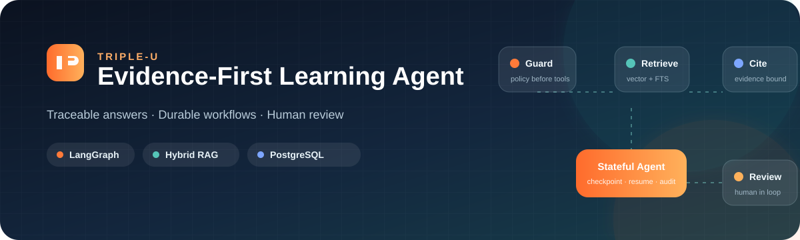
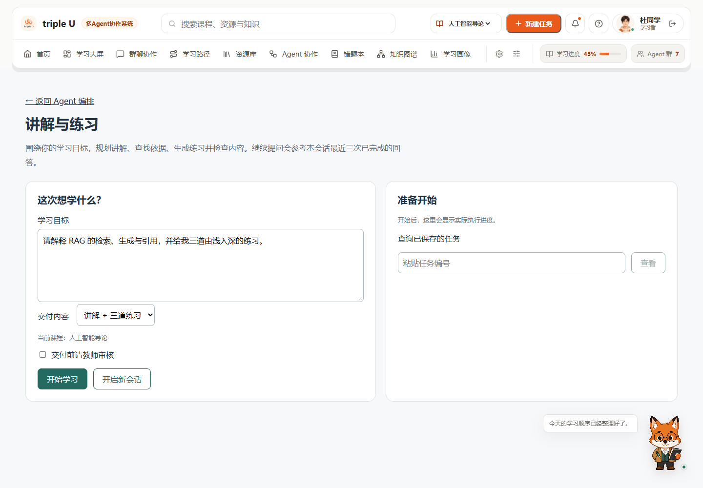
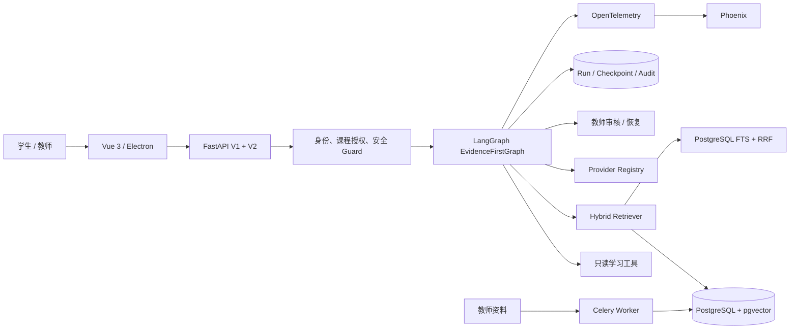
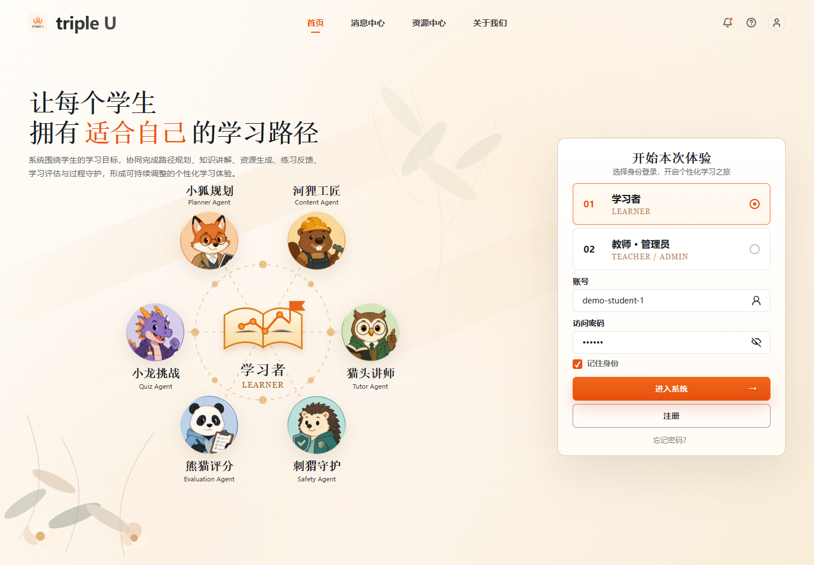
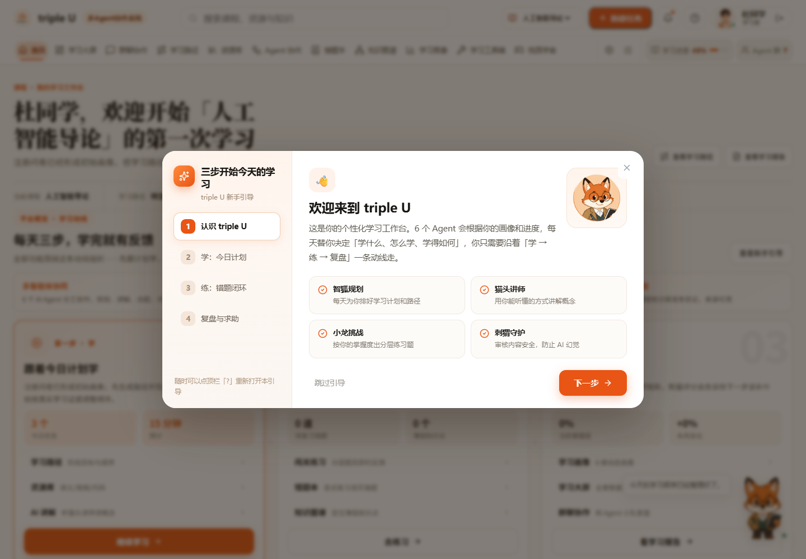

<p align="center">
  
</p>

# 智学领航——个性化学习多Agent平台

<p align="center">
  <strong>面向高校课程的企业级、可追溯、可恢复学习 Agent</strong><br />
  LangGraph orchestration · Hybrid RAG · Human review · Durable execution
</p>

<p align="center">
  <a href="https://github.com/a142269/evidence-first-learning-agent/actions/workflows/ci.yml"></a>
  
  
  
  
  
</p>

---

## 项目概览

智学领航把课程问答、个性化讲解、练习生成与教师审核组织成一条可审计的学习工作流。每个回答都携带实际使用的来源；长任务通过 PostgreSQL 检查点和执行租约实现断线恢复；高风险内容在生成前拦截，需要人工确认的内容进入教师审核。

**旗舰链路是 V2 证据优先学习包**：受限规划与课程检索 → Tutor 讲解 → Practice 练习 → Reviewer 审查与最多一次返工 → 按需教师审核。V1 多角色对话是兼容和演示能力；辩论、多模态等属于实验功能，不代表 V2 的生产工作流。

V1 调度器按优先级分组并行执行；`depends_on` 是未执行的兼容字段，不提供 DAG 依赖调度。早期项目设计文档中的任务 DAG 属于规划，并非当前实现。

引用 ID 有效只说明来源存在，不能证明结论得到来源支持。[三组固定证据对照报告](evals/results/ablation-fixed-evidence-20261017.md)已记录 72 次真实模型运行及失败原因；双人质量复核尚未完成，不能据此声称多 Agent 优于单 Agent。逐条事实复核方法见 [评测计划](evals/CLAIM_AND_ABLATION.md)。

<p align="center">
  
</p>

| 核心能力 | 工程实现 | 可验证结果 |
| --- | --- | --- |
| Evidence-first RAG | pgvector + PostgreSQL FTS + RRF + 来源级去重 | 76 条新版 Golden Set 中 74 条通过 |
| Stateful Agent | LangGraph、PostgreSQL Checkpointer、SSE、执行租约 | 真实 PostgreSQL 恢复组合 15/15 |
| Tutor → Practice 学习包 | 受限检索决策循环、逐项引用、Reviewer 一次返工 | 真实后端采集的 13 条契约场景 13/13（离线回放评测结构/引用/预算，非内容质量） |
| 生产权限边界 | 持久化令牌摘要、逐账号课程授权、V1 白名单 | SQLite / PostgreSQL 跨进程验证 |
| 异步知识摄取 | Celery、Redis、版本化文档、分块与向量重建 | 幂等、重投和租约接管测试 |
| 可观测与评测 | OpenTelemetry、Phoenix、预算守卫、数据集签名 | 可重放评测与用量审计 |

## 实测指标

以下在线指标来自 2026-10-16 的隔离测试环境，在线模型成绩与本地契约测试分开统计；"本地离线测试"一行按标注日期与运行环境单独复跑。

| 验证项 | 结果 |
| --- | ---: |
| 新版中文 Golden Set | **74 / 76（97.37%）** |
| 事实题 Hit@5 | **95.83%** |
| 事实题 Recall@5 | **94.79%** |
| 引用存在率 / 有效率 | **100% / 100%** |
| 本地离线测试（全量 `pytest tests/`） | **2336 passed / 0 failed / 20 skipped**（2026-10-23 QWEN-201 复跑，Windows + Python 3.12.15，1156.38 s，194 个测试文件 / 2356 项；口径不变：`A3_OFFLINE_DEMO=true LLM_PROVIDER=none` + 仓库默认 SQLite + 全新 `--basetemp output/qwen201-2026-10-23/pytest-full`，挂同一 fail-closed socket 探针，探针 **`outbound attempts=0 unique_hosts=0`**，零计费模型调用、无用例因阻断转红；本轮交付**确认门控的长期记忆**：`user_memories` + `memory_events` 两张表与可完全回滚的迁移 `20261023_0012`——隔离 SQLite 上 `alembic` CLI 真跑 `upgrade head`（12 个 revision）→ `downgrade base`（12 步回滚，两张表与全部 7 个索引消失）→ 再 `upgrade head`（表回归且为空）；服务层 `backend/app/services/user_memory.py` 把写入压成三段：模型只能 `propose`（签名里没有 session，**结构上不可能落库**），`confirm` 必须显式 `student`/`teacher` actor 且来源 run 的 `status` 必须是 `completed`——`partially_completed`/`failed`/`awaiting_approval`/`reviewing`/`interrupted`/`rejected`/`running` **七态一律拒入记忆**，`revoke` 只改状态并留审计；同一 `(user_id, kind)` **只允许一条 `active`**，由部分唯一索引 `uq_user_memory_active … WHERE status = 'active'` 与服务层同事务 supersede 双重表达，退役行留在原表供审计而不撞库；TTL 从确认时刻起算、过期只不读不删；重放 `revoke` 不灌水审计；错误面只给稳定 code、不外泄 DB 文本。**零模型调用、未读 `.env`、未加端点或 UI（留给 203）**；测试 **53 项全部为新增**（50 服务 + 3 迁移），另有 9 组反向验证逐条禁用绑定规则、各让对应用例转红后恢复。详见 `docs/CLAIMS_LEDGER.md` §20、`docs/TEST_MATRIX.md` §17）。再前 **2283 passed / 0 failed / 20 skipped**（2026-10-23 QWEN-104d 复跑，Windows + Python 3.12.15，842.46 s，192 个测试文件 / 2303 项；口径不变：`A3_OFFLINE_DEMO=true LLM_PROVIDER=none` + 仓库默认 SQLite + 全新 `--basetemp output/qwen104d-2026-10-23/pytest-full-final`，挂同一 fail-closed socket 探针，探针 **`outbound attempts=0 unique_hosts=0`**，零计费模型调用、无用例因阻断转红；该轮按 Lead 两项裁定落地：① 管理端 `cost` 字典在"生产者声明 `estimated` 但投影拿不到可用金额"（缺 `amount_cny` 键、`None`、非有限、负数、字符串、`True`）时补 `reason="no_cost_amount_recorded"`，**保留生产者写的 `estimated`、不降级、不补任何金额**，`cost_cny` 与 `runs_without_estimated_cost` 口径不变；② `scripts/report_eval_cost.py` 的过期模板说明改为"latency 已由 QWEN-104b/104c 修复、复跑 127→0"，**已交付的 tracked 报告未重生成、一字未动**，验证一律写 scratch；`tests/a/test_run_usage_admin.py` 13 → 14 项，反向验证（撤掉新支）为 2 failed / 12 passed，详见 `docs/CLAIMS_LEDGER.md` §19、`docs/TEST_MATRIX.md` §16）。再前 **2282 passed / 0 failed / 20 skipped**（2026-10-23 QWEN-104c 复跑，Windows + Python 3.12.15，873.67 s，192 个测试文件 / 2302 项；口径不变：`A3_OFFLINE_DEMO=true LLM_PROVIDER=none` + 仓库默认 SQLite + 全新 `--basetemp output/qwen104c-2026-10-23/pytest-full`，挂同一 fail-closed socket 探针，探针 **`outbound attempts=0 unique_hosts=0`**，零计费模型调用、无用例因阻断转红；该轮给管理端用量投影的 `_number`/`_amount` 加 `math.isfinite`——`inf`/`-inf`/`nan` 一律判为未记录，不再可能以字面 `Infinity` 或静默 `null` 出接口，`_count` 与 token/`model_calls`/`tool_calls`/`duration_ms` 的整数口径不动，`tests/a/test_run_usage_admin.py` 11 → 13 项，详见 `docs/CLAIMS_LEDGER.md` §18、`docs/TEST_MATRIX.md` §15）。再前 **2280 passed / 0 failed / 20 skipped**（2026-10-23 QWEN-104b 复跑，Windows + Python 3.12.15，762.69 s，192 个测试文件 / 2300 项；口径不变：`A3_OFFLINE_DEMO=true LLM_PROVIDER=none` + 仓库默认 SQLite + 全新 `--basetemp output/qwen104b-2026-10-23/pytest-full`，挂同一 fail-closed socket 探针，探针 **`outbound attempts=0 unique_hosts=0`**，零计费模型调用、无用例因阻断转红；该轮把管理端 `reported_latency_ms` 的投影从"只接受非负整数"改为接受非负 int/float（token、`model_calls`、`tool_calls`、`duration_ms` 仍限整数），`tests/a/test_run_usage_admin.py` 9 → 11 项，详见 `docs/CLAIMS_LEDGER.md` §17、`docs/TEST_MATRIX.md` §14）。再前 **2278 passed / 0 failed / 20 skipped**（2026-10-22 QWEN-107 复跑，Windows + Python 3.12.15，1095.22 s，192 个测试文件 / 2298 项；口径与上一轮一致：`A3_OFFLINE_DEMO=true LLM_PROVIDER=none` + 仓库默认 SQLite + 新 `--basetemp output/qwen107-2026-10-22/base-full`，挂同一 fail-closed socket 探针，探针记录 6 次外联尝试 / 2 个 IP 全部阻断，无任何计费模型端点，无用例因阻断转红）。上一轮 **2272 passed / 1 failed / 20 skipped**（同日 QWEN-104，731.42 s，192 文件 / 2293 项），唯一失败是既有用例 `tests/integration/test_manim_fallback.py::TestFallbackAssets::test_code_only_skips_fallback`：Level-1 agent 视频被质量门以"画面与旁白时长偏差 2.09 s / 2.17 s，超过允许的 2.00 s"逐轮不同幅度地拒绝，脚本态因此触发兜底——属质量门与用例期望的语义冲突。QWEN-107 按 Lead 2026-10-22 裁定的**方案②**修正产品语义：`include_manim=false`（未请求渲染）时交付可编辑讲稿脚本，`success=True`、`video_status="script_only"`、`rendered=False`、不触发兜底；请求渲染时质量门照旧强制、阈值未改（详见 `docs/CLAIMS_LEDGER.md` §11）。该红点转绿并新增 5 项确定性回归：2273 → **2278**。同日 **QWEN-107b** 再按 Lead 裁定把"可编辑讲稿"真正交付到 `content`（正文来源 `generate_manim` 的 `metadata.generated_code`；正文缺失或为空则显式失败并给稳定错误，不再静默返回空产物），扩展的是既有用例、**未新增测试项**，同口径复跑仍 **2278 passed / 0 failed / 20 skipped**（756.16 s，探针 6 次外联尝试全部阻断、无计费），详见 `docs/CLAIMS_LEDGER.md` §12 与 `docs/TEST_MATRIX.md` §9。同日 **QWEN-108** 把此前唯一需要探针阻断的外联来源（`tests/a/test_knowledge_platform.py` 摄取用例真实调用 embeddings）改成显式离线，同口径全量复跑 **2278 passed / 0 failed / 20 skipped（764.23 s）且 `outbound attempts=0 unique_hosts=0`** —— 离线不再靠探针兜底；只动测试 fixture，产品代码零改动，见 `docs/CLAIMS_LEDGER.md` §13、`docs/TEST_MATRIX.md` §10。同日 **QWEN-107c** 再把脚本态的 CoV/Safety 审计输入从"顶层空文本"改为**实际交付的讲稿正文**（`metadata.generated_code`），`include_manim=true` 的渲染分支口径不变，同口径全量复跑仍 **2278 passed / 0 failed / 20 skipped**（649.18 s，`attempts=0`，用例数未变；真链路探针显示修复前空文本会得到 `cov.score=1.0/passed=True` 的虚过），详见 `docs/CLAIMS_LEDGER.md` §15、`docs/TEST_MATRIX.md` §12。同日 **QWEN-109** 交付只读的评测用量/成本汇总（`scripts/report_eval_cost.py` + `docs/EVAL_USAGE_COST_REPORT_2026-10-22.md`），不改产品投影、未新增用例，全量口径仍 **2278 / 0 / 20**；该报告登记的产品投影偏差（127/127 条浮点 `latency_ms` 被判为未记录）已由上文 **QWEN-104b** 修复，见 `docs/CLAIMS_LEDGER.md` §17、`docs/TEST_MATRIX.md` §14；报告正文那两行过期说明已按 Lead 指令在 **QWEN-104c** 更正为同命令复跑 127→0，已交付的统计数字与结论一字不改（§18.3）。更早 **2264 / 0 / 20**（2026-10-21 QWEN-106，834.21 s，191 文件），再前 **2263 / 1 / 20**（2026-10-19，唯一失败是本机 `.env` 把 `EMBEDDING_BATCH_SIZE` 设为 20 而用例期望默认 10，已由一行 `monkeypatch.delenv` 隔离修复）与更早一轮 **2235 / 0 / 20**（612.61 s，189 文件），逐批评见 `docs/TEST_MATRIX.md` §8 与 `docs/CLAIMS_LEDGER.md` §11） |
| PostgreSQL 专项测试 | **15 / 15**（2026-10-16 历史口径）。2026-10-22 QWEN-105 用本机一次性 `pgvector/pgvector:pg16` + `redis:7-alpine` 环回容器复跑了 CI `enterprise-contract` 的 38 个 PG 契约文件（含检查点跨进程恢复、API 崩溃恢复、摄取幂等、向量版本检索、未完成续跑），两轮均 **364 passed / 0 failed / 0 skipped**（162.58 s / 159.53 s，`127.0.0.1` 口径，零外联）；Redis 服务可用但该子集未走真实 Redis 路径，故 PG 层与 Redis 层分开主张。详见 `docs/CLAIMS_LEDGER.md` §14、`docs/TEST_MATRIX.md` §11 |
| CI 可移植子集（`quality` job 快清单） | **465 passed / 1 skipped**（2026-10-23 QWEN-201b：`.github/workflows/ci.yml:213-214` 把两份记忆测试纳入清单，**40 → 42 个文件**；本地按 `ci.yml:215` 同形旗标 `--no-cov --benchmark-disable -q` 复跑，前置 `init_db()`，`--basetemp output/qwen201b-2026-10-23/pytest-ci-rs`，96.08 s，探针 **`outbound attempts=0 unique_hosts=0`**；相对 201 的 412/1 恰好 **+53** = 记忆服务 50 + 迁移 3，唯一 skip 是 `test_auth_restart.py:18` 要求一次性 PostgreSQL。这是本地同形复跑，GitHub `quality` job 的真实回执属远程证据。详见 `docs/CLAIMS_LEDGER.md` §21、`docs/TEST_MATRIX.md` §18） |
| 学习包标准在线契约 | **13 / 13**（真实后端采集后的离线回放契约评测；不含人工内容质量评分） |

评测口径、阈值和限制见 [evals/README.md](evals/README.md) 与 [实施状态](docs/UPGRADE_IMPLEMENTATION_STATUS.md)。

以上为历史测试汇总，不等于当前提交自动重跑的结果；[脱敏汇总和失败分析](evals/results/)不包含逐例原始报告，学习包在线契约也不等同人工内容质量评分。

## 系统架构



### 学习问答状态机

```text
鉴权 → 安全判断 → 检索 → 画像上下文 → 生成 → 引用校验 → 持久化
```

学习包使用 Tutor → Practice 两步计划。模型只能选择 `search_course` 或 `finish`，最多检索三次；讲解和每道练习分别返回 `source_ids` 与结构化引用。交付状态区分 `completed`、`partially_completed`、`awaiting_approval`、`rejected`、`failed`、`interrupted`：只有通过 Reviewer 分项结论（以及按需教师审核）的内容才会交付，部分成功不会把未交付内容标记为已验证，详见 [学习包指南](docs/LEARNING_PACKAGE_GUIDE.md)。

## 产品界面

<table>
  <tr>
    <td width="50%"></td>
    <td width="50%"></td>
  </tr>
  <tr>
    <td align="center">六智能体角色与演示登录</td>
    <td align="center">个性化学习工作台与新手引导</td>
  </tr>
</table>

## 技术栈

- **Backend:** Python, FastAPI, SQLAlchemy, Alembic, Celery, Redis
- **Agent:** LangChain, LangGraph, SSE, human-in-the-loop
- **RAG:** PostgreSQL, pgvector, HNSW, PostgreSQL FTS, RRF
- **Frontend:** Vue 3, TypeScript, Vite, Ant Design Vue, Electron
- **Observability:** OpenTelemetry, Phoenix, structured audit events
- **Delivery:** Docker Compose, GitHub Actions, Ruff, MyPy, Pytest

## 快速开始

### 1. 离线预览

离线模式不会调用付费模型 API。

```bash
git clone https://github.com/a142269/evidence-first-learning-agent.git
cd evidence-first-learning-agent
cp .env.example .env

python -m venv .venv
# Windows: .venv\Scripts\activate
# macOS/Linux: source .venv/bin/activate
pip install -r requirements.txt
python -m scripts.seed_demo
uvicorn backend.app.main:app --reload --port 8000
```

Windows / Python 3.12 可使用 `pip install -r requirements.lock.txt` 安装固定版本；该锁文件在 Windows 上解析并验证过定向测试。Linux / Python 3.12 使用已提交的 `requirements.lock.linux.txt`（uv 生成、带哈希，144 个包）：`python -m pip install --require-hashes -r requirements.lock.linux.txt`。nightly 的 `linux-lockfile` 任务会在 Ubuntu + Python 3.12 上按哈希安装该锁并运行核心学习包测试；如需重新生成（例如新增依赖后）使用 `uv pip compile --python-version 3.12 --python-platform linux --generate-hashes --no-header --output-file requirements.lock.linux.txt requirements.txt`。

另开一个终端：

```bash
cd frontend
npm ci
npm run dev
```

打开 <http://localhost:5173>，演示学生账号为 `demo-student-1`，访问密码为 `123456`。

### 2. 企业本地栈

需要 Docker Desktop。示例配置中的所有密钥均为空或为本地占位值。

```bash
cp .env.example .env
cp .env.enterprise.example .env.enterprise
docker compose --env-file .env.enterprise \
  -f docker-compose.yml \
  -f docker-compose.enterprise.yml \
  up -d --build
```

服务入口：

- Web：<http://localhost:5173>
- OpenAPI：<http://localhost:8000/docs>
- Phoenix：<http://localhost:6006>

## 验证

```bash
# 后端关键检查
ruff check --select=E9,F63,F7,F82 backend/app scripts tests
pytest tests/ --no-cov --benchmark-disable -q

# 前端
cd frontend
npm ci
npm run build
```

在线评测和向量回填可能产生第三方 API 费用。部分评测脚本提供预算守卫；固定证据对照采集脚本不设置费用上限，应由使用者自行控制服务商账户和账单。普通本地测试默认使用离线模式。

## 目录结构

```text
backend/app/
  agent_runtime/              # LangGraph、检查点、租约、学习包
  api/v2/                     # V2 认证、SSE、运行生命周期
  services/                   # 检索、摄取、向量重建、安全
  evaluation/                 # Golden Set 与学习包评测
frontend/src/                 # Vue 产品界面
alembic/versions/             # SQLite / PostgreSQL 数据迁移
evals/                        # 数据集、阈值和评测说明
scripts/                      # 回填、评测、运维与演示脚本
tests/                        # 单元、集成、PostgreSQL 恢复测试
docs/                         # 架构、权限、恢复与演示文档
```

## 深入阅读

- [企业架构实现指南](docs/ENTERPRISE_ARCHITECTURE_GUIDE.md)
- [V2 十模块实现说明](docs/V2_TEN_MODULE_IMPLEMENTATION.md)
- [Agent 十模块完备性评估与 Qwen 优化主计划（2026-10-19）](docs/QWEN_AGENT_UPGRADE_MASTER_PLAN_2026-10-19.md)
- [Qwen ↔ Lead 协作对话（共享文件）](docs/QWEN_LEAD_DIALOGUE.md)
- [学习包设计与使用](docs/LEARNING_PACKAGE_GUIDE.md)
- [持久化认证与课程权限](docs/AUTH_AND_COURSE_ACCESS.md)
- [运行状态修复与断线恢复](docs/RUN_RECONCILIATION.md)
- [PostgreSQL 检查点验收](docs/POSTGRES_CHECKPOINT_ACCEPTANCE.md)
- [生产部署与安全边界](docs/PRODUCTION_DEPLOYMENT.md)（"企业级"仅指本机 Compose 全栈构建/启动与边界验收通过；公网 TLS、域名、备份与监控**未验证**）
- [结构化输出诊断与复测（2026-10-18）](evals/results/structured-output-20261018.md)
- [第三方许可与素材说明](THIRD_PARTY_NOTICES.md)
- [5 分钟演示脚本](docs/DEMO_5_MINUTES.md)

## 安全说明

- 不提交 `.env`、API Key、访问令牌、供应商账单或在线评测原始输出。
- 生产模式默认要求身份认证和逐账号课程授权。
- V1 生产入口只开放经过审核的路由白名单。
- Agent 工具为只读集合；写入、发布、删除和外发操作会被拒绝。

## 许可证

项目代码采用 [MIT License](LICENSE)。第三方素材和依赖的许可条款以其各自声明为准。

---

<p align="center">Built as an auditable learning system where every answer can point back to evidence.</p>
