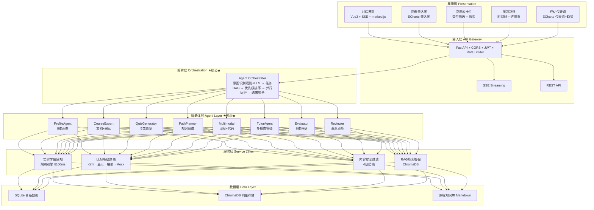
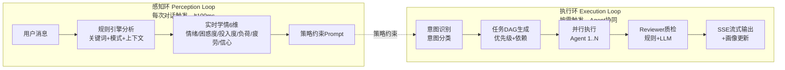
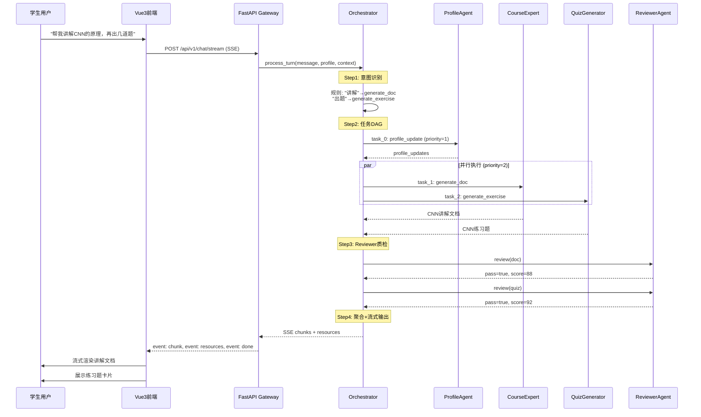
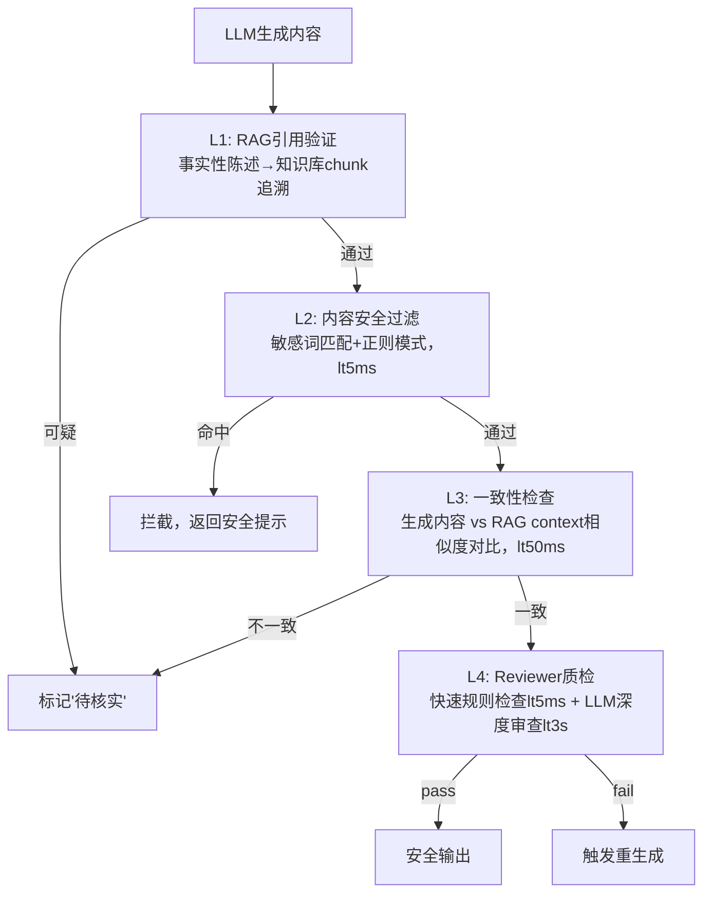
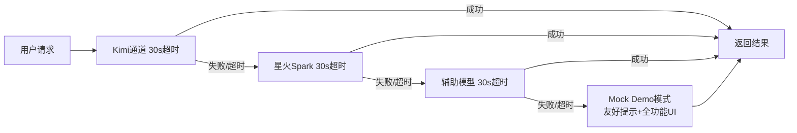

# 04-系统架构图集

> 历史架构图：图中的 V1 任务 DAG 是设计设想；当前 V1 按优先级分组调度，不执行 `depends_on`。当前旗舰链路以根目录 README 和 V2 学习包使用说明为准。

> F3 智学领航 · A3 个性化学习多智能体系统  
> 用于嵌入系统开发说明书和答辩PPT的正式架构图

---

## 一、六层系统总架构

---

## 二、双环学习引擎（核心创新）

---

## 三、多智能体协同流程

---

## 四、防幻觉四级防线

---

## 五、LLM多通道降级路由

