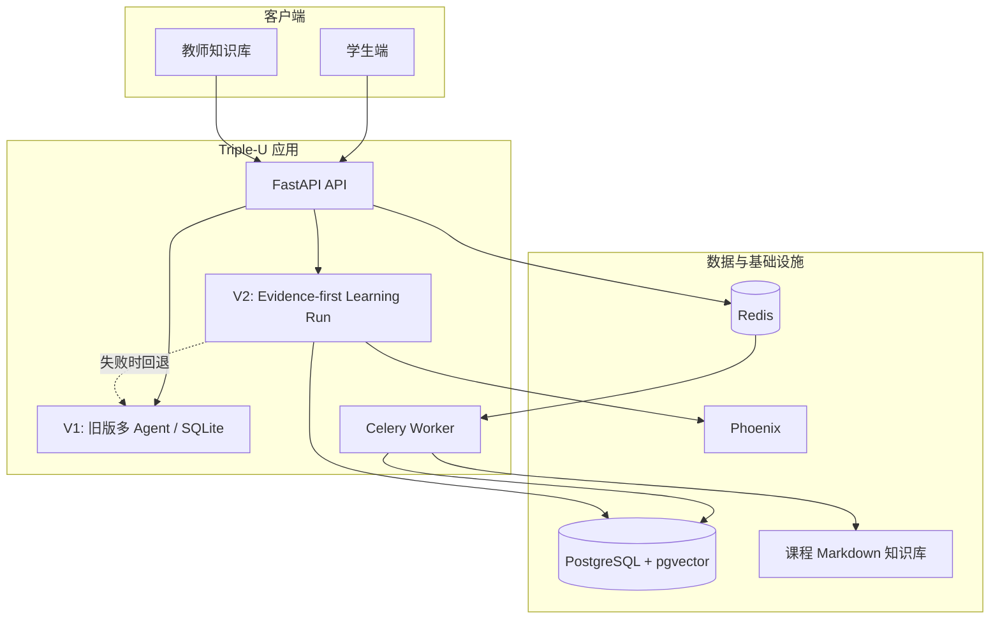
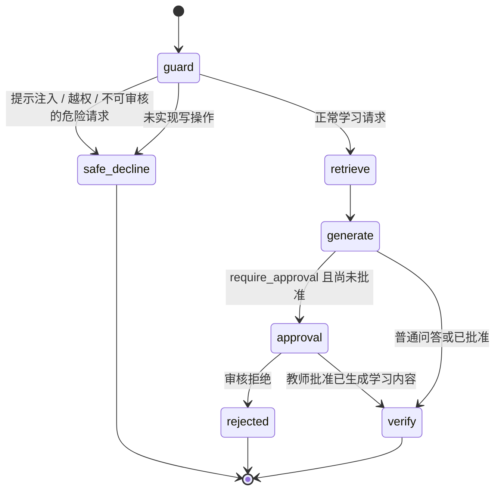
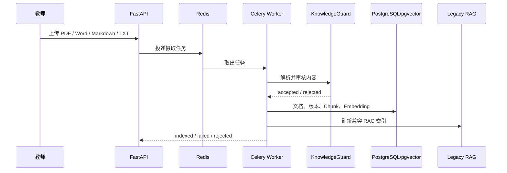

# Triple-U 企业级 Agent / RAG 架构实现指南

> 阅读目标：理解 Triple-U 如何把“一个能对话的教育项目”升级为“有证据、可恢复、可审计、可评测”的 Agent 系统。V2 十模块的逐项代码、失败路径与验收边界见 [实现详解](V2_TEN_MODULE_IMPLEMENTATION.md)。

## 1. 先建立全局心智模型

Triple-U 有两层系统：

1. **V1 兼容层**：原有多 Agent、Electron 演示、SQLite 与 TF-IDF RAG；即使没有 Docker、PostgreSQL 或云端模型，也能用于离线演示。
2. **V2 旗舰层**：把“有证据的个性化学习问答与资源推荐”作为单一迁移链路，使用 FastAPI SSE、LangGraph、PostgreSQL/pgvector、Celery、OpenTelemetry 和 Phoenix。

这种渐进式迁移比一次性推倒重写更适合真实项目：新链路出现故障时，旧链路仍可维持最基本的功能。



## 2. 组件、职责与入口

| 组件 | 职责 | 关键实现 |
| --- | --- | --- |
| Vue / Electron | 学生问答、教师上传、旧版演示界面 | `frontend/`、`electron/` |
| FastAPI | 提供 V1 兼容 API 与 V2 SSE API | `backend/app/api/` |
| LangGraph | 编排状态、分支、人审中断与恢复 | `backend/app/agent_runtime/learning_graph.py` |
| LangChain / Provider | 统一模型、Prompt、Retriever 调用方式 | `backend/app/core/llm_client.py`、Provider 配置 |
| PostgreSQL + pgvector | 版本化文档、向量、运行、审计、检查点 | `backend/app/core/models.py`、`alembic/versions/` |
| Redis + Celery | 上传资料的异步解析、审核与索引 | `backend/app/tasks/ingestion.py` |
| Phoenix + OTel | 查看请求的 Trace、耗时和失败位置 | `backend/app/core/observability.py` |
| Golden Set Harness | 以可量化门禁验证检索、引用和安全 | `evals/`、`scripts/evaluate_golden_set.py` |

企业本地环境由 `docker-compose.enterprise.yml` 在原有 Compose 之上叠加：

```text
Frontend :5173 ──> Backend :8000
                         ├── PostgreSQL + pgvector :5432
                         ├── Redis :6379 ──> Celery Worker
                         └── OTLP HTTP ──> Phoenix :6006
```

## 3. 一次 V2 学习问答是如何执行的

V2 的 HTTP 入口是 `POST /api/v2/learning-runs/stream`，文件为
[`backend/app/api/v2/learning_runs.py`](../backend/app/api/v2/learning_runs.py)。它采用 **SSE**，而不是等待模型生成完再返回一个大 JSON。

### 3.1 请求与事件契约

请求的核心字段：

```json
{
  "message": "RAG 的基本流程是什么？",
  "course_id": "artificial_intelligence",
  "session_id": "browser-session-001",
  "user_id": "anonymous",
  "require_approval": false
}
```

`user_id` 只是兼容字段，**不可信**。企业 Compose 默认开启认证后，服务端从 Bearer Session 读取真实账号并覆盖该值。

客户端会依次接收下列事件：

| SSE 事件 | 含义 | 前端应该做什么 |
| --- | --- | --- |
| `run.started` | 已创建 Run 与审计记录 | 显示“正在处理” |
| `retrieval.completed` | 已得到证据与引用 | 渲染来源卡片 |
| `tool.completed` | 只读工具已返回脱敏状态、条数与耗时 | 显示工具进度，不展示原始画像 |
| `answer.delta` | 一段回答文本 | 追加到流式消息 |
| `review.required` | Graph 在敏感操作前中断 | 展示审核面板，不自动继续 |
| `plan.replanned` | 上一版计划失效，Planner 在硬上限内重规划一次；只含原因标识与预算计数 | 可选提示“正在调整学习计划”；前端忽略未识别事件，不展示原始内容 |
| `run.completed` | 成功结束，包含答案、证据、质量字段 | 固化消息和引用 |
| `run.failed` | 失败，包含稳定错误码 | 友好展示并保留 Run ID |

持久化事件有 `event_sequence` 与 SSE `id`；`GET /{run_id}/events?after=N` 可按序读取已保存的进度。创建请求可传 `Idempotency-Key`；键与请求指纹绑定，重复提交复用 Run，不重复触发模型。

### 3.2 鉴权与课程隔离

入口首先调用 [`access.py`](../backend/app/api/v2/access.py) 的 `resolve_v2_principal()`：

1. 从 `Authorization: Bearer ...` 读取 V1 Session；
2. 将认证账号作为唯一可信的 `user_id`；
3. 如果请求体伪造其他用户 ID，返回 `403 user_identity_mismatch`；
4. 生产模式强制查询持久化 `course_grants`；开发模式可选数据库授权或演示白名单。教师也受其课程授权约束；
5. 人审 `/resume` 仅教师可执行；普通未完成节点 `/continue` 可由有 Run 归属和课程权限的用户触发，教师 `/reconcile` 只读取稳定检查点修复展示状态。

这是一条重要原则：**客户端描述身份，服务端决定身份**。Session 令牌摘要与逐账号课程授权已持久化，生产模式不接受内置演示账号；IdP/OIDC 尚未接入。登录失败有持久化限流，过期会话可清理。

### 3.3 Harness：把运行约束显式建模

[`contracts.py`](../backend/app/agent_runtime/contracts.py) 定义三个轻量数据契约：

```text
RunContext  = 谁在什么课程、会话、权限、预算、超时、Trace 下执行
RunPolicy   = 允许哪些工具、最大步骤数、是否允许模型降级、是否必须人审
RunResult   = 答案、引用、证据、质量、成本、延迟、审计事件
```

当前 Run 的核心逻辑没有把这些字段全部强制执行完，但先建立稳定边界可以避免后续把权限、成本、工具策略散落在 Prompt 或路由函数中。

### 3.4 LangGraph 状态机

[`learning_graph.py`](../backend/app/agent_runtime/learning_graph.py) 中的 `LearningState` 记录跨节点状态：消息、课程、用户、证据、答案、引用、人审状态和安全决策。



各节点的工作内容：

- `guard`：调用 `LearningRunGuard` 做确定性规则检查。提示注入、系统提示词/私有资料索取、试卷答案、医疗处方等在检索前直接拒绝。
- `retrieve`：调用 `LearningRuntime.retrieve()` 获取混合检索证据。
- `generate`：只把前几条证据和最小化的学习画像摘要传给模型，并要求“无证据则说明无法确认”。
- `approval`：调用 LangGraph `interrupt()`，把 `run_id`、动作、草稿、引用和原因交给人工审核。
- `verify`：从实际 evidence 生成引用，而不是相信模型自行编写来源。
- `rejected`：审核拒绝时清空返回证据和引用，避免用户把拒绝流程当成资料泄露旁路。

### 3.5 为什么可以跨请求恢复

`initialize_checkpointer()` 位于
[`checkpointing.py`](../backend/app/agent_runtime/checkpointing.py)：当 `DATABASE_URL` 是 PostgreSQL 时，创建 `AsyncPostgresSaver` 并执行 `setup()`。Graph 在运行时使用 `thread_id`，所以 `interrupt()` 后的状态会落到 PostgreSQL 的 LangGraph checkpoint 表。

审核者调用 `POST /api/v2/learning-runs/{run_id}/resume` 后，服务端构造 LangGraph `Command(resume=decision)`，从同一 `thread_id` 继续而不是重新生成整条流程。

如果运行在 SQLite 离线演示模式，没有 Checkpointer，系统宁可只发出 `review.required` 也不执行敏感操作。这是“安全失败”而不是“为了演示继续执行”。

## 4. 文档从上传到可检索的完整路径

### 4.1 教师上传与异步任务

教师资料先被写入受控暂存目录；Celery 任务 `ingest_staged_document()` 位于
[`tasks/ingestion.py`](../backend/app/tasks/ingestion.py)。该任务限制路径必须在 `/app/data/ingest_staging` 下，防止调用方借由任务读取任意宿主机文件。



### 4.2 摄取函数做了什么

实际业务函数是 [`knowledge_ingest.py`](../backend/app/services/knowledge_ingest.py) 的 `ingest_document()`：

1. 校验课程、后缀、大小与文件名，防止路径穿透；
2. 对 PDF/Word/Markdown/TXT 提取纯文本；
3. `KnowledgeGuard` 进行注入和内容质量审核；
4. 将原件放入 `uploads/_raw/`，将规范化正文写入 `uploads/*.md`；
5. 刷新 V1 兼容 RAG；
6. 创建 `knowledge_documents` 记录；
7. 创建 `document_versions`；
8. 使用 `ENTERPRISE_CHUNK_SIZE=1200`、`ENTERPRISE_CHUNK_OVERLAP=160` 分块；
9. 按 Embedding Provider 的 `batch_size` 批量生成向量；
10. 先 `flush()` 文档版本，再写 `document_chunks`，避免 PostgreSQL 外键顺序问题。

内置课程不是上传文件，因此使用 `scripts/backfill_enterprise_corpus.py` 调用 `backfill_curated_markdown()` 迁入同一套版本化 pgvector 表。脚本显式排除 `uploads/`，避免绕过教师资料的审核链路。

### 4.3 关键数据模型

| 表 | 一条记录代表什么 | 关键价值 |
| --- | --- | --- |
| `knowledge_documents` | 一份逻辑资料 | 课程、文件名、状态、来源、审核信息 |
| `document_versions` | 某份资料的一个内容版本 | 内容哈希、解析器、Embedding 元信息 |
| `document_chunks` | 一个可检索的文本块 | 正文、顺序、哈希、pgvector 向量 |
| `retrieval_logs` | 一次 Run 的检索证据 | 可回放“当时检索到什么” |
| `agent_runs` | 一次 Agent 生命周期 | 状态、耗时、请求与结果摘要 |
| `agent_checkpoints` | 本系统的节点级审计点 | started / human_review / completed 等 |
| `checkpoints` 等 | LangGraph 持久化状态 | 支持 `interrupt` 后恢复 |

Alembic 迁移 `20261010_0005_enterprise_agent_rag.py` 创建 pgvector 扩展和 `embedding vector(1024)` 列，并建立 HNSW 余弦索引；`20261011_0006_document_chunk_fulltext.py` 为 `to_tsvector('simple', content)` 建 GIN 索引。

## 5. RAG：为什么不是“只做向量检索”

### 5.1 两阶段兼容检索

[`enterprise_retriever.py`](../backend/app/services/enterprise_retriever.py) 在 PostgreSQL 中并行执行：

1. **稠密召回**：问题经过 Qwen Embedding 转为 1024 维向量，使用 pgvector 余弦距离 `embedding <=> query_vector` 查询；
2. **词法召回**：用 PostgreSQL `websearch_to_tsquery('simple', query)` 与 `ts_rank_cd` 查询关键词；
3. **RRF 融合**：将两种排序转换为名次信号。

RRF 的思想是：不直接比较“向量相似度 0.71”和“全文分数 0.18”，而是对同一候选累加：

```text
RRF(d) = Σ 1 / (k + rank_i(d))，默认 k = 60
```

一个同时被稠密和词法检索靠前命中的 Chunk，会获得更高分。

### 5.2 为什么还保留 V1 RAG

`LearningRuntime.retrieve()` 同时调用企业检索与 V1 `rag_service`：

- PostgreSQL 或云端 Embedding 不可用：直接返回 V1 检索结果；
- 两者都可用：按来源去重后，再做 RRF；
- 按**来源**去重很重要：上传资料在迁移期可能同时出现在 Markdown 索引和 PostgreSQL，如果按 chunk ID 融合，同一文档会占多个 Top-K 位置，遮蔽课程章节。

最终 `verify` 节点把 evidence 转换为引用列表，因此来源来自真实检索结果而不是 LLM 幻觉。

### 5.3 已知边界

- PostgreSQL `simple` 词法配置并不是中文最佳分词方案；
- 当前以云端 Qwen Embedding 优先，降低本地机器内存/显存要求；
- 旧版 66 条在线基线（历史，2026-10-11）为 64/66、Recall@5 95.83%、引用完整性 100%；新版 76 条 Golden Set 与学习包待真实 Docker + PostgreSQL + 云端模型验收，不沿用历史指标；
- 下一步最有价值的优化是引入中文 reranker，并比较“纯稠密 / RRF / RRF + reranker”的离线指标。

## 6. 可观测性、审计与评测闭环

### 6.1 Trace 与审计不是一回事

| 机制 | 解决的问题 | 保存位置 |
| --- | --- | --- |
| OTel Trace | “这次请求在哪一步慢、失败在哪里？” | Phoenix |
| `agent_runs` / `agent_checkpoints` | “这个业务 Run 的状态、审核和结果是什么？” | PostgreSQL |
| `retrieval_logs` | “当时给模型的证据有哪些？” | PostgreSQL |
| Golden Set 报告 | “改动后检索、引用和安全有没有退化？” | 本地 `reports/` / CI Artifact |

[`observability.py`](../backend/app/core/observability.py) 只有在配置 `OTEL_EXPORTER_OTLP_ENDPOINT` 时才初始化 Exporter；配置失败会安全降级为 no-op，不能让观测系统阻断业务启动。企业 Compose 把端点设置为 Phoenix 的 `/v1/traces`。

### 6.2 Golden Set Harness 如何工作

`evals/golden_set_zh.jsonl` 有 66 条中文用例：48 条事实/跨章节问答、8 条安全拒答、10 条人工审核。评测脚本：

1. 使用演示账号登录，仅在内存中保留 Token；
2. 调用 V2 SSE，收集事件、evidence 与 citations；
3. 事实题评估来源是否进入 Top-5 与引用是否完整；
4. 安全题检查是否拒答且不泄露来源；
5. 审核题检查是否出现 `review.required`；
6. 汇总 Recall@5、引用完整性、安全/审核通过率与平均延迟；
7. 与 `golden_set_baseline.json` 比较，限制相对回退不超过 3 个百分点。

针对网络中的瞬时 `Timeout` / `ConnectionError`，脚本只会有限重试，并给每次尝试生成独立 Graph thread ID，防止人审 checkpoint 串扰。它不会重试业务逻辑失败或认证失败，避免“用重试掩盖错误”。

## 7. 从零复现与学习顺序

### 7.1 复现顺序

```cmd
cd /d D:\xunfei\triple-U
docker compose --env-file .env.enterprise -f docker-compose.yml -f docker-compose.enterprise.yml up -d --build
docker compose --env-file .env.enterprise -f docker-compose.yml -f docker-compose.enterprise.yml exec backend python scripts/backfill_enterprise_corpus.py --course artificial_intelligence
docker compose --env-file .env.enterprise -f docker-compose.yml -f docker-compose.enterprise.yml ps
```

确认服务健康后，先运行低成本单例，再运行完整 Golden Set：

```cmd
D:\Anaconda3\envs\dxtorch\python.exe scripts\evaluate_golden_set.py --base-url http://localhost:8000 --login-account demo-student-1 --login-password 123456 --case-id qa-022 --retries 1 --output reports\smoke.json
```

### 7.2 推荐阅读路径

1. `README.md`：理解产品边界和总体架构；
2. `api/v2/learning_runs.py`：理解 SSE API 如何创建和结束一个 Run；
3. `agent_runtime/learning_graph.py`：理解状态机、Guard、审核中断；
4. `services/knowledge_ingest.py`：理解资料如何变成 Chunk 和向量；
5. `services/enterprise_retriever.py`：理解稠密、词法和 RRF；
6. `evaluation/golden_set.py` 与 `scripts/evaluate_golden_set.py`：理解如何把质量变成门禁；
7. `docs/adr/`：理解为什么是这一套技术选型，而不是另一套。

## 8. 当前工作边界与下一步

已实现的是一条可运行、可验证的旗舰链路，并非宣称所有旧 Agent 都已迁入 LangGraph。下一步按价值排序：

1. 在固定语料上完成稠密、混合、混合加多样性的真实 PostgreSQL 延迟与安全回归；默认仍为混合检索；
2. 完成新版 76 条和学习包在线质量及人工事实核查，再决定是否引入中文 reranker；
3. 增加答案句子到来源片段的蕴含校验；
4. 为 Phoenix 增加生产环境所需的 TLS、认证、数据保留策略与访问控制；
5. V1 全量资源隔离及可选 IdP/OIDC 对接另列迁移计划。

## 9. 相关文档

- [升级工作记录](ENTERPRISE_AGENT_RAG_UPGRADE.md)
- [架构决策记录（ADR）](adr/README.md)
- [5 分钟演示脚本](DEMO_5_MINUTES.md)
- [Golden Set 说明](../evals/README.md)
