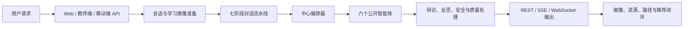
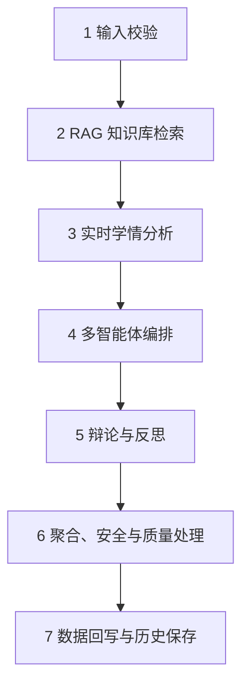
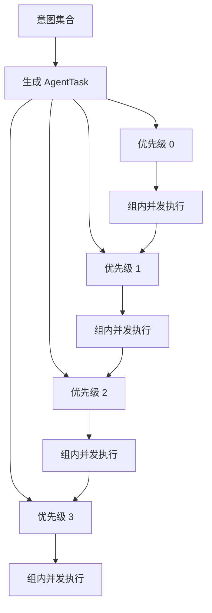
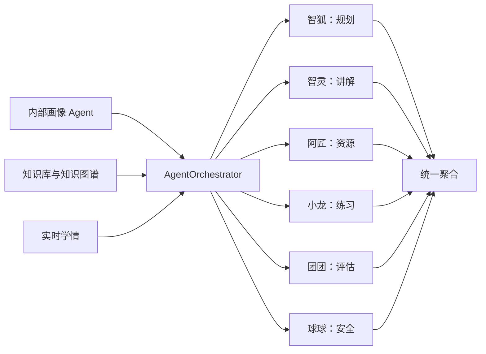
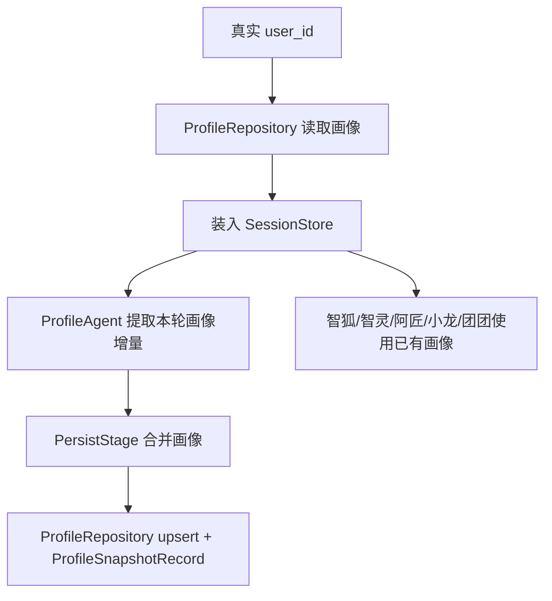
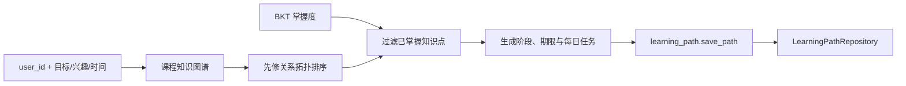

# Triple U 平台多智能体真实构建方式与后端执行流程

> 文档用途：项目报告、答辩材料与 PPT 内容整理。  
> 依据范围：当前工作区一方源码、配置、测试和必要数据文件。  
> 表述原则：只描述代码中能够确认的实际实现；运行环境无法确定的内容标注“待确认”。

## 一页概览

Triple U 采用“**固定对话流水线、中心编排、多角色执行、统一聚合、闭环回写**”的多智能体架构。

用户请求进入平台后，首先完成会话和画像准备，再依次经过输入校验、知识库检索、实时学情分析、多智能体编排、辩论或反思、结果聚合与安全校验、数据回写七个阶段。中心编排器根据显式角色提及、关键词规则和大模型意图识别结果，将任务分配给智狐、智灵、阿匠、小龙、团团和球球中的一个或多个角色。



平台中的六个公开角色负责面向用户的业务任务；画像分析、批评审查、知识入库审核等内部 Agent 和服务负责支撑六个角色完成个性化生成与质量控制。

---

## 1. 用户请求进入系统后经过哪些后端模块

### 1.1 Web 主聊天入口

学生端主聊天由 `frontend/src/api/chat.ts` 发起请求。

| 请求方式 | 后端接口 | 用途 |
| --- | --- | --- |
| SSE 流式请求 | `POST /api/v1/chat/stream` | 聊天页面的主要调用方式 |
| 普通 JSON 请求 | `POST /api/v1/chat/send` | 同步获得完整处理结果 |

两个接口都复用：

```text
backend/app/api/v1/chat.py::_process_turn()
```

因此，普通请求和流式请求的核心业务过程一致，区别主要在结果的传输方式。

### 1.2 会话与用户身份准备

请求进入 `chat.py` 后依次完成：

1. 读取 `message`、`session_id`、`dm_session_id`、`target_agent`、`course` 和 `user_id`。
2. 通过 `SessionStore.get_or_create()` 获取或创建内存会话。
3. 通过 `_bind_session_user()` 将真实学生 `user_id` 绑定到当前会话。
4. 从持久化画像接口读取该学生已有画像，并装入会话。
5. 构造 `PipelineContext`，作为后续阶段共享的数据载体。

`PipelineContext` 中包含：

- 当前用户请求；
- 会话 ID 与学生 ID；
- 课程；
- 历史消息；
- 学习画像；
- RAG 检索结果；
- 实时学情；
- 个性化策略提示；
- Agent 执行结果；
- 资源、安全、质量和遥测信息。

### 1.3 七阶段后端流水线

`ConversationPipeline` 按固定顺序执行七个 Stage。



| 阶段 | 后端实现 | 主要工作 |
| --- | --- | --- |
| 1. 输入校验 | `InputValidationStage` | 清理输入；校验消息非空；限制长度为 1–4000；确定学生或教师视图。 |
| 2. RAG 检索 | `RAGRetrievalStage` | 按用户问题和课程，从课程知识库检索 top 5 内容片段。 |
| 3. 实时学情 | `RealtimeStateStage` | 根据本轮消息、历史和上一状态分析困惑、投入、情绪、认知负荷和疲劳等状态。 |
| 4. 智能体编排 | `OrchestrationStage` | 把画像、历史、RAG、学情策略等交给 `AgentOrchestrator`，识别任务并调用目标 Agent。 |
| 5. 辩论与反思 | `DebateReflectionStage` | 对符合条件的生成结果运行 Expert–Critic 辩论，或执行 Bloom-aware 反思。 |
| 6. 聚合与校验 | `AggregationStage` | 选择主回答，合并其他结果，执行最终内容安全检查和快速质量评分。 |
| 7. 数据回写 | `PersistStage` | 更新画像与活动痕迹，保存资源和聊天历史，并记录相关学习状态。 |

### 1.4 教师端请求

教师 Copilot 使用：

```text
POST /api/v1/teacher/copilot/consult
```

其执行过程为：

1. 从班级或学生数据构建教学快照；
2. 将快照压缩为 `teacher_context`；
3. 设置 `role_view="teacher"`；
4. 构造面向教学诊断、备课或干预的协作任务；
5. 复用 `_process_turn()` 和完整七阶段流水线；
6. 返回供教师审核的教学建议和资源结果。

教师请求不会被当作学生对话写入学生画像。

### 1.5 移动端请求

移动端消息入口为：

```text
POST /api/v1/mobile/rooms/{room_id}/messages
```

移动端首先将消息写入 `MobileChatRepository`。在直接 Agent 房间或消息明确请求一位 Agent 时，后台任务 `_run_ai_reply()` 会创建独立会话并复用 `_process_turn()`。

生成结果经过纯文本整理后写回移动聊天仓储，再通过 WebSocket 向房间成员广播。

### 1.6 其他独立入口

平台还有几条与主聊天并列的业务链：

| 功能 | 接口 | 实际服务 |
| --- | --- | --- |
| Smart Tutor | `/api/v1/smart-tutor/ask` | `SmartTutoringEngine` |
| 个性化路径 | `/api/v1/insights/path/generate` | 知识图谱拓扑排序、BKT 过滤、LearningPathRepository |
| 资源推荐 | `/api/v1/insights/recommendations` | BKT、知识图谱、画像和资源池 |
| 动态策略 | `/api/v1/insights/adaptive-strategy/{user_id}` | 评估趋势、错题、BKT 和资源类型权重 |
| 统一学习状态 | `/api/v1/learner-state/{user_id}` | `LearnerStateService` |
| 知识上传 | 知识库上传接口 | `knowledge_ingest`、`KnowledgeGuardAgent`、RAG refresh |

这些入口共同组成 Triple U 的学习闭环，但不全部经过聊天编排器。

---

## 2. 任务如何被识别、拆解并分配给不同智能体

### 2.1 编排入口

第四阶段调用：

```text
AgentOrchestrator.process_turn()
```

编排器接收：

- 当前请求；
- 当前学习画像；
- 会话历史；
- RAG 检索结果；
- 实时学情摘要；
- 个性化策略提示；
- 课程信息；
- 学生或教师视图；
- 可选目标 Agent。

### 2.2 三种任务进入方式

#### 方式一：教师配置型 Agent

编排器首先通过 `agent_config_service.find_mentioned()` 查找教师创建的配置型 Agent。

命中 `@配置型Agent名称` 后，系统使用其：

- 名称与身份；
- system prompt；
- 能力描述；
- 启用状态；

构造 `ConfigurableAgent` 并执行定向回答。

#### 方式二：单智能体定向请求

当请求携带 `target_agent` 时，编排器将前端公开角色 key 映射为后端 Agent：

| 公开 key | 后端 Agent |
| --- | --- |
| `planner` | `path_planner` |
| `tutor` | `tutor` |
| `content` | `doc_gen` |
| `quiz` | `exercise` |
| `evaluation` | `evaluator` |
| `safety` | `safe_decline` |

编排器创建一个 `direct_message` 任务并交给指定 Agent。

#### 方式三：团队编排请求

没有指定单一目标时，系统进入团队模式，依次执行：

```text
显式 @ 识别
→ 关键词规则匹配
→ LLM 意图识别兜底
→ 添加必要的画像任务
→ 生成 AgentTask
```

### 2.3 显式角色识别

| 用户提及 | 识别意图 |
| --- | --- |
| `@智狐` | `plan_path` |
| `@智灵` | `tutoring` |
| `@阿匠` | 文档、PPT、导图、视频、音频等资源生成 |
| `@小龙` | `generate_exercise` |
| `@团团` | `evaluation` |
| `@球球` | `out_of_scope` |

阿匠的任务还会根据请求中的资源词进一步区分：

- PPT、课件、幻灯片；
- 思维导图、脑图、结构图；
- 视频、动画；
- 语音、音频、TTS；
- 文档、讲义、笔记、资料；
- 代码、练习题等综合资源。

### 2.4 关键词规则识别

当请求没有显式 @ 时，编排器使用 `intent_keywords` 识别：

- 文档与总结；
- PPT；
- 思维导图；
- 练习与测试；
- 拓展阅读；
- 视频与动画；
- 语音与音频；
- 学习路径；
- 知识答疑；
- 学习评估；
- 教学范围外请求。

### 2.5 大模型意图兜底

规则没有充分确定任务时，编排器调用 `IntentClassifier`。

该服务要求大模型返回受限制的意图集合，编排器再依据允许列表过滤结果。若意图服务没有给出可用结果，系统采用答疑任务作为默认教学入口。

### 2.6 从意图生成任务

`_plan_tasks()` 将意图转换为 `AgentTask`。

每个任务包含：

```text
task_id
agent_name
action
input_data
priority
depends_on
```

当前调度主要依据 `priority`：

| 优先级 | 任务 |
| ---: | --- |
| 0 | 教学边界与安全拒答 |
| 1 | 学习画像更新 |
| 2 | 答疑、练习和多模态资源生成 |
| 3 | 学习路径和学习评估 |

### 2.7 角色级任务合并

同一公开角色在一轮中只保留一个主要任务。

例如用户同时要求阿匠生成 PPT、导图和代码时，编排器先将它们合并为一个阿匠任务，再由 `ResourceGeneratorAgent` 从完整请求中解析资源类型，启动多个资源生成子任务。

### 2.8 多角色指令拆解

当用户输入编号式协作任务时：

```text
1. @智狐 制定学习路线
2. @智灵 讲解核心概念
3. @阿匠 生成导图和代码
```

`_extract_role_request()` 会从原始请求中提取当前角色对应的子指令。

每个 Agent 的上下文同时保留：

- 自己的具体子任务；
- 原始协作总请求；
- 当前角色名称；
- task ID；
- 本轮共享画像、历史、RAG 和实时学情策略。

### 2.9 优先级分组与并发执行



编排器按优先级从低到高依次处理，各优先级组内部通过：

```python
asyncio.gather(..., return_exceptions=True)
```

并发执行。每个任务获得独立复制的 `AgentContext`，避免并发任务互相修改上下文。

---

## 3. 六个智能体分别负责什么，以及它们如何协作

### 3.1 六个公开智能体

六个角色由 `chat.py::_PUBLIC_AGENT_INFO` 统一映射到前端身份、后端 Agent 和显示顺序。

| 角色 | 定位 | 后端实现 | 核心产物 |
| --- | --- | --- | --- |
| 智狐 | 学习规划师 | `PathPlannerAgent` | 个性化学习路径、阶段任务、ZPD 候选、下一知识点建议 |
| 智灵 | 知识讲师 | `TutorAgent` | 概念讲解、示例、误区、关联知识点、巩固建议 |
| 阿匠 | 内容工匠 | `ResourceGeneratorAgent`、`MultimodalAgent` | PPT、导图、代码、文档、视频、语音、题集 |
| 小龙 | 闯关教练 | `QuizGeneratorAgent` | 分层练习、互动题目、答案解析、下载题集 |
| 团团 | 学习评估师 | `EvaluatorAgent` | 学习评估、BKT/DINA 分析、叙事报告、SVG 图表 |
| 球球 | 安全守护员 | `SafeDeclineAgent`；知识入库场景使用 `KnowledgeGuardAgent` | 教学边界提示、安全拒答、知识入库审核 |

### 3.2 智狐：学习规划

智狐的主要执行过程：

1. 读取当前学习画像；
2. 读取课程知识库检索结果；
3. 获取 BKT 掌握度；
4. 查询知识图谱中的知识点邻居；
5. 选出 mastery 在 0.5–0.8 区间的 ZPD 候选；
6. 使用 Thompson Sampling 为候选知识点计算推荐；
7. 将算法结果、课程信息和用户目标加入提示词；
8. 调用 LLM 生成阶段化路径；
9. 解析 `learning_path` 结构块，形成路径数据和展示内容。

智狐输出的路径结构包含：

- 阶段 ID 与标题；
- 学习主题；
- 阶段时长；
- 所需资源；
- 先修关系；
- 阶段评估方式。

### 3.3 智灵：个性化答疑

智灵读取：

- 学生知识水平；
- 认知风格；
- RAG 前 5 条课程内容；
- 对话历史；
- 实时学情策略。

`TutorStrategyPlanner` 进一步根据问题类型和知识点 Bloom 层级生成苏格拉底式教学策略。

智灵的回答结构主要包括：

- 一句话核心答案；
- 深入讲解；
- 类比、示例、图示或公式；
- 常见误区；
- 关联知识点；
- 巩固练习与拓展建议。

### 3.4 阿匠：多模态资源生成

阿匠首先解析用户请求中的资源类型，再调用统一工具：

```text
generate_learning_materials
```

该工具进入 `generate_multi_with_fallback()` 和 `generate_multi()`，并行生成：

- `pptx`：PPT 课件；
- `mermaid`：思维导图；
- `code`：代码案例；
- `document`：讲义或文档；
- `manim`：动画/视频；
- `tts`：语音导学；
- `quiz`：配套题集。

每类资源均以统一 `ResourceEnvelope` 返回，包含内容、文件路径、下载信息、证据、一致性检查和教学安全信息。

导图类任务还可以由 `MultimodalAgent` 调用 Mermaid Studio，生成 Mermaid 代码和 PNG/data URI。

### 3.5 小龙：练习与闯关

小龙根据：

- 学生知识水平；
- 画像中的薄弱点；
- RAG 检索到的课程内容；
- 用户要求的题量和题型；

调用 LLM 生成 `quiz_json`。

题目覆盖单选、多选、判断、填空、公式推导、代码阅读、代码 Debug 和综合设计等类型，并携带：

- 难度；
- Bloom 层级；
- 正确答案；
- 解析；
- 训练重点。

系统将题目整理成前端可内联展示的 `quiz_data`，同时注册可下载的 Markdown 题集。

### 3.6 团团：学习评估

团团以真实学生 ID 汇总：

- BKT 掌握度；
- 可用的 DINA 快照；
- 学习画像；
- 学习活动和练习信息。

评估过程包括：

1. `NarrativeGenerator` 生成模板化学习叙事；
2. `SVGVisualization` 生成画像雷达图和掌握度图；
3. LLM 补充个性化评估建议；
4. 解析 `evaluation_result`；
5. 返回评估正文、结构化数据和可下载报告。

### 3.7 球球：安全与教学边界

主聊天中，球球由 `SafeDeclineAgent` 执行：

- 对普通闲聊或课程范围外请求进行礼貌引导；
- 对敏感请求使用更简短的安全回复；
- 不调用 LLM；
- 不更新学生画像。

知识上传场景中，`KnowledgeGuardAgent` 对入库内容进行规则审核和可选 LLM 审核，审核通过后才写入知识库并刷新 RAG。

### 3.8 六角色协作方式

六个角色采用“**中心编排、共享上下文、分工执行、统一汇总**”的协作模式。



协作的共享信息包括：

- 本轮用户需求；
- 当前学习画像；
- 会话历史；
- 课程 RAG 内容；
- 实时学情摘要；
- 个性化策略提示；
- 教师场景的班级或学生快照。

### 3.9 辩论与反思协作

对于答疑、练习和内容生成等任务，第五阶段可运行：

```text
Expert 初稿
→ CriticAgent 审稿
→ Expert 根据反馈修订
→ 选择通过版本或最高分版本
```

没有进入辩论的可反思内容会调用 Bloom-aware 反思器，从事实性、教学结构、Bloom 匹配和内容完整度等角度形成修订结果。

---

## 4. 智能体调用知识库、大模型、多模态生成和学习画像的过程

### 4.1 知识库调用

主聊天的 RAG 调用发生在智能体编排之前。

```text
用户问题
→ RAGRetrievalStage
→ RAGService.retrieve()
→ 课程过滤
→ top 5 知识片段
→ AgentContext.rag_results
→ 各 Agent 按需引用
```

RAG 返回字段包括：

- `content`
- `source`
- `course`
- `score`
- `chunk_id`
- `title_hint`

当前知识检索支持的后端顺序为：

1. SQLite TF-IDF；
2. 持久化 jieba TF-IDF；
3. sklearn TF-IDF；
4. 关键词重叠。

知识库内容来自配置目录中的 Markdown 文件。知识上传审核通过后会写入 Markdown，并调用 `rag.refresh()` 更新检索索引。

### 4.2 知识图谱调用

知识图谱用于：

- 查询知识点先修关系；
- 获取已掌握知识点的后继节点；
- 生成个性化学习路径；
- Smart Tutor 的知识点定位；
- 推荐系统的知识点名称和关键词扩展；
- Agent 工具中的 N 跳子图查询。

独立路径接口会对课程知识图谱进行拓扑排序，再结合 BKT 掌握度过滤已掌握知识点。

### 4.3 大模型调用

常规 Agent 继承 `BaseAgent`，通过：

```text
BaseAgent._acall_llm()
→ LLMClient.achat()
→ LLMClient.chat_stream()
```

构造的大模型上下文包括：

1. Agent 的 system prompt；
2. 实时学情生成的个性化策略；
3. 最近最多 10 条历史消息；
4. 当前用户请求；
5. 当前 Agent 追加的画像、RAG、算法或任务约束。

`LLMClient` 支持：

- 讯飞星火 WebSocket；
- OpenAI-compatible Chat Completions；
- 本地演示模式。

多模态子系统还提供：

- 讯飞星火媒体客户端；
- DeepSeek PPT 大纲客户端；
- Kimi PPT 内容规划客户端。

生产部署实际启用的 provider、model 和凭据属于运行环境配置，**待确认**。

### 4.4 学习画像调用

学习画像的使用链如下：



画像中被不同模块使用的主要信息包括：

- 知识基础；
- 学习偏好；
- 薄弱点；
- 时间管理；
- 自我效能；
- 认知风格；
- 学习目标；
- 互动模式；
- 兴趣方向；
- 最近学习主题。

`ProfileAgent` 通过大模型输出 `profile_update`，再由 `profile_extractor` 解析结构化增量，并计算 learner archetype。

### 4.5 实时学情调用

`RealtimeStateAnalyzer` 根据当前消息、历史和上一状态分析：

- 情绪与隐式情绪；
- 投入度；
- 信心；
- 困惑度；
- 好奇度；
- 认知负荷；
- 疲劳度；
- 卡点主题；
- 偏好回复方式；
- 下一最佳动作。

系统将状态转换为 `strategy_prompt`，注入后续 Agent 的 system prompt。

实时状态同时写入：

- 当前会话内存状态；
- `RealtimeStateRecord`。

### 4.6 BKT、DINA 与 RealDINA

平台中的认知诊断服务承担不同任务：

| 模块 | 主要用途 |
| --- | --- |
| BKT | 记录和查询知识点掌握概率；支持路径、评估和推荐 |
| DINA | 提供知识属性层面的诊断快照 |
| RealDINA | 提供学习强项、弱项和在线掌握状态 |

团团、画像分析、学习路径、统一学习状态和推荐系统会在各自流程中读取这些认知诊断信息。

### 4.7 多模态生成调用

```text
阿匠识别资源类型
→ Agent Tool Registry
→ generate_learning_materials
→ generate_multi_with_fallback
→ generate_multi
→ 各资源生成器并发执行
→ RAG 一致性检查
→ 教学安全检查
→ 文件注册与下载信息
→ ResourceEnvelope
```

多资源请求会根据 `user_id` 从 `ProfileRepository` 加载画像，用于调整：

- 内容难度；
- 示例风格；
- 视觉组织；
- 资源组合；
- 题目层次。

### 4.8 Agent 工具调用

工具注册表提供：

| 工具 | 对接模块 |
| --- | --- |
| `lookup_knowledge_point` | RAG 知识点检索 |
| `query_knowledge_graph` | 知识图谱 N 跳查询 |
| `execute_code` | 受限 Python 代码沙箱 |
| `search_resources` | 已生成资源检索 |
| `generate_learning_materials` | 多模态资源生成 |

工具调用会写入 `ToolCallTrace`，供工作流或监控页面查询调用次数、耗时和结果摘要。

---

## 5. 结果如何汇总、校验、输出，并回写画像、路径或资源推荐

### 5.1 Agent 结果汇总

第四阶段结束后得到：

```text
task_id → AgentResponse
```

`AgentResponse` 包含：

- Agent 名称；
- 是否成功；
- 正文；
- 内容类型；
- 资源；
- 画像更新；
- 元数据；
- 错误信息。

`AggregationStage` 按以下方式汇总：

1. 单独识别画像响应；
2. 从成功的业务 Agent 中选择主响应；
3. 将其他成功 Agent 的正文作为协作结果追加；
4. 合并其他 Agent 产生的资源；
5. 形成最终聚合文本。

### 5.2 辩论、反思与内容处理

聚合前，平台对符合条件的内容运行：

- Expert–Critic 多轮审查；
- Bloom-aware 反思与修订。

聚合后，平台执行：

1. `ContentSafetyChecker.validate()` 最终内容安全检查；
2. 清理只供程序解析的 `profile_update`、`evaluation_result`、`learning_path` 和 `quiz_json` 结构块；
3. `quick_quality_score()` 快速质量评分；
4. 保存安全级别、原因和质量结果。

多模态资源还在各自生成过程中执行：

- RAG 一致性检查；
- evidence 记录；
- 教学安全评估；
- 下载文件有效性整理。

### 5.3 REST 返回结构

主聊天返回：

| 字段 | 内容 |
| --- | --- |
| `primary_agent` | 主回答 Agent |
| `content` | 聚合后的正文 |
| `content_type` | Markdown、quiz、evaluation、learning_path 等 |
| `resources` | 本轮生成资源 |
| `saved_resources` | 已写入资源库的资源摘要 |
| `profile` | 当前学习画像 |
| `profile_meta` | 画像提取状态 |
| `realtime_state` | 当前实时学情 |
| `rag_hits` | 知识库来源摘要 |
| `agents_invoked` | 本轮调用的公开 Agent |
| `agent_messages` | 各公开角色独立消息 |
| `quality` | 快速质量结果 |
| `safety` | 最终安全结果 |
| `debate` | 辩论摘要 |
| `reflection` | 反思摘要 |
| `telemetry` | 阶段耗时与 Agent 调用信息 |

### 5.4 SSE 输出

SSE 接口在流水线运行期间发送：

- `thinking`：阶段进度；
- 辩论相关过程事件；
- `meta`：会话、Agent、画像和 RAG 摘要；
- `agent_start` / `agent_chunk` / `agent_done`：多角色消息；
- `chunk`：单角色正文；
- `resources`：本轮资源；
- `profile_update` / `profile_status`：画像结果；
- `quality` / `safety`：质量和安全信息；
- `debate` / `reflection`：协作校验信息；
- `done`：本轮完成。

前端根据 `task_id` 为每个公开角色建立独立消息气泡，从而保留多角色身份和资源归属。

### 5.5 学习画像回写

`PersistStage` 优先读取 ProfileAgent 的 `profile_updates`，并调用：

```text
SessionStore.merge_profile()
→ ProfileRepository.upsert(source="chat")
```

画像回写同时完成：

- 会话内画像更新；
- SQLite 画像持久化；
- 画像版本递增；
- 创建 `ProfileSnapshotRecord`；
- 记录 changed keys；
- 标记更新来源；
- 更新 `last_interaction_at`；
- 更新 `recent_topics`。

因此画像能够跨会话延续，并可通过画像历史接口展示演变过程。

### 5.6 资源回写

Agent 产生的普通资源由：

```text
resources_api.persist_resource(record)
```

写入资源模块和 SQLite。

保存内容包括：

- 资源 ID；
- 用户 ID；
- 资源类型；
- 标题；
- Agent 名称；
- 元数据；
- 下载信息；
- 标签；
- 创建时间；
- 来源。

聊天正文和资源文件分开存储，资源库主要保存资源元数据及实际产物入口。

### 5.7 对话与群聊回写

聊天历史通过：

```text
SessionStore.append_history()
→ ChatHistoryRepository.append()
```

写入数据库。

团队模式下，各公开角色的正文和身份会分别保存。Web 群聊还通过 `GroupChatRepository` 保存学生消息和 Agent 回复，供教师端查看。

移动端由 `MobileChatRepository` 保存房间消息，并通过 WebSocket 广播。

### 5.8 学习路径生成与保存

平台中完整的个性化学习路径闭环由：

```text
POST /api/v1/insights/path/generate
```

完成：



路径生成会：

- 将兴趣、目标、截止时间和每日学习时间写入画像；
- 按知识图谱先修顺序排列知识点；
- 跳过达到掌握阈值的内容；
- 按难度组织学习阶段；
- 生成阶段截止时间、里程碑和今日任务；
- 通过 `LearningPathRepository` 持久化。

### 5.9 资源推荐

资源推荐入口：

```text
GET /api/v1/insights/recommendations
```

推荐过程：

1. 获取用户 BKT 掌握度；
2. 从知识图谱补齐课程知识点；
3. 选择当前最弱的 3 个知识点；
4. 根据知识点 ID、名称和关键词匹配可见资源；
5. 有现成资源时返回学习入口；
6. 没有匹配资源时返回多模态资源生成建议；
7. 根据认知风格、成绩趋势和错题情况调整资源类型权重。

不同学习风格会影响推荐组合：

- 视觉偏好：导图、视频优先；
- 听觉偏好：TTS、音视频优先；
- 实践偏好：代码、练习优先。

### 5.10 动态策略与路径调整

`adaptive-strategy` 根据：

- 近期评估成绩趋势；
- 未解决错题数量；
- 当前薄弱知识点；
- 学习画像中的认知风格；

计算：

- 每日练习强度；
- 资源类型权重；
- 路径重规划建议。

调用：

```text
POST /api/v1/insights/adaptive-strategy/{user_id}/apply
```

后，系统可以重新生成错题修复路径，并刷新资源推荐。

### 5.11 统一学习者状态

`LearnerStateService.snapshot()` 将以下信息聚合为统一状态：

- 学习画像与画像快照；
- BKT/DINA 掌握度；
- 错题归因；
- SM-2 复习日程；
- 已生成资源；
- 学习路径和路径调整；
- 评估记录；
- 推荐解释。

该状态用于画像页面、学习时间线以及“为什么系统这样推荐”的解释。

---

## 6. 代码依据、确认范围与待确认项

### 6.1 全量代码读取范围

本次共读取 **806 个一方源码、测试、脚本、配置与必要数据文件**，约 **263,306 行**，读取失败数为 **0**。

| 范围 | 文件数 | 行数 |
| --- | ---: | ---: |
| `backend/` | 272 | 71,462 |
| `frontend/` | 193 | 95,658 |
| `scripts/` | 101 | 17,747 |
| `tests/` | 137 | 23,883 |
| `mobile/` | 31 | 1,730 |
| 配置、工具和必要数据等 | 72 | 52,826 |

读取范围不包含第三方依赖、Git 元数据、构建产物、缓存、二进制媒体和生成资源，例如 `node_modules/`、`dist/`、`build/`、`htmlcov/`、`.git/` 和音视频/PDF/PPTX 文件。

### 6.2 测试辅助验证

聊天流水线、编排器、单 Agent 路由、聊天端到端、移动端、持久化、学习路径和知识平台相关测试中，已有 **144 项测试通过**，可作为本文调用关系的辅助证据。

### 6.3 待确认项

以下属于运行环境或生产数据，无法仅从静态代码确认：

1. 生产环境实际启用的 LLM provider、model 和 API 凭据。
2. 讯飞、Kimi、DeepSeek、OCR、TTS、Manim 和 Office 渲染依赖在目标部署机的可用状态。
3. 生产数据库当前画像、BKT/DINA、知识图谱、资源、路径和评估数据的完整程度。
4. 实际大模型在所有课程主题上的生成质量。

### 6.4 主要代码证据索引

| 内容 | 代码位置 |
| --- | --- |
| 应用启动与路由 | `backend/app/main.py`；`backend/app/api/router.py` |
| 聊天入口与结果序列化 | `backend/app/api/v1/chat.py` |
| 七阶段流水线 | `backend/app/api/v1/chat_pipeline/pipeline.py`；`chat_pipeline/stages/` |
| 会话、画像和历史 | `backend/app/api/v1/chat_pipeline/session.py` |
| 任务识别与编排 | `backend/app/agents/orchestrator.py` |
| Agent 注册表 | `backend/app/agents/__init__.py` |
| 智狐 | `backend/app/agents/path_planner.py` |
| 智灵 | `backend/app/agents/tutor_agent.py` |
| 阿匠 | `backend/app/agents/resource_generator_agent.py`；`multimodal_agent.py` |
| 小龙 | `backend/app/agents/quiz_generator.py` |
| 团团 | `backend/app/agents/evaluator_agent.py` |
| 球球 | `backend/app/agents/safe_decline_agent.py`；`knowledge_guard.py` |
| 辩论与反思 | `backend/app/agents/debate_moderator.py`；`critic_agent.py`；`reflection/` |
| RAG | `backend/app/services/rag_service.py`；`services/rag/` |
| 知识图谱 | `backend/app/services/knowledge_graph/` |
| LLM | `backend/app/agents/base.py`；`backend/app/core/llm_client.py` |
| Agent 工具 | `backend/app/services/agent_tools/registry.py` |
| 多模态生成 | `backend/app/api/v1/artifacts/multi.py`；`multi_with_fallback.py` |
| 画像仓储 | `backend/app/repositories/profile_repo.py` |
| 学习路径 | `backend/app/api/v1/learning_path.py`；`repositories/path_repo.py` |
| 路径与推荐闭环 | `backend/app/api/v1/insights.py` |
| 统一学习状态 | `backend/app/services/learner_state.py`；`api/v1/learner_state.py` |
| 教师端 | `backend/app/api/v1/teacher.py` |
| 移动端 | `backend/app/api/v1/mobile.py`；`mobile/` |
| 前端聊天与角色展示 | `frontend/src/api/chat.ts`；`frontend/src/views/ChatView.vue` |

## 可直接用于报告的总结

Triple U 平台以七阶段对话流水线为主干，以 AgentOrchestrator 为中心完成任务识别和角色分配。系统根据显式角色提及、关键词规则和大模型意图识别，将学习规划、知识讲解、多模态资源、分层练习、学习评估和安全守护任务分别交给智狐、智灵、阿匠、小龙、团团和球球。

各智能体共享课程知识库、知识图谱、学习画像、会话历史和实时学情，但按照角色分工独立完成子任务。系统随后通过 Expert–Critic 辩论、Bloom-aware 反思、内容安全检查和质量评分完成结果处理，并以 REST、SSE 或 WebSocket 形式输出。

对话结果进一步进入学习闭环：画像与活动痕迹持续更新，多模态产物进入资源库，知识图谱与 BKT 共同生成个性化路径，评估趋势、错题和认知风格共同驱动资源推荐与策略调整，最终由 LearnerStateService 汇总成统一、可解释的学习者状态。
