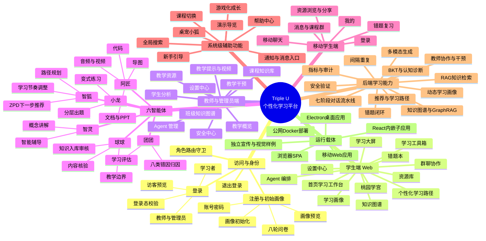
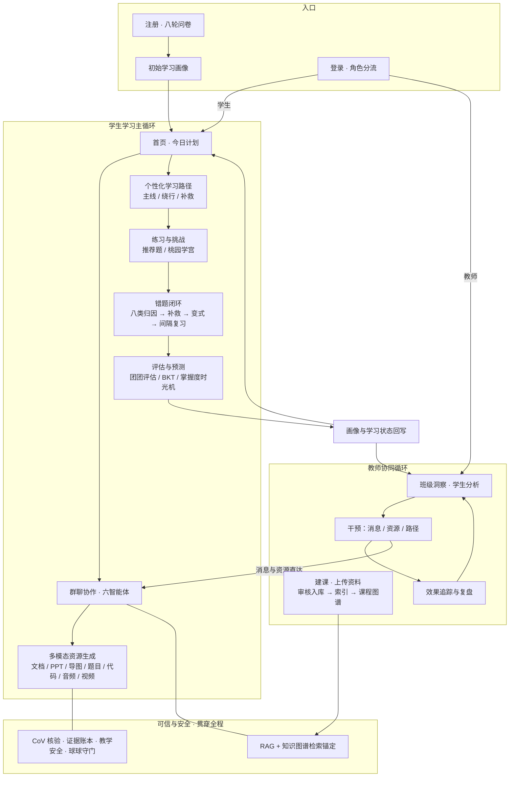
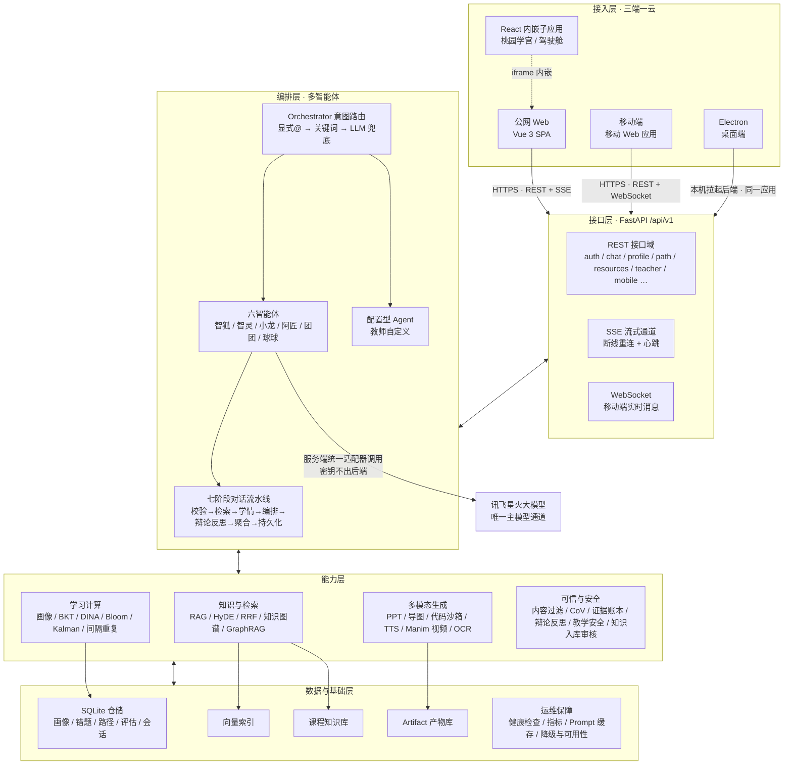
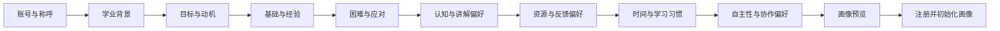
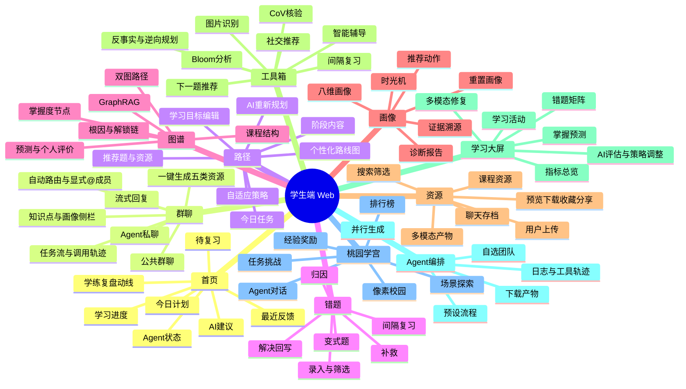
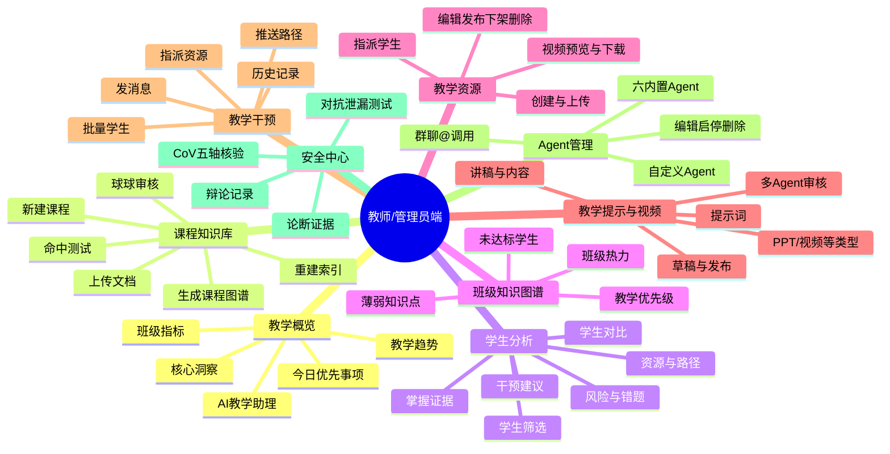
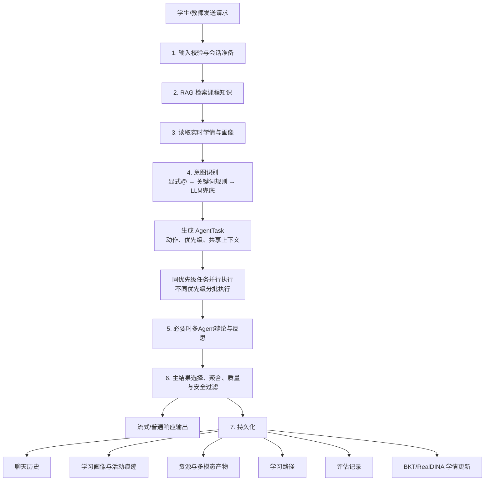
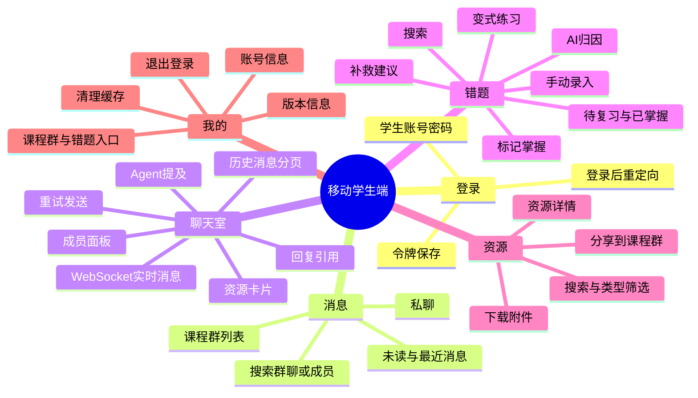
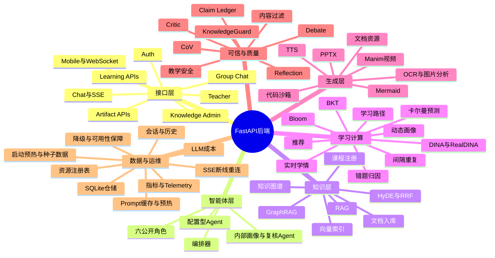

# Triple U 平台全功能思维导图

> 文档用途：项目报告、答辩材料和 PPT 内容整理。  
> 梳理原则：只写代码中可以定位的页面、交互和后端能力；全部功能均已核对确认闭环。
> 覆盖范围：现行 Vue Web、教师/管理员端、移动端、Electron 桌面端、React 像素校园子应用、独立静态展示页、FastAPI 后端、智能体与基础服务。第三方依赖目录和构建产物不作为产品功能重复统计。

## 一、全平台总思维导图

### 1.1 全平台总体运行流程图

一名学生从注册到掌握的完整旅程，与教师协同循环共同构成平台的双闭环；可信与安全能力贯穿每一次生成，学习结果回写画像驱动下一轮个性化。

### 1.2 整体技术架构图

三端共享同一后端与同一份学习状态；后端自上而下分为接口、编排、能力、数据四层，讯飞星火作为唯一主大模型通道由编排层统一调用。

## 二、入口、身份与全局功能

### 2.1 登录页 `/login`

代码依据：`frontend/src/views/LoginView.vue`、`frontend/src/api/auth.ts`、`backend/app/api/v1/auth.py`。

- 身份选择：学习者、教师/管理员。
- 账号密码登录：提交账号、密码和所选身份；后端校验账号、密码及角色。
- 教师与管理员合并：前端使用同一入口和管理端；后端将 `admin` 归一到教师角色。
- 记住身份：登录表单提供身份记忆选项。
- 访客预览：创建本地预览会话，不经过正式账号登录即可进入角色首页。
- 注册入口：跳转 `/register`。
- 登录后角色分流：学生进入 `/home`，教师/管理员进入 `/teacher`。
- 顶部辅助入口：首页、消息中心、资源中心、关于我们、通知、用户信息。
- 页面内弹层：消息预览、通知、关于团队与赛题、快速帮助。
- 键盘与弹层操作：`Esc` 关闭弹层，点击页面外部关闭用户菜单。

### 2.2 注册与八轮问卷 `/register`

代码依据：`frontend/src/views/RegisterView.vue`、`backend/app/api/v1/auth.py`、`backend/app/services/onboarding_profile.py`。

- 账号设置：称呼、登录账号、密码、确认密码；校验账号和密码一致性。
- 第一轮“学业背景”：专业或方向、所处阶段、当前课程或主题。
- 第二轮“目标与动机”：主要目标、兴趣方向、成果周期、学习动力、成功标准。
- 第三轮“基础与经验”：熟悉程度、已接触知识点、实际使用经历。
- 第四轮“困难与应对”：主要阻碍、反复错误情形、卡住后的求助方式。
- 第五轮“认知与讲解偏好”：图示/推导/例子/练习偏好，新概念切入方式，讲解信息量。
- 第六轮“资源与反馈偏好”：视频、文档、PPT/导图、题目、代码、项目；练习反馈方式；内容节奏；挑战强度。
- 第七轮“时间与习惯”：每周投入时间、高效时段、单次学习时长、计划方式、干扰因素。
- 第八轮“自主性与协作”：难题支持需求、系统介入方式、复盘习惯、独学/协作偏好。
- 问卷控制：上一步、继续、暂时跳过、多选项数量限制。
- 动态画像预览：问卷进行时同步展示已形成的初始画像。
- 注册提交：后端创建账号，调用 `build_initial_profile` 生成初始画像，通过画像仓储写入并计算完整度。
- 注册完成：可查看完整画像或进入学习首页。

### 2.3 退出与路由保护

- `/logout` 调用退出接口、清理本地认证会话并返回登录页。
- Web 路由守卫会检查本地登录态，再调用 `/auth/me` 验证正式令牌。
- 教师专属页会拒绝学生角色；学生专属学习大屏和个人图谱会将教师导回管理端。
- 访客预览令牌只用于本地演示会话。
- Web 通配路由 `/:pathMatch(.*)*` 将未识别地址统一重定向到首页。
- 移动端无令牌时跳转移动登录页；令牌失效事件会统一返回登录页；移动通配路由 `/:pathMatch(.*)*` 返回消息页。

### 2.4 全局应用壳与小功能

代码依据：`frontend/src/components/layout/AppShell.vue`。

- 学生导航：首页、学习大屏、群聊协作、学习路径、资源库、Agent 协作、错题本、知识图谱、学习画像、学习工具箱、桃园学宫。
- 教师导航：教学概览、课程知识库、知识图谱、学生分析、教学提示与视频、教学资源、教学干预、Agent 协作、安全中心、设置中心。
- 课程切换：学生课程状态写入本地存储；教师课程在所有管理页共享并持久化。
- 全局搜索：学生搜索后进入资源库；教师搜索后进入教学资源页。
- “新建任务”：进入群聊并带上新建任务参数。
- 通知按钮、用户菜单、退出登录、设置入口。
- Agent 邀请/协作提示：解释当前可调用的智能体团队。
- 游戏化数据刷新：等级、经验、连续学习等状态同步。
- 统一页面异常边界：页面组件异常时展示恢复入口。

## 三、学生端 Web 功能思维导图

### 3.1 首页 `/home`

- 当前课程切换和课程列表加载。
- 学习概览：路径阶段、已完成知识点、连续学习、最近学习时间。
- “学 → 练 → 复盘”三段学习动线及直达入口。
- 新手引导重放。
- 今日学习计划：按画像、路径、近期表现排序，显示任务、知识点、预计时长和操作入口。
- AI 学习建议：推荐优先巩固主题，直达讲解或练习。
- 学习进度：路径完成度、本周完成任务、本周学习时长、掌握度变化。
- 待复习项：结合错题、掌握度和遗忘风险，直达错题本。
- 最近反馈：显示学习结果与 Agent 调整记录。
- Agent 小队工作状态：展示智能体当前任务和完成情况，跳转协作详情。
- 数据来源：学生概览、推荐、学习状态时间线、游戏化信息、课程列表。

### 3.2 学习大屏 `/dashboard`

- 全屏学习效果大屏、手动刷新、退出大屏、自动刷新开关。
- 顶部指标：平均掌握度、连续打卡、学习行为数、资源使用、未解决错题、画像完整度。
- AI 综合评估：团团评估、智狐策略调整、球球校验；支持应用评估策略。
- 学习活跃热力图与学习行为时间线。
- 八维学习画像权重图。
- 错题错因分布、AI 错题洞察、知识点 × 错因矩阵。
- 资源推送策略权重、资源构成统计。
- 多模态诊断与修复包：错因回放、导图/代码/视频任务、变式验证后回写。
- BKT 知识掌握度、模型差异。
- 30 天掌握度预测与里程碑。
- 星期学习节奏、练习成绩趋势、薄弱知识点多模态修复推荐。
- 图表支持窗口尺寸变化重绘和悬停查看明细。

### 3.3 群聊协作 `/chat`

- 公共课程群：学生与六个智能体共同协作。
- Agent 私聊：从伙伴列表新建私聊、切换会话、删除会话、加载私聊历史。
- 显式路由：`@智狐`、`@智灵`、`@小龙`、`@阿匠`、`@团团`、`@球球`。
- 自动路由：没有 `@` 时由后端识别意图并选择智能体。
- 发送、停止流式生成、清空会话、新建会话、退出聊天。
- 引用回复、取消引用、快捷指令、推荐动作。
- SSE 流式输出：正文增量、思考阶段、Agent 开始/完成、产物、画像、质量、安全和完成事件。
- SSE 断线重连：服务端以环形缓冲保留近期事件，客户端携带 `Last-Event-ID` 重放断线期间丢失的事件；心跳帧保活，长任务不白屏。
- 消息气泡：按智能体身份分离显示；支持 Markdown、数学内容、引用和附件。
- 会话列表：群聊、私聊、未读/状态信息。
- 群成员面板：成员列表、六 Agent 伙伴、进入私聊。
- 右侧任务流：阶段状态、当前 Agent、进度、质量分、安全分。
- 实时学情仪表盘：困惑度、疲劳度、认知负荷、学习信心、探索意愿、卡点、兴趣点和建议。
- 知识库侧栏：课程知识点加载与定位。
- 学习画像侧栏：画像完整度、字段值、证据和完整画像入口。
- 资源侧栏：聊天生成资源、后端产物同步、预览和下载。
- 一键生成：并行请求 PPT、思维导图、代码、TTS 音频、Manim 讲解视频；实时显示每类生成进度并归档。
- 教师课程群消息同步：加载教师消息，教师 `@Agent` 后的回复可进入同一房间。
- `/chat-demo`：离线模拟流式回复、阶段状态、团队协作和演示附件。
- `/chat-bubble-demo`：聊天气泡组件的独立演示页。

### 3.4 学习路径 `/path`

- 综合路径进度、本周学习时长、周目标、剩余时长、知识掌握度。
- 今日任务表：任务名、所属阶段、时长、进度和开始/继续/完成操作。
- 路线图：阶段展开/收起、当前阶段、里程碑、阶段完成标记。
- 阶段内容：拉取知识点内容、难度、掌握度、预计时间、学习入口和问 AI。
- 学习目标编辑：目标、截止日期、每日可用时长、兴趣方向。
- AI 一键规划：根据用户、课程、目标和画像生成并保存新路径。
- 路径调整：按最近行为、薄弱点和兴趣重新规划。
- 个性化推理链：展示 BKT 已掌握跳过、薄弱点优先、认知风格、每日练习强度和学习者类型。
- 自适应策略：读取调整建议并确认应用。
- 今日推荐资源、换一换、资源详情。
- 下一道推荐题、直接练习、答题详情。
- 同伴学习动态和群聊讨论入口。
- 跳转资源库、群聊、知识图谱、桃园学宫。
- 学习完成后写入评估记录并更新 BKT 状态。

### 3.5 资源库 `/resources`

- 课程资源与聊天存档两个主视图。
- 资源来源：课程内置资源、教师资源、学生个人资源、Agent 生成产物、聊天归档。
- 课程切换、关键词搜索、知识点筛选、资源类型筛选、高级筛选、排序和分页。
- 资源分类、资源概览、最近访问、本周推荐、AI 个性化推荐。
- 类型覆盖：文档、PPT、视频、音频、题库、代码、动画、思维导图及其他附件。
- 在线预览：文本、图片、音频、视频和元数据预览；不支持的格式提供下载。
- 下载：普通课程附件与 Artifact 产物分别处理。
- 收藏/取消收藏、分享链接、复制标题、更多操作菜单。
- “带入群聊学习”：将资源主题带入群聊继续提问。
- 用户上传：读取不超过 10MB 的文本、Markdown、JSON、代码、CSV 等文件并保存为个人资源。
- 新建文件夹与分类弹层：文件夹及资源归类结果持久化保存，刷新与重新登录后保留。
- 空状态恢复：清除筛选、重新同步资源库。

### 3.6 Agent 编排 `/workflow`

- 输入学习需求。
- 快速模板和编排预设。
- 自选 Agent 团队：启用/禁用，展开填写每个 Agent 的自定义指令。
- 画像提示注入：显示上次生成实际使用的画像特征。
- 校验至少选择一个可产出资源的智能体。
- 一键并行运行多资源生成流水线。
- 执行状态：Agent 运行状态、成功/失败、耗时、质量和安全分。
- 实时运行日志、模型/Provider 轨迹、工具调用轨迹。
- 生成产物列表及下载。
- 历史运行、工具调用成功率、历史产物。
- 跳转资源库查看全部产物。

### 3.7 错题本 `/mistakes`

- 错题列表：全部、待复习、已掌握、高频易错、近 7 天、收藏。
- 课程和知识点筛选、分页、排序、视图切换。
- 手动录入：题目、知识点、学生答案、正确答案、错误类型和上下文。
- 演示样例导入。
- 周重点、待攻克数量、复习掌握率、连续复习。
- AI 错题洞察：薄弱知识点和改进建议。
- 团团归因：识别错误原因并展示归因结果。
- 智灵补救：生成讲解和复习建议。
- 小龙变式：生成同知识点变式题、显示答案与解析、上报做对/做错。
- 加入复习队列。
- 今日复习：逐题核对答案，自评“完全掌握/有点模糊/还是不会”。
- 间隔复习历史、到期提醒、优先级和遗忘曲线相关统计。
- 标记解决：同步错题状态、复习排期、BKT 与游戏化经验。
- 错题卡片展开、收藏、知识点入口。

### 3.8 知识图谱 `/graph`

- 课程选择与课程图谱加载。
- 3D/关系图可视化：缩放、适配、重置、全屏、视角切换和布局方式切换。
- 聚类概览、全部节点、章节展开/折叠、章节焦点。
- 掌握状态筛选：已掌握、学习中、薄弱、待学习、AI 推荐、学习路径。
- 关系类型筛选、单关系聚焦、清除筛选。
- 节点详情：掌握度、趋势、练习次数、前置知识、后续知识、直接关系。
- 节点操作：开始学习、开始练习、查看资源、向智灵提问。
- 课程路径叠加：把个人路径覆盖到知识图谱上。
- 双图路径规划：先修图 + 语义相似图；主路径、绕行路径、补救路径切换。
- 掌握度时光机：BKT + Kalman 未来 30 天预测、置信区间与里程碑。
- 解锁链路分析：当前知识点掌握后可解锁的直接和间接节点。
- 薄弱根因追溯：追踪前置知识缺口。
- 节点对比：选择两个节点绘制比较图。
- 统一知识检索：名称、语义、知识点 ID。
- GraphRAG：混合检索课程节点与关系，返回关系结论、引用节点和引用关系，并在图谱中高亮。
- 学习笔记：保存 GraphRAG 结果为笔记。
- 节点评价：理解程度、学习难度、资源质量、需要复习、易混标记、个人备注；保存在本机。
- 图谱快照导出 PNG、键盘快捷键、最近查看。
- 教师端“同步知识点”调用知识图谱种子构建接口。

### 3.9 学习画像 `/profile`

- 八维动态画像和能力雷达图：综合评分、优势维度、待提升维度。
- 学习者类型/原型徽章。
- 画像速览：版本、字段节点和趋势。
- 字段级证据溯源：当前值、可信度、最后计算时间、证据来源、原始对话入口。
- AI 诊断：当前问题、优势亮点、改进建议和模型诊断。
- 画像时光机：按版本回放画像演变、播放/暂停/拖动时间轴。
- 画像预测：未来能力趋势和置信度。
- 错题洞察：薄弱知识点、推荐练习、答案解析和学习资料。
- 评估趋势：读取真实测评记录。
- 个性化补强路径和完整建议。
- 更新队列：确认或忽略待确认画像更新。
- 画像驱动动作：资源推荐、到期复习、自适应策略。
- 学习诊断报告：生成 Markdown 报告、页面内阅读、新窗口打开、下载 HTML。
- 游戏化：签到、经验、成就解锁。
- 重置画像：调用后端重置接口，后续对话重新构建。
- 完整学习档案：画像版本、特征节点、字段来源和更新记录。

### 3.10 学习工具箱 `/evidence`

- 工具搜索、最近使用工具、工具分组和直达入口。
- 图片学习助手：上传 PNG/JPG/WebP，OCR 识别题目/教材、公式和匹配标签。
- 实时学习状态：掌握状态、未解决错题、待复习、可用资源、风险知识点和小狐建议。
- Bloom 分析：层级识别、同层级典型题和修订建议。
- CoV 五轴核验：对 AI 回答进行教育场景验证，支持演示用例。
- 质量与安全数据：论断支撑率、脚手架引导度、教学风险。
- 智能辅导：提交问题、查看参与 Agent 和最近辅导记录。
- 学习推荐：按课程生成下一项学习建议。
- 间隔复习：队列、统计、优先级、间隔、复习次数、自评提交。
- 下一道最佳题：按知识点和不确定度推荐。
- 反事实预测：比较不同学习强度的掌握度结果。
- 逆向规划：从目标掌握度和期限反推每日题量、强度与里程碑。
- 游戏化：等级、连续天数、签到和奖励。
- 社交学习：互补同伴推荐、导师推荐。
- 智能导师记录和更多系统入口。

### 3.11 桃园学宫 `/playground`

代码主体：`frontend/integrated-map-src/src/views/LabView.jsx`，由 Vue 页面以 iframe 嵌入。

- 全屏像素校园，提供退出到首页。
- 课程切换，每门课程拥有独立场景、任务、挑战与本地进度。
- 方向键控制学生角色移动，位置与互动区域碰撞检测。
- 校园区域：教学区、图书馆、实验区、自习区、生活区、学院区。
- 建筑/区域/热点点击和进入室内场景。
- 六 Agent 场景化角色入口；进入场景后可与对应 Agent 对话。
- 场景热点触发预设学习动作。
- 日常任务：领取任务、推进步骤、到达地点、领取奖励。
- 挑战题：题目选择、提交、答案解析、下一题。
- 根据推荐、错题和“下一道最佳题”动态生成挑战。
- 游戏化：经验、等级、积分、连续学习、学习事件、聊天奖励。
- 任务面板、挑战面板、总榜/周榜、玩家 HUD、最近事件。
- 每日任务刷新、本地进度迁移与按课程持久化。
- 学宫数据可对接学习路径、错题、游戏化、驾驶舱和聊天后端。

### 3.12 设置中心 `/settings`

- 显示当前登录用户、学生 ID。
- 重置当前聊天会话。
- 后端连接状态和运行时长。
- 指标摘要：LLM 调用、生成产物、Agent 失败数。
- 知识库索引状态和知识切片数量。
- 知识图谱节点统计。
- 选择课程并触发知识库重建索引。
- 教学安全说明：球球守护、练习不泄漏答案、讲解优先脚手架引导。

## 四、教师端与管理员端功能思维导图

> 代码中的教师与管理员使用同一套页面和功能；“管理员端”不是另一套路由。

### 4.1 教学概览 `/teacher`

- 课程和学生范围选择。
- 班级数据同步、加载状态和数据更新时间。
- 本周核心教学洞察：班级掌握度、优先补强知识点、未达标人数、典型错题、建议投入时间。
- 关键指标：班级掌握度、7 日活跃、优先关注、待处理错题。
- “备课 → 观察 → 干预 → 协作”教学工作流入口。
- 教师新手引导及重放。
- 今日优先三件事：按风险、影响范围和收益排序。
- 班级学习结构：BKT 五层掌握分布、薄弱知识点、错误原因。
- 近 7/14/30 天趋势：活动次数、日均得分和教学干预变化，支持图表悬停。
- AI 教学助理：提交班级问题，由现有六 Agent 协同生成教学方案。
- 直达班级图谱、学生证据、教学任务和干预页。

### 4.2 课程知识库 `/teacher/kb`

- 课程列表与课程卡片。
- 新建课程：课程标识、显示名称等课程信息。
- 选择课程并加载文档列表。
- 拖拽或选择文件上传；支持 Markdown、PDF、Word、TXT。
- 深度审核选项。
- 球球知识守护审核：显示文档索引/审核状态和审核问题。
- 文档删除。
- 课程重建索引，可选择强制重建。
- 命中测试：输入查询、课程和 Top-K，查看知识库召回结果。
- 从课程文档生成知识点图谱。
- 文件大小格式化、上传队列和操作通知。

### 4.3 班级知识图谱 `/teacher/knowledge`

- 拉取班级知识地图。
- 显示知识点、关系、班级平均掌握度和未达标人数。
- 按掌握度和教学优先级着色。
- 缩放、重置视图、节点布局。
- 知识点 Bloom 层级、难度和来源关系。
- 选择知识点后进入学生分析或打开 Copilot 制定教学动作。
- 与课程切换联动。

### 4.4 学生分析 `/teacher/students`

- 学生列表、课程切换、状态筛选。
- 优先关注、持续观察、状态稳定分类。
- 学生详情：综合掌握度、画像、掌握证据、优势和薄弱知识点。
- 风险证据、近期教学判断。
- 错题模式、未解决错题。
- 学习路径和教师推荐路径。
- 资源使用记录。
- AI 三步干预建议：概念辨析、即时练习、延迟复测。
- 生成干预建议。
- 联系学生、指派资源、创建补强路径、发送教师提醒。
- 两名学生对比及班级报表导出由教师分析 API 提供。

### 4.5 教学资源 `/teacher/resources`

- 资源列表、课程/状态/关键词筛选。
- 创建资源：标题、类型、正文、标签、知识点、可见范围、目标学生、草稿/发布状态。
- 文件上传：课程、可见范围、目标学生、资源类型和标签。
- 编辑资源。
- 发布、下架为草稿。
- 删除资源。
- 下载附件。
- 视频资源在线播放预览。
- 指派资源给指定学生，并附教师说明。
- 指派结果同时进入学生资源侧和课程群消息。

### 4.6 教学提示与视频 `/teacher/studio`

- 教师提示词输入和常用提示模板。
- 输出类型选择：由 `STUDIO_TYPES` 配置教学内容类型。
- 输出范围：全班或指定学生。
- 调用教学 Copilot 生成内容。
- 生成阶段展示：阿匠整合内容、团团对齐 Bloom 与学情、球球做安全核验。
- 显示参与 Agent、主 Agent、动作类型和安全等级。
- 将生成结果保存为草稿。
- 将生成结果发布到学生端资源中心。
- PPT 课件会调用 `POST /api/v1/artifacts/generate/multi` 生成真实 `.pptx`，教学视频会以 `include_manim=true`、`manim_render=true` 调用同一接口并要求返回可播放 `.mp4`；前端仅在 artifact registry 返回有效下载项后展示“立即下载”并允许发布。
- 保存草稿/发布时，`POST /api/v1/teacher/resources/from-artifact` 从服务端 artifact registry 校验来源和文件类型，将真实二进制复制到教师资源受控目录，写入 `metadata.generated_artifact.binary_generated=true`，随后可由教师端和学生资源中心下载。
- 若二进制生成失败，页面保留结构化正文用于排错，但明确禁止将正文发布为 PPT/视频资源。

### 4.7 教学干预 `/teacher/interventions`

- 干预模式：发送消息、指派资源、推荐路径。
- 支持选择多名学生批量执行。
- 五类消息模板：新学期问候、错题积压提醒、连续学习鼓励、阶段掌握表扬、阶段性复习。
- AI 起草教师消息，教师可编辑后发送。
- 资源指派：选择资源并添加说明。
- 路径推荐：填写路径标题和阶段列表。
- 逐学生执行并汇总成功/失败数量。
- 干预记录列表：类型、目标学生、内容、时间和执行结果。
- 学生课程群消息：普通教师消息不调用 LLM；包含 `@` 时进入多智能体编排并将 Agent 回复写入同一群。
- 学生路径页和群聊同步收到教师推送路径。

### 4.8 Agent 协作管理 `/teacher/agents`

- 列出六个内置 Agent 和教师创建的配置型 Agent。
- 新增配置型 Agent：名称、标题、描述、提示词等。
- 编辑 Agent 配置。
- 启用/停用 Agent。
- 删除配置型 Agent。
- 内置角色展示：智狐、智灵、阿匠、小龙、团团、球球。
- 教师 Copilot 可选择系统多 Agent 协作，也可指定某一已启用 Agent。
- 学生群聊通过 `@自定义名称` 调用配置型 Agent。
- 教师 Copilot 结果只作为教师决策建议；保存、发布、指派由教师后续操作触发。

### 4.9 安全中心 `/safety`

- CoV 教育五轴核验：对答案进行验证并展示轴向判断、修订建议。
- CoV 演示用例。
- 脚手架得分、答案泄漏风险、误概念强化风险和综合教学风险。
- 对抗泄漏测试：选择诱导策略，对题目、正确答案和候选回答发起测试。
- 显示综合判定、策略得分、诱导文本和修订版回复。
- 论断证据：论断支撑率、置信度和证据项。
- 多 Agent 辩论记录：专家、批判者和收敛结果。
- 安全机制说明：教学安全、证据链、CoV、辩论仲裁。

### 4.10 教师端跨页面分析与批处理

- 个体 BKT 掌握度、薄弱前 12 知识点和趋势。
- 错题热区。
- BKT + Kalman 未来 30 天遗忘曲线和 95% 置信区间。
- 班级掌握分布、薄弱知识点 Top 5、错误原因分布和 30 天学习趋势。
- 风险学生排序：掌握度、错题积压和活跃度综合。
- 两名学生对比。
- 班级报告导出。
- 错题多选、全选、批量标记已解决/恢复。
- 教学 Copilot：班级诊断、学生干预、教学资源和路径等动作；可补充教师指令。

## 五、六智能体及协作功能

| 对外角色 | 后端主要实现 | 真实职责 | 主要入口 |
|---|---|---|---|
| 智狐 · 学习规划师 | `PathPlannerAgent` | 生成/调整个性化路径，安排阶段和每日任务，结合画像与掌握度给出下一步（ZPD 最近发展区 + Thompson Sampling 推荐） | 群聊、学习路径、桌宠、教师路径干预 |
| 智灵 · 知识讲师 | `TutorAgent` | 概念解释、答疑、例子、脚手架式辅导、错题补救 | 群聊、错题本、知识图谱、学习工具箱 |
| 小龙 · 练习挑战 | `QuizGeneratorAgent` | 按知识点和掌握度生成练习题、变式题与反馈 | 群聊、错题本、路径推荐题、桃园挑战 |
| 阿匠 · 内容工匠 | `MultimodalAgent`、`ResourceGeneratorAgent` | 文档、PPT、思维导图、代码、TTS 音频、Manim/视频等资源生成 | 群聊一键生成、Agent 编排、教学提示与视频、资源库 |
| 团团 · 学习评估 | `EvaluatorAgent` | 学习效果评估、八类错因归因、下一步建议、评估记录 | 群聊、学习大屏、错题本、画像、教师洞察 |
| 球球 · 安全守护 | `SafeDeclineAgent`、`KnowledgeGuardAgent`、`COVVerifierAgent` | 越界与敏感内容守门、知识入库审核、生成内容验证链 | 全局自动运行、教师知识库、安全中心、群聊 |

后端还注册了画像、课程专家、复核、批判、辩论仲裁、教材问答和 AI 讲师等内部 Agent。它们是六个对外角色背后的协作能力，不新增前端公开角色。

### 5.1 一轮请求的真实协作链

- 显式 `@` 最高优先级；阿匠会根据 PPT、导图、视频、音频等资源词进一步识别产物类型。
- 无显式提及时，先用关键词规则识别文档、导图、练习、阅读、视频、音频、路径、辅导、评估和越界意图。
- 规则结果不足时调用 LLM 意图分类器；无法分类时回到智灵辅导。
- 学生普通对话自动附加画像更新任务；教师请求不写入学生画像。
- 同一公开角色只生成一个子任务；阿匠的多个资源意图会合并交给统一资源生成链。
- 同优先级子任务通过 `asyncio.gather` 并行执行。
- 多 Agent 输出经过辩论/反思条件判断、主响应选择、内容聚合、安全过滤和质量信息汇总。
- 配置型 Agent 被 `@名称` 命中后走单 Agent 回复；停用时返回状态提示。

## 六、桌宠、帮助中心和引导系统

### 6.1 小狐桌宠 `PlannerPixelPet.vue`

- 仅学生端显示；教师端和知识图谱页不显示。
- 像素动画状态：待机、眨眼、挥手、思考、指向、庆祝、睡眠。
- 拖拽移动，位置写入本地存储。
- 展开、关闭、最小化、恢复和静音。
- 五个功能页签：
  - 页面指引：说明当前页面用途、操作步骤和下一站。
  - 快捷导航：首页、路径、图谱、错题、资源、工具箱。
  - 对话：以 `@智狐` 向真实聊天接口提问。
  - 今日任务：读取学生概览并跳转对应任务。
  - 推荐：读取个性化推荐，把推荐问题交给智狐。
- 快捷问题：解释当前难点、进入群聊、调整计划。
- 感知当前路由并切换提示文案。
- 可触发完整功能指南和重放新手引导。

### 6.2 帮助中心 `HelpCenter.vue`

- 平台介绍。
- 按角色展示的快速上手。
- 全功能使用手册：学生 12 个功能页、教师 9 个功能页（页面指南数据源 `platformGuide.ts` 覆盖教师 9 页；设置中心与学生端共用说明，不单列，故与教师导航的 10 个入口不冲突）。
- 六智能体介绍、职责和召唤方式。
- 安全与防幻觉机制说明。
- 常见问题。
- 当前页面定位和页面间导航。
- 重放新手引导。
- 与桌宠共同使用 `platformGuide.ts` 作为页面指南数据源。

### 6.3 新手引导与演示导览

- `OnboardingTour.vue`：步骤高亮、上一步、下一步、跳转、跳过、完成状态持久化和重新播放。
- 学生首页与教师概览分别配置角色化引导步骤。
- `DemoTour.vue`：群聊 → 资源 → 路径 → 安全 → 工具箱 → 桃园学宫的评审演示线路。
- 演示导览支持进度、重置和隐藏。

## 七、移动学生端

代码入口：`mobile/src/router/index.ts`、`mobile/src/views/*`、`backend/app/api/v1/mobile.py`。

### 7.1 移动端页面图

### 7.2 页面与交互明细

- `/login`：学生账号密码登录、密码显示切换、演示账号预填、登录后返回原目标页。
- `/messages`：课程群/会话列表、搜索群聊或成员、最近消息、未读信息、进入聊天。
- `/chat/:roomId`：
  - 加载房间、成员和历史消息。
  - 分页查看更早消息。
  - WebSocket 实时连接，显示在线/重连状态。
  - 发送消息、失败重试、回复引用、取消回复。
  - 长消息展开。
  - 群聊中提及 Agent。
  - 学习资源卡片跳转。
  - 群成员/私聊成员面板。
  - 标记房间已读。
- `/mistakes`：待复习/已掌握切换、搜索、手动录入错题。
- `/mistakes/:id`：题目、学生答案、正确答案、AI 归因、补救建议、变式练习、标记已掌握。
- `/resources`：资源搜索、类型筛选、资源卡片列表。
- `/resources/:id`：资源详情、下载附件、选择课程群并分享资源消息。
- `/me`：账号、课程群、错题复习、清理本机缓存、版本信息、退出登录。
- 底部导航：消息、错题、资源、我的。

## 八、Electron 桌面端与内嵌/独立页面

### 8.1 Electron 桌面端

代码依据：`electron/main.ts`、`electron/preload.ts`、根目录 `main.js`。

- 启动 FastAPI 后端子进程：开发环境运行 Uvicorn，生产环境运行打包后的后端程序。
- 默认本地服务端口 `18000`。
- 轮询 `/healthz`，后端就绪后创建桌面窗口。
- 桌面窗口加载同一套 Vue/FastAPI 应用。
- 外部链接交给系统默认浏览器。
- 配置桌面用户数据目录、SQLite 数据库和向量库路径。
- 提供离线演示相关环境配置。
- 后端日志写入桌面日志目录。
- 开发环境可打开开发者工具。
- 应用退出时终止后端子进程并清理窗口状态。

### 8.2 React 内嵌子应用 `/integrated-map`

- 由 `IntegratedMapView.vue` 通过 iframe 加载 `/integrated-map/index.html`。
- React 子应用内部页面：学习驾驶舱、学习路径、资源中心、Agent 工作流、学习画像、桃园学宫。
- 学习驾驶舱：
  - 聊天时间线、消息操作、引用/追问/重新生成/加入路径。
  - Agent 调用状态和任务进度。
  - 生成资源预览/下载。
  - 知识点、画像完整度和实时学情。
  - 清空会话、群设置和快捷指令。
- React 资源中心：
  - 资源/Artifact 列表、搜索、类型筛选、预览、下载、删除。
  - 生成中心：PPT、导图、TTS、Manim、Mermaid 代码和多类型生成。
- React 路径、画像和工作流页面包含各自的展示与操作入口。
- `/playground` 实际复用该子应用的 `page=lab&shell=0` 模式。

### 8.3 独立静态展示资产

- `a3-learning-ui-perfect-avatars/.../index.html`：角色选择、六 Agent 形象、进入系统和直接预览的视觉样例页。
- `brochure/index.html`：项目宣传/介绍型静态页面。
- 以上静态页未在现行 Vue Router 中注册为正式业务路由。

### 8.4 公网部署与容器运行

代码依据：`docker-compose.yml`、`docker/`、`.env.example`、后端 `/healthz` 与系统状态接口。

- 前后端以 Docker Compose 编排为两容器：前端服务（5173）与后端服务（8000），数据目录与课程知识库以卷挂载持久化。
- 系统已部署公网云服务器，通过域名对外提供访问（具体地址见演示材料）；评审无需本地安装即可体验全部功能。
- 公网环境与本地环境使用同一套镜像与配置，仅以环境变量区分；移动端与 Web 端访问同一公网后端。
- 本地保留三种运行形态：开发模式（Vite + Uvicorn）、Docker 一键部署、Electron 桌面端。
- 部署后验证：后端 `/healthz` 健康检查与系统状态接口确认服务就绪。

## 九、后端能力总图

### 9.1 知识库与知识图谱

- 课程注册表和课程清单。
- 教师创建课程、上传资料、删除资料、重建索引。
- 知识入库审核。
- 文档切分、索引管理、向量检索。
- RAG 服务预热。
- HyDE 查询扩展和 RRF 融合检索模块。
- 知识点存储、邻居查询、3D 图数据、统计、搜索。
- 图谱构建、社区聚类和图检索。
- 命中测试和从课程文档生成课程图谱。

### 9.2 学习画像、认知诊断与推荐

- 初始问卷画像构建。
- 对话画像抽取、字段合并、版本历史、完整度计算。
- 学习者原型识别。
- 实时学情状态。
- BKT、BKT+、DINA、RealDINA、Bloom 分类与细分、Kalman 平滑和掌握预测。
- 主动学习不确定度采样和下一道最佳题；路径下一步推荐采用 ZPD（最近发展区）候选筛选 + Thompson Sampling 多臂采样。
- 反事实预测和逆向学习计划。
- 错题洞察、归因、补救和变式生成。
- SM-2、FSRS、HLR、遗忘曲线等间隔复习模块。
- 个性化路径、双图路径和自适应策略。
- 学生概览、学习日历、同伴比较、个性化推理链。
- 同伴匹配、导师推荐和社会化学习建议。
- 诊断报告生成、Markdown/HTML 报告内容和可视化服务。

### 9.3 多模态生成

- PPTX：结构规格、主题、版式、素材、讲者备注、质量检查和构建。
- Mermaid：意图识别、规格、模板、校验、渲染。
- 代码沙箱：执行代码并形成可下载结果。
- TTS：语音列表与语音生成。
- Manim：DSL、模板、编译、渲染和 AI 讲师。
- 视频服务和讯飞图像/OCR 接口。
- 单类型生成、多类型并行生成、带降级生成和流式多类型生成。
- Artifact 注册、恢复扫描、信息查询、Data URI 和多格式下载。

### 9.4 安全、可信、质量和审计

- 输入/输出内容安全过滤。
- 教学边界安全与安全拒答。
- 练习答案泄漏对抗测试。
- 论断账本和来源证据。
- CoV 论断抽取、证据核验和内容重写。
- Critic 从事实、教学、Bloom、引用等维度评分。
- 多 Agent 辩论、收敛追踪和仲裁。
- Reflexion、Self-Refine、Bloom-aware 反思策略。
- 知识入库 KnowledgeGuard。
- Agent 工具调用 Trace、统计和清理。
- Prometheus 指标、健康状态、流水线阶段耗时、LLM 调用和估算成本。

### 9.5 数据持久化与启动

- SQLite 初始化与数据模型。
- 账号、会话、画像、聊天历史、资源、路径、评估、错题等仓储。
- 资源内存缓存与 SQLite 双写。
- Artifact 注册表持久化和丢失文件清理。
- 启动时预热 RAG。
- 空库时导入种子数据。
- 启动时补齐课程资源并扫描已有 PPT、音频、导图、视频、代码和题库产物。
- Prompt 缓存：以请求内容哈希为键落 SQLite，支持 TTL 过期、预热与命中统计；模型配额受限或网络抖动时，相同请求直接命中缓存返回。
- 降级与可用性保障：模型服务不可用时返回课程知识库检索结果、规则化学习建议或明确标记的离线演示内容，不将降级结果伪装为实时模型回答；多模态生成具备逐级降级（视频/动画不可渲染时降级为幻灯片、静态图或图文加语音）。
- SPA 静态文件托管与前端路由回退。

### 9.6 后台研究、画像分析与报告能力

这些模块没有独立前端页面，但属于仓库中的真实计算或离线支持能力：

- 学生行为特征：公共特征、学习行为、学习结果、课程探索、生活健康、社交生活、风险、趋势和波动特征。
- 模式分析：学习行为聚类、学习结果聚类、模式分类、风险预测和模型融合。
- 规则分析：五类场景规则引擎与风险规则。
- 个体画像、群体画像和画像校验服务。
- 归因引擎、叙事生成、教学桥接、教学上下文和教学策略。
- 数据字典与数据血缘。
- 报告构建、报告增强、可视化、导出和 LLM 叙事生成。
- 学生报告模板：HTML、DOCX 和图表配置。
- ASSISTments 数据集下载、缓存、清洗和序列构建。
- 认知模型研究基线：DINA、RealDINA、BKT、DKT、SAKT 和 Naive Baseline。
- 评测适配、概率校准、按学生 K 折交叉验证。
- 指标计算：AUC、RMSE、Accuracy 和聚合评测结果。

### 9.7 工程运行、数据构建与验证工具

- 数据库迁移：Alembic 配置和迁移脚本。
- 数据备份与恢复。
- 开发服务器一键启动、Docker Compose、Docker 冒烟验证。
- Electron 构建与后端可执行程序打包。
- 知识库索引、知识图谱构建和扩展构建。
- 题库构建、扩充、Bloom 重标注、Python 题库生成和分析题库合并。
- 演示学生、教师知识图谱、移动课程群、错题和业务数据种子。
- 已有 Artifact 扫描、注册和章节附件绑定。
- MP3、视频、Manim 脚本、Notebook 和诊断报告离线生成。
- 认知模型、RealDINA 和间隔复习基准测试。
- 聊天 SSE、意图路由、演示旅程、资源、视频、题库和生成数据验证。
- Prompt Cache 预热和统计。
- 负载测试、能力探针和本地参考答案对照。

## 十、后端已挂载 API 功能索引

> 下列索引来自 `backend/app/api/router.py` 实际挂载的路由和 `backend/app/main.py` 根路由。统一业务前缀为 `/api/v1`。

### 10.1 认证、聊天与会话

- `auth`：`POST /auth/login`、`POST /auth/register`、`GET /auth/me`、`POST /auth/logout`。
- `chat`：`POST /chat/send`、`POST /chat/stream`、`GET /chat/profile/{session_id}`、`GET /chat/history/{session_id}`、`GET /chat/realtime/{session_id}`、`POST /chat/clear`、`GET /chat/archive/{user_id}`、`POST /chat/with-cov`、`GET /chat/cov-demo-cases`。
- `group-chat`：`GET /group-chat/{room_id}/messages`、`POST /group-chat/{room_id}/messages`。
- `agent-tools`：`GET /agent-tools/trace`、`GET /agent-tools/trace/stats`、`POST /agent-tools/trace/clear`。

### 10.2 画像、评估、认知与学习状态

- `profile`：`GET /profile/dimensions`、`GET /profile/{user_id}/history`、`GET /profile/{user_id}`、`POST /profile/{user_id}/update`、`POST /profile/{user_id}/reset`。
- `assessment`：`GET /assessment/{user_id}`、`POST /assessment/{user_id}/record`。
- `cognitive`：`GET /cognitive/bloom/levels`、`GET /cognitive/bloom/detail`、`POST /cognitive/bloom/classify`、`GET /cognitive/bkt/{user_id}`、`POST /cognitive/bkt/update`、`POST /cognitive/diagnose`、`GET /cognitive/forecast`、`GET /cognitive/counterfactual`、`POST /cognitive/next-best-question`。
- `learner-state`：`GET /learner-state/{user_id}`、`GET /learner-state/{user_id}/timeline`、`GET /learner-state/{user_id}/recommendation`。
- `learner`：`GET /learner/learning_path`、`GET /learner/mastery_history`。
- `cockpit`：`GET /cockpit/student/{user_id}`、`GET /cockpit/schema`。

### 10.3 学习路径、洞察与推荐

- `learning-path`：`GET /learning-path/list`、`GET /learning-path/{path_id}`、`GET /learning-path/{path_id}/stages/{stage_id}/content`、`POST /learning-path/save`、`POST /learning-path/{path_id}/progress`、`POST /learning-path/dual-graph`。
- `insights`：`GET /insights/student-overview/{user_id}`、`POST /insights/kg/seed-from-map`、`POST /insights/path/generate`、`GET /insights/report/{user_id}`、`GET /insights/recommendations`、`GET /insights/study-calendar/{user_id}`、`GET /insights/adaptive-strategy/{user_id}`、`POST /insights/adaptive-strategy/{user_id}/apply`、`GET /insights/peer-comparison/{user_id}`、`GET /insights/personalization-chain/{user_id}`。
- `social`：`GET /social/peer-suggestions`、`GET /social/tutor-suggestions`。
- `gamification`：`GET /gamification/{user_id}`、`POST /gamification/{user_id}/xp`、`POST /gamification/{user_id}/achievement`、`POST /gamification/{user_id}/checkin`。

### 10.4 错题与间隔复习

- `mistakes`：`GET /mistakes/categories`、`GET /mistakes/heatmap`、`POST /mistakes/seed`、`POST /mistakes/insights/{user_id}`、`GET /mistakes/insights/{user_id}`、`GET /mistakes/{user_id}`、`POST /mistakes/record`、`POST /mistakes/{mistake_id}/analyze`、`POST /mistakes/{mistake_id}/variants`、`POST /mistakes/{mistake_id}/remediation`、`POST /mistakes/{mistake_id}/resolve`、`GET /mistakes/{mistake_id}/attribution`。
- `spaced-repetition`：`GET /spaced-repetition/daily/{user_id}`、`GET /spaced-repetition/recommend/{user_id}`、`POST /spaced-repetition/review`、`GET /spaced-repetition/history/{user_id}`、`GET /spaced-repetition/stats/{user_id}`、`GET /spaced-repetition/schedule/{user_id}/{item_id}`、`POST /spaced-repetition/enqueue`。
- `system` 变式题：`POST /system/variant/{mistake_id}`、`GET /system/variant/demo-samples`。

### 10.5 课程知识、图谱与资源

- `knowledge`：`GET /knowledge/status`、`POST /knowledge/index/{course_name}`、`GET /knowledge/courses`。
- `knowledge-graph`：`GET /knowledge-graph/kps`、`GET /knowledge-graph/kps/{kp_id}`、`GET /knowledge-graph/lookup`、`GET /knowledge-graph/search`、`GET /knowledge-graph/stats`、`GET /knowledge-graph/3d`、`GET /knowledge-graph/neighbors`。
- `teacher/knowledge`：`GET /teacher/knowledge/courses`、`POST /teacher/knowledge/courses`、`PATCH /teacher/knowledge/courses/{slug}`、`POST /teacher/knowledge/courses/{slug}/documents`、`GET /teacher/knowledge/courses/{slug}/documents`、`DELETE /teacher/knowledge/documents/{doc_id}`、`POST /teacher/knowledge/courses/{slug}/reindex`、`POST /teacher/knowledge/hit-test`、`POST /teacher/knowledge/courses/{slug}/generate-map`。
- `resources`：`GET /resources/list`、`GET /resources/types`、`GET /resources/{resource_id}`、`GET /resources/{resource_id}/download`、`POST /resources/save`、`DELETE /resources/{resource_id}`。

### 10.6 Artifact 与多模态

- 下载与查询：`GET /artifacts/download/{rid}`、`GET /artifacts/{rid}/pptx`、`GET /artifacts/{rid}/mp3`、`GET /artifacts/{rid}/png`、`GET /artifacts/{rid}/mermaid`、`GET /artifacts/{rid}/manim`、`GET /artifacts/{rid}/data-uri`、`GET /artifacts/list`、`GET /artifacts/info/{rid}`。
- 单类型生成：`POST /artifacts/generate/pptx`、`POST /artifacts/generate/mermaid`、`POST /artifacts/generate/mermaid-code`、`POST /artifacts/generate/code`、`POST /artifacts/generate/tts`、`GET /artifacts/tts/voices`、`POST /artifacts/generate/manim`。
- 多类型生成：`POST /artifacts/generate/multi`、`POST /artifacts/generate/multi-with-fallback`、`POST /artifacts/generate/multi-stream`。
- 智能导师：`POST /smart-tutor/image-analyze`、`POST /smart-tutor/ask`、`GET /smart-tutor/records/{user_id}`。

### 10.7 教师与管理员

- 学生与班级：`GET /teacher/students`、`GET /teacher/students/{user_id}/summary`、`GET /teacher/analytics/class`。
- 教学 Copilot：`POST /teacher/copilot/consult`。
- 教学资源：`POST /teacher/resources/upload`、`GET /teacher/resources/{resource_id}/download`、`GET /teacher/resources`、`POST /teacher/resources`、`PATCH /teacher/resources/{resource_id}`、`DELETE /teacher/resources/{resource_id}`。
- 指派：`POST /teacher/assignments/resource`、`POST /teacher/assignments/path`。
- Agent 管理：`GET /teacher/agents`、`POST /teacher/agents`、`PATCH /teacher/agents/{agent_key}`、`DELETE /teacher/agents/{agent_key}`。
- 消息与干预：`POST /teacher/messages`、`GET /teacher/interventions`。
- 分析：`GET /teacher/analytics/knowledge-map`、`GET /teacher/analytics/compare`、`GET /teacher/analytics/class/export`。
- 错题批处理：`POST /teacher/mistakes/batch-resolve`。

### 10.8 移动端

- 房间与消息：`GET /mobile/rooms`、`GET /mobile/rooms/{room_id}/members`、`GET /mobile/rooms/{room_id}/messages`、`POST /mobile/rooms/{room_id}/messages`、`POST /mobile/rooms/{room_id}/read`、`WEBSOCKET /mobile/ws`。
- 资源：`GET /mobile/resources`、`GET /mobile/resources/{resource_id}`、`GET /mobile/resources/{resource_id}/download`。
- 错题：`GET /mobile/mistakes`、`POST /mobile/mistakes`、`GET /mobile/mistakes/{mistake_id}`、`POST /mobile/mistakes/{mistake_id}/analyze`、`POST /mobile/mistakes/{mistake_id}/remediation`、`POST /mobile/mistakes/{mistake_id}/variants`、`POST /mobile/mistakes/{mistake_id}/resolve`。

### 10.9 安全、指标与系统状态

- `safety`：`POST /safety/adversarial-leakage`、`GET /safety/adversarial-leakage/strategies`。
- API 指标：`GET /metrics`、`GET /metrics/summary`、`GET /metrics/health`。
- 根路由：`GET /healthz`、`GET /metrics`、`GET /metrics/llm-cost`、`GET /api/v1/system/status`。

## 十一、页面—后端能力对应索引

| 前端页面/功能 | 主要后端模块 |
|---|---|
| 登录、注册、退出 | `auth` |
| 首页 | `insights`、`learner-state`、`gamification`、`knowledge` |
| 学习大屏 | `cognitive`、`profile`、`insights`、`learner-state`、`assessment`、`gamification`、`mistakes` |
| 群聊 | `chat`、`group-chat`、`artifacts`、`knowledge-graph`、`profile` |
| 学习路径 | `learning-path`、`insights`、`assessment`、`cognitive`、`resources` |
| 资源库 | `resources`、`artifacts`、`insights`、`chat`、`knowledge` |
| Agent 编排 | `artifacts`、`metrics`、`agent-tools`、`insights` |
| 错题本 | `mistakes`、`system`、`spaced-repetition`、`cognitive`、`gamification` |
| 知识图谱 | `knowledge-graph`、`knowledge`、`learner`、`learning-path`、`cognitive`、`insights` |
| 学习画像 | `profile`、`cockpit`、`assessment`、`mistakes`、`gamification`、`cognitive`、`insights`、`learner-state` |
| 学习工具箱 | `smart-tutor`、`cognitive`、`cockpit`、`chat`、`spaced-repetition`、`social`、`gamification`、`learner-state`、`insights`、`knowledge-graph` |
| 设置中心 | `knowledge`、`metrics`、`knowledge-graph` |
| 教学概览/学生分析 | `teacher`、`cognitive`、`mistakes` |
| 课程知识库 | `teacher/knowledge`、`knowledge` |
| 教学资源/工作室/干预/Agent 管理 | `teacher`、`group-chat`、`chat` |
| 安全中心 | `safety`、`chat/with-cov`、`cockpit` |
| 桃园学宫 | `chat`、`learner`、`mistakes`、`cognitive`、`insights`、`gamification` |
| 移动端全部页面 | `mobile`、`auth` |

## 十二、代码覆盖清单

本文件的功能结论主要来自以下运行时代码目录：

- Web 路由与页面：`frontend/src/router`、`frontend/src/views`。
- Web 公共组件：`frontend/src/components`，包括 AppShell、聊天、桌宠、帮助中心、新手引导、图表和资源卡片。
- Web 接口适配：`frontend/src/api`。
- Web 会话与角色状态：`frontend/src/composables`、`frontend/src/utils`、`frontend/src/constants`。
- React 内嵌应用：`frontend/integrated-map-src/src`。
- 移动端：`mobile/src`。
- 桌面端：`electron`、根目录 `main.js`。
- 后端入口与路由：`backend/app/main.py`、`backend/app/api/router.py`、`backend/app/api/v1`。
- 智能体：`backend/app/agents`。
- 学习、知识、多模态、安全、推荐和报告服务：`backend/app/services`。
- 数据、配置、LLM、指标和种子数据：`backend/app/core`、`backend/app/repositories`、`backend/app/schemas`。
- 独立展示资产：`a3-learning-ui-perfect-avatars`、`brochure`。
- 测试、脚本、迁移和配置代码用于交叉核对功能入口，但未作为面向用户的页面重复列入思维导图。

## 十三、可直接用于报告/PPT的功能主线

1. **画像起点**：学生注册并完成八轮问卷，形成可持续更新的初始学习画像。
2. **日常学习**：首页汇总今天要学、要练、要复习的任务，学习路径负责阶段推进。
3. **六 Agent 协作**：智狐规划、智灵讲解、小龙出题、阿匠生成资源、团团评估、球球守护。
4. **知识与证据**：RAG、知识图谱、GraphRAG、论断证据和安全核验共同支撑回答。
5. **练习闭环**：错题归因 → 补救讲解 → 变式练习 → 间隔复习 → BKT 与画像回写。
6. **资源闭环**：教师资料、知识库资料和 Agent 多模态产物进入统一资源库，可预览、下载、分享和再次带入群聊。
7. **评价与调整**：学习大屏、画像、认知诊断、掌握预测和推荐共同驱动路径与策略调整。
8. **教师闭环**：班级洞察 → 学生分析 → 教学资源/工作室 → 消息、资源、路径干预 → 效果追踪。
9. **多端协同**：Web 负责完整学习与管理，移动端承接消息、错题和资源，Electron 提供桌面一体化运行，桃园学宫提供游戏化学习场景。

## 十四、赛题条款与平台功能对照

> 用途：答辩与文档审查时按条款快速定位功能证据；条款文字依据赛题原文（A3.md）。

| 赛题条款 | 平台对应功能 | 主要入口 | 本文档章节 |
|---------|------------|---------|:---:|
| 必选 1：对话式学习画像自主构建（≥6 维、随学随新） | 注册八轮问卷初始画像 + 对话持续更新的 8 维画像 + 字段级证据溯源 + 画像时光机 | `/register`、`/profile`、群聊画像侧栏 | §2.2、§3.9 |
| 必选 2：多智能体协同的资源生成（≥5 类资源） | 六智能体分工协作 + 七阶段流水线；文档、PPT、思维导图、练习题、代码、TTS 音频、Manim/视频共 7 类资源并行生成 | 群聊一键生成、`/workflow` | §3.3、§3.6、§五、§9.3 |
| 必选 3：个性化学习路径规划和资源推送 | 双图路径（先修图 + 语义相似图）主线/绕行/补救三方案 + 个性化推理链 + 画像感知的资源与练习推送 | `/path`、`/graph`、首页推荐 | §3.4、§3.8、§9.2 |
| 加分 1：智能辅导（多模态答疑） | 智灵脚手架式辅导 + 错题归因/补救/变式/间隔复习闭环 + 图片 OCR 识题 + 多模态解答 | `/mistakes`、`/evidence`、群聊 | §3.7、§3.10 |
| 加分 2：学习效果评估（多维评估 + 动态调整） | 团团多维评估 + 学习大屏 + BKT/Kalman 掌握度预测（时光机）+ 反事实与逆向规划 + 评估驱动策略应用 | `/dashboard`、`/profile`、`/evidence` | §3.2、§3.9、§9.2 |
| 非功能：流式输出 / 生成进度追踪 | SSE 全链路流式 + 任务流面板 + 多资源并行进度 + 断线重连 | 群聊、`/workflow` | §3.3、§3.6 |
| 非功能：防幻觉与内容安全过滤 | RAG 来源锚定 + CoV 声明核验 + 论断证据账本 + 教学安全（防泄题）+ 对抗泄漏红队 + 球球守门 + 知识入库审核 | `/safety`、群聊、教师知识库 | §4.9、§9.4 |
| 非功能：界面美观 / Markdown / 卡片化 | 统一设计系统 + Markdown/数学渲染 + 资源卡片 + 桌宠/帮助中心/新手引导 | 全站 | §二、§六 |
| 测试数据：自构建完整课程知识库 | 教师建课 → 上传资料 → 审核入库 → 重建索引 → 命中测试 → 生成课程图谱；一套架构接入任意课程 | `/teacher/kb` | §4.2、§9.1 |
| 开发类型不限（Web/移动/桌面） | 公网 Web + 移动 Web 端 + Electron 桌面端三端一云 | 全端 | §七、§八 |
