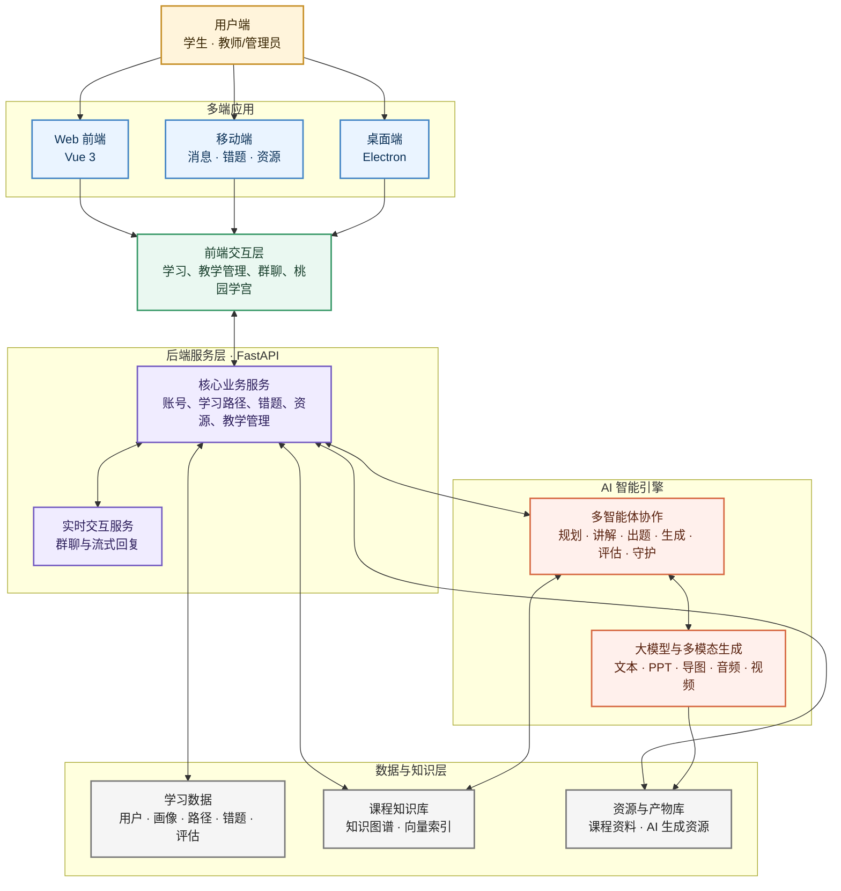

# Triple U 平台简明技术架构图

> 用途：报告与 PPT 展示。仅保留平台的关键层次和核心数据流，不展开具体算法、校验与内部实现。

## 图示说明

- 多端应用统一访问 Vue 前端和 FastAPI 后端；Electron 复用同一套应用。
- 后端负责账号、学习、资源、教学管理及实时聊天等核心业务。
- 多智能体调用大模型与多模态生成能力，并根据课程知识库提供个性化服务。
- 学习数据、课程知识和生成资源统一沉淀，持续支持学习路径、画像与教学决策。
