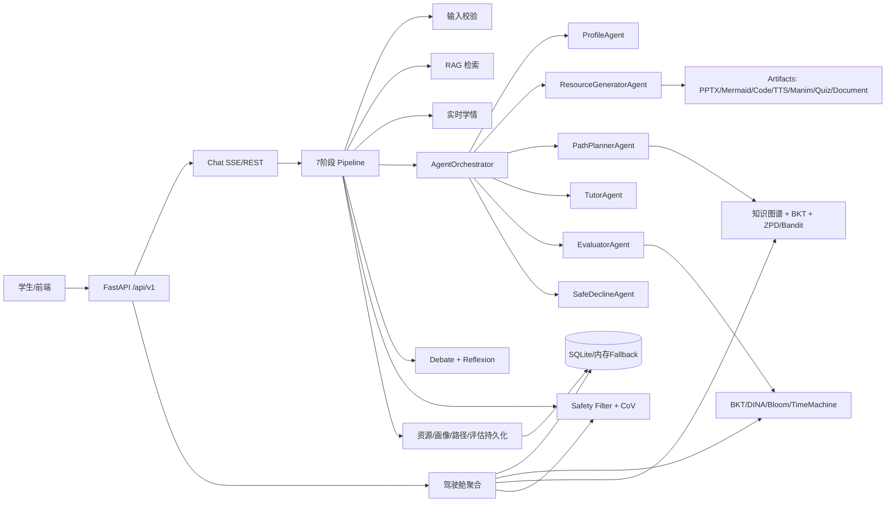

# A3 后端功能链路提取文档

生成日期：2026-07-06  
赛题：基于大模型的个性化资源生成与学习多智能体系统开发  
代码范围：`backend/app`

## 1. 赛题要求到后端能力映射

| 赛题要求 | 后端已落地链路 | 主要入口 |
|---|---|---|
| 对话式学习画像自主构建 | 对话 Pipeline 每轮触发 `ProfileAgent`，并支持独立画像查询、更新、历史快照 | `/api/v1/chat/send`、`/api/v1/chat/stream`、`/api/v1/profile/*` |
| 多智能体协同资源生成 | `AgentOrchestrator` 按意图路由多 Agent；`ResourceGeneratorAgent` 调 artifacts 工具生成文档、PPT、题库、导图、代码、音频、视频 | `/api/v1/chat/*`、`/api/v1/artifacts/generate/*`、`/api/v1/artifacts/generate/multi` |
| 个性化学习路径规划和资源推送 | `PathPlannerAgent`、KG 拓扑、BKT 掌握度、ZPD/Bandit、资源推荐共同生成路径和推送 | `/api/v1/learning-path/*`、`/api/v1/insights/path/generate`、`/api/v1/insights/recommendations` |
| 智能辅导 | `TutorAgent` 与 `SmartTutoringEngine` 提供文字、图解、动画降级、练习建议，并回写画像 | `/api/v1/chat/*`、`/api/v1/smart-tutor/ask` |
| 学习效果评估 | Assessment、BKT、DINA、Bloom、错题归因、主动选题、时光机预测、动态策略调整 | `/api/v1/assessment/*`、`/api/v1/cognitive/*`、`/api/v1/mistakes/*`、`/api/v1/insights/adaptive-strategy/*` |
| 防幻觉与内容安全 | 聚合阶段内容安全过滤、CoV-Edu 五轴校验、对抗泄露红队、证据链 ledger | `/api/v1/chat/with-cov`、`/api/v1/safety/adversarial-leakage`、`/api/v1/cockpit/student/{user_id}` |
| 流式输出与进度追踪 | SSE 事件缓冲、Pipeline thinking 事件、chunk 流式文本、profile/resource/done 事件 | `/api/v1/chat/stream` |

## 2. 后端总入口链路

### 2.1 FastAPI 应用入口

代码位置：
- `backend/app/main.py`
- `backend/app/api/router.py`

链路：

1. `backend/app/main.py` 创建 `FastAPI` 应用。
2. 注册 CORS，允许前端 `5173/5174` 访问。
3. 中间件 `_require_auth_for_api` 对非公开接口做 Bearer Token 校验。
4. `app.include_router(api_router)` 挂载 `/api/v1` 总路由。
5. 启动时执行 `_warmup()`：
   - 初始化数据库 `init_db()`。
   - 预热 RAG：`get_rag_service().stats()`。
6. 额外暴露：
   - `/healthz`：基础健康检查。
   - `/metrics`：Prometheus 指标。
   - `/metrics/llm-cost`：LLM 调用成本估算。
   - `/api/v1/system/status`：系统状态、RAG、画像维度、Agent 列表。

### 2.2 API 路由聚合

`backend/app/api/router.py` 统一挂载：

| 模块 | 前缀 | 功能 |
|---|---|---|
| auth | `/api/v1/auth` | 登录、当前用户、登出 |
| chat | `/api/v1/chat` | 对话、多 Agent、SSE、画像、历史、CoV |
| profile | `/api/v1/profile` | 学习画像查询、更新、重置、历史 |
| resources | `/api/v1/resources` | 学习资源保存、列表、详情、删除 |
| learning-path | `/api/v1/learning-path` | 学习路径保存、进度、双图路径规划 |
| assessment | `/api/v1/assessment` | 学习活动与测评记录 |
| knowledge | `/api/v1/knowledge` | 课程知识库状态、索引、课程列表 |
| artifacts | `/api/v1/artifacts` | 多模态产物生成、下载、注册 |
| insights | `/api/v1/insights` | KG 种子、路径、诊断报告、推荐、动态策略 |
| safety | `/api/v1/safety` | 对抗泄露测试 |
| learner-state | `/api/v1/learner-state` | 统一学习者状态与时间线 |
| agent-tools | `/api/v1/agent-tools` | Agent 工具调用 trace |
| mistakes | `/api/v1/mistakes` | 错题记录、归因、变式、补救 |
| cognitive | `/api/v1/cognitive` | Bloom、BKT、DINA、预测、主动选题 |
| knowledge-graph | `/api/v1/knowledge-graph` | 知识点、图检索、3D 图谱、邻居推荐 |
| gamification | `/api/v1/gamification` | XP、成就、打卡 |
| social | `/api/v1/social` | 学伴和导师推荐 |
| cockpit | `/api/v1/cockpit` | 学情驾驶舱聚合 |
| spaced-repetition | `/api/v1/spaced-repetition` | SM2 复习队列与推荐 |
| smart-tutor | `/api/v1/smart-tutor` | 智能辅导闭环接口 |
| metrics | `/api/v1/metrics` | 后端指标摘要与依赖健康 |

## 3. 主对话与多智能体协同链路

主要代码：
- `backend/app/api/v1/chat.py`
- `backend/app/api/v1/chat_pipeline/*`
- `backend/app/agents/orchestrator.py`
- `backend/app/agents/*`

### 3.1 同步对话 `/api/v1/chat/send`

链路：

1. 前端提交 `message/session_id/course/user_id`。
2. `chat_send()` 校验 `message`，从 `SessionStore` 获取或创建会话。
3. `_bind_session_user()` 将 user_id 绑定到 session。
4. `_process_turn()` 构造 `PipelineContext`。
5. 执行 7 阶段 Pipeline。
6. 返回聚合后的 `content/resources/profile/realtime_state/rag_hits/agents_invoked/quality/safety/debate/reflection/telemetry`。

### 3.2 流式对话 `/api/v1/chat/stream`

链路：

1. 前端 `fetch` POST 到 `/chat/stream`。
2. 后端创建 `EventBuffer`，先发 `meta`。
3. 后台 task 执行 `_process_turn()`。
4. Pipeline 各阶段通过 `emit_thinking()` 推送 `thinking` 事件。
5. 生成完成后，后端把正文按 chunk 切片推送：
   - `chunk`：正文分片。
   - `resources`：资源卡片。
   - `profile_update`：画像更新。
   - `profile_status`：画像抽取状态。
   - `done`：结束，带 `content_type`。
6. 异常时返回 `error` 事件。

说明：当前已增加空响应兜底。如果 DeepSeek 4Pro 思考模式超时或 Pipeline fatal，后端会返回可读诊断，而不是让前端收到空答案。

### 3.3 7 阶段 Pipeline

构建位置：`backend/app/api/v1/chat_pipeline/stages/__init__.py`

| 阶段 | 类 | 输入 | 核心动作 | 输出 |
|---|---|---|---|---|
| 1 | `InputValidationStage` | user_input | 空消息、长度校验，准备 role_view | `ctx.validated` |
| 2 | `RAGRetrievalStage` | user_input/course | `get_rag_service().retrieve()` 检索课程知识库 | `ctx.rag_results` |
| 3 | `RealtimeStateStage` | message/history/profile | `RealtimeStateAnalyzer.analyze()` 识别困惑、参与度、负荷，生成个性化 prompt | `ctx.realtime_state`、`ctx.strategy_prompt` |
| 4 | `OrchestrationStage` | profile/RAG/history/state | `AgentOrchestrator.process_turn()` 多 Agent 编排 | `ctx.agent_results` |
| 5 | `DebateReflectionStage` | agent_results | 对核心生成 Agent 跑 debate；对可反思结果跑 Reflexion | `ctx.debate_log`、`ctx.reflection_log` |
| 6 | `AggregationStage` | agent_results | 选 primary，合并资源，内容安全过滤，质量评分 | `ctx.aggregated_text`、`ctx.quality` |
| 7 | `PersistStage` | aggregated/profile/resources | 合并画像，保存资源/路径/评估，追加历史 | `ctx.saved_resources` |

### 3.4 Agent 编排链路

代码位置：`backend/app/agents/orchestrator.py`

链路：

1. `_classify_intent()`：
   - 显式 `@阿匠/@智狐/@智灵/@小龙/@团团/@球球` 路由。
   - 关键词规则匹配：生成资料、导图、练习、阅读、视频、路径、辅导、评估、越界。
   - 兜底调用 `IntentClassifier`，失败回退到 tutoring。
   - 默认每轮追加 `profile_update`，越界请求除外。
2. `_plan_tasks()`：
   - 将 intent 映射为 `AgentTask`。
   - 用 priority 控制先后顺序。
3. `process_turn()`：
   - 同优先级 Agent 并发执行。
   - 不同优先级串行执行。
4. `_run_agent()`：
   - 从 `AGENT_REGISTRY` 懒加载 Agent。
   - 构造独立 `AgentContext`。
   - 调用 `agent.execute()`。

Agent 路由表：

| intent | agent | 作用 |
|---|---|---|
| `profile_update` | `profile` | 对话式画像更新 |
| `generate_doc` | `doc_gen` | 文档/讲义/资料生成 |
| `generate_mindmap` | `mindmap` | 思维导图生成 |
| `generate_exercise` | `exercise` | 题库/练习生成 |
| `generate_reading` | `reading` | 拓展阅读 |
| `generate_video` | `video` | 视频/动画资源 |
| `plan_path` | `path_planner` | 学习路径规划 |
| `tutoring` | `tutor` | 智能答疑 |
| `evaluation` | `evaluator` | 学习效果评估 |
| `out_of_scope` | `safe_decline` | 教学边界守门 |

## 4. 对话式学习画像链路

主要代码：
- `backend/app/agents/profile_agent.py`
- `backend/app/api/v1/profile.py`
- `backend/app/repositories/profile_repo.py`
- `backend/app/services/profile_schema.py`
- `backend/app/services/profile_extractor.py`

### 4.1 对话中自动画像更新

链路：

1. `/chat/send` 或 `/chat/stream` 进入 Pipeline。
2. `AgentOrchestrator` 默认加入 `profile_update`。
3. `ProfileAgent.execute()`：
   - 读取当前画像。
   - 调用 LLM 生成对话回复。
   - 要求 LLM 输出 ```profile_update``` JSON 块。
4. `extract_profile_updates()` 抽取画像更新。
5. `ProfileAgent` 同时尝试补充：
   - 学习者类型 `LearnerArchetypeService`。
   - BKT 掌握度快照。
   - RealDINA 强弱项快照。
6. `PersistStage._merge_profile()` 将 `profile_updates` 合并到 session/profile store。
7. SSE 额外推送：
   - `profile_update`
   - `profile_status`

### 4.2 独立画像 API

| API | 链路 | 输出 |
|---|---|---|
| `GET /profile/dimensions` | 读取 `profile_schema` 标准画像定义 | schema version、标准维度、legacy 维度 |
| `GET /profile/{user_id}` | `ProfileRepository.get()`，无数据则 demo seed fallback | profile、完整度、已填维度数 |
| `GET /profile/{user_id}/history` | `ProfileRepository.history()` | 历史快照、变化字段 |
| `POST /profile/{user_id}/update` | 过滤合法字段、normalize、upsert | 更新后的画像 |
| `POST /profile/{user_id}/reset` | repository reset 或内存清空 | reset 状态 |

## 5. 多模态资源生成链路

主要代码：
- `backend/app/agents/resource_generator_agent.py`
- `backend/app/api/v1/artifacts/generate.py`
- `backend/app/api/v1/artifacts/multi.py`
- `backend/app/api/v1/artifacts/download.py`
- `backend/app/api/v1/artifacts/registry.py`
- `backend/app/api/v1/resources.py`

### 5.1 对话触发资源生成

链路：

1. 用户在群聊中输入“生成资料/PPT/题库/导图/视频/代码”等。
2. `AgentOrchestrator` 命中 `generate_doc/generate_exercise/generate_mindmap/generate_video`。
3. 路由到 `ResourceGeneratorAgent`。
4. `ResourceGeneratorAgent` 根据关键词推断 `requested_types`：
   - `pptx`
   - `mermaid`
   - `quiz`
   - `document`
   - `manim`
   - `code`
5. 从 `agent_tools.registry` 找到 `generate_learning_materials` 工具。
6. 工具调用 `/artifacts/generate/multi` 同等逻辑。
7. 资源生成结果包装为 `AgentResponse.resources`。
8. `PersistStage` 通过 `resources.persist_resource()` 保存资源卡片。
9. 前端收到 `resources` SSE 事件并展示卡片。

### 5.2 Artifacts 单资源生成 API

| API | 后端链路 | 产物 |
|---|---|---|
| `POST /artifacts/generate/pptx` | `PPTXBuilder -> SlideDeckBuilder -> ArtifactRegistry.register()` | `.pptx` 教学课件 |
| `POST /artifacts/generate/mermaid` | `get_mermaid_studio().from_concept()` | 思维导图/流程图 PNG + Mermaid code |
| `POST /artifacts/generate/mermaid-code` | `get_mermaid_studio().render_code()` | Mermaid 渲染图片 |
| `POST /artifacts/generate/code` | `get_code_sandbox().execute()`，AST/Restricted/subprocess 多级沙箱 | 代码运行结果与安全提示 |
| `POST /artifacts/generate/tts` | `get_tts_service().synthesize()`，讯飞 TTS，失败 mock | MP3 朗读音频 |
| `POST /artifacts/generate/manim` | `AILecturerAgent -> Manim DSL/Python -> renderer` | 教学动画视频或代码 |

每个生成 API 统一返回：

```json
{
  "resource_id": "...",
  "type": "...",
  "filepath": "...",
  "data_uri": "...",
  "method": "...",
  "metadata": {},
  "duration_ms": 0,
  "error": "",
  "success": true
}
```

### 5.3 多资源一键生成 `/artifacts/generate/multi`

链路：

1. 入参 `MultiResourceRequest` 指定 topic、types、user_id、kp_id、Bloom、目标、误区等。
2. `_record_trace_for_multi()` 写入工具调用 trace。
3. 根据 `types` 并发调用：
   - `_gen_pptx`
   - `_gen_mermaid`
   - `_gen_code`
   - `_gen_tts`
   - `_gen_manim`
   - `_gen_document`
   - `_gen_quiz`
4. 每个子生成器再调用单资源 API 或 Agent。
5. `_enrich_with_safety_cov()` 为资源补充：
   - evidence
   - CoV 质量校验
   - safety 风险评估
6. `_build_downloads()` 生成下载链接。
7. 聚合 `overall_quality` 与 `overall_safety`。

### 5.4 资源管理 API

| API | 链路 |
|---|---|
| `GET /resources/list` | 从内存热缓存和 SQLite 双写缓存读取资源，按 user/type/limit 过滤 |
| `GET /resources/types` | 返回支持类型：document、mindmap、quiz、code、ppt、reading |
| `GET /resources/{resource_id}` | 查询单个资源 |
| `POST /resources/save` | 生成 resource_id，写内存与 SQLite |
| `DELETE /resources/{resource_id}` | 内存与 DB 双删 |

### 5.5 下载与登记

`ArtifactRegistry` 负责登记真实文件路径。`download.py` 提供：

- `GET /artifacts/{rid}/pptx`
- `GET /artifacts/{rid}/mp3`
- `GET /artifacts/{rid}/png`
- `GET /artifacts/{rid}/mermaid`
- `GET /artifacts/{rid}/manim`
- `GET /artifacts/{rid}/data-uri`
- `GET /artifacts/list`
- `GET /artifacts/info/{rid}`

## 6. 个性化学习路径与资源推送链路

主要代码：
- `backend/app/agents/path_planner.py`
- `backend/app/api/v1/learning_path.py`
- `backend/app/api/v1/insights.py`
- `backend/app/services/learning_path_dual_graph.py`

### 6.1 对话触发路径规划

链路：

1. 用户输入“规划路径/下一步/怎么学”等。
2. `AgentOrchestrator` 命中 `plan_path`。
3. `PathPlannerAgent.execute()`：
   - 读取画像、历史、RAG。
   - 读取 BKT 掌握度。
   - 从知识图谱找先修/后继候选。
   - 计算 ZPD 候选：mastery 0.5-0.8 的最近发展区。
   - Thompson Sampling 在候选知识点中选择下一步。
   - 将算法建议注入 prompt。
   - LLM 输出自然语言路径和 ```learning_path``` JSON。
4. `PersistStage` 若资源类型为 `learning_path`，调用学习路径保存逻辑落库。
5. 前端显示路径卡片、阶段、资源建议。

### 6.2 Learning Path API

| API | 链路 | 输出 |
|---|---|---|
| `GET /learning-path/list` | `LearningPathRepository.list()` 或内存 fallback | 路径列表 |
| `GET /learning-path/{path_id}` | repository get | 路径详情 |
| `POST /learning-path/save` | 生成 path_id，保存阶段、进度 | path_id、path |
| `POST /learning-path/{path_id}/progress` | 更新 current_stage/progress | 更新后的 path |
| `POST /learning-path/dual-graph` | `get_dual_graph_path_planner().plan()` | 主路径、绕行路径、卡点补救路径 |

### 6.3 Insights 路径生成

`POST /insights/path/generate`

链路：

1. 读取 `knowledge_base/knowledge_map.yaml`。
2. `_bkt_masteries(user_id)` 获取 BKT 掌握度。
3. `_topo_order()` 对知识点按先修关系做 Kahn 拓扑排序。
4. 跳过 BKT 掌握度大于阈值的知识点。
5. 按难度切成 4 阶段：
   - 基础概念
   - 核心方法
   - 进阶原理
   - 综合实战
6. 调用 `learning_path.save_path()` 保存。
7. 返回 path、pending_kps、skipped_kps、算法说明。

### 6.4 资源精准推送

`GET /insights/recommendations`

链路：

1. 获取用户 BKT 掌握度。
2. 结合 `knowledge_map.yaml` 找最弱 3 个知识点。
3. 扫描已保存资源 `resources_api._resources`。
4. 用知识点名称与关键词匹配资源标题/内容。
5. 若找到资源，返回“去学习”推荐。
6. 若无资源，返回“一键生成 document/quiz/mindmap”行动项。

## 7. 智能辅导链路

主要代码：
- `backend/app/agents/tutor_agent.py`
- `backend/app/api/v1/smart_tutor.py`
- `backend/app/services/smart_tutoring.py`
- `backend/app/services/tutor_strategy.py`

### 7.1 对话式 TutorAgent

链路：

1. 用户提问“为什么/怎么理解/举例”等。
2. `AgentOrchestrator` 命中 `tutoring`。
3. `TutorAgent._build_prompt()` 汇总：
   - 学生问题。
   - 画像中的知识水平、认知风格。
   - RAG 检索材料。
4. `_build_strategy()` 调用 `tutor_strategy`：
   - 识别问题意图。
   - 判断 Bloom 层级。
   - 生成 Socratic 提示梯度。
   - 约束不直接泄露最终答案。
5. 调用 LLM 输出 Markdown 答疑。
6. 返回 tutoring 资源卡片与 tutor_strategy metadata。

### 7.2 Smart Tutor 独立闭环

`POST /smart-tutor/ask`

链路：

1. 入参包含 `user_id/question/input_type/preferred_modes/session_id`。
2. `SmartTutoringEngine.ask()`：
   - 定位知识点 `_locate_knowledge_point()`。
   - 加载标准画像。
   - 生成 text answer。
   - 生成 Mermaid 图解。
   - 生成 animation 降级脚本。
   - 生成 follow-up practice。
3. 生成 profile_update：
   - 最近问题。
   - 最近知识点。
   - 偏好响应模式。
4. `ProfileRepository.upsert(source="smart_tutor")` 回写画像。
5. 记录 tutoring record。
6. 返回 used_agents、agent_plan、outputs、profile_update、path_update。

`GET /smart-tutor/records/{user_id}` 返回最近辅导记录。

## 8. 学习效果评估与诊断链路

主要代码：
- `backend/app/api/v1/assessment.py`
- `backend/app/api/v1/cognitive.py`
- `backend/app/agents/evaluator_agent.py`
- `backend/app/api/v1/mistakes.py`
- `backend/app/api/v1/spaced_repetition.py`
- `backend/app/api/v1/insights.py`

### 8.1 Assessment 记录链路

| API | 链路 | 输出 |
|---|---|---|
| `POST /assessment/{user_id}/record` | 保存 type、score、topic、duration、metadata 到 `AssessmentRepository` | recorded record |
| `GET /assessment/{user_id}` | `AssessmentRepository.summary()` 或内存聚合 | session 数、平均分、资源使用、提问数、最近记录 |

### 8.2 EvaluatorAgent 对话评估

链路：

1. 用户请求“诊断/评估/掌握了吗”。
2. `AgentOrchestrator` 命中 `evaluation`。
3. `EvaluatorAgent` 收集：
   - BKT 掌握度。
   - DINA snapshot。
   - 画像。
4. `NarrativeGenerator` 生成模板化评估叙事。
5. `SVGVisualizer` 生成评估图表 data URI。
6. LLM 补充个性化建议。
7. 抽取 ```evaluation_result``` JSON。
8. 返回 evaluation report 资源、metadata、profile_updates。
9. `PersistStage` 将评估记录写入 assessment。

### 8.3 Cognitive 认知诊断 API

| API | 链路 | 作用 |
|---|---|---|
| `GET /cognitive/bloom/levels` | 返回 Bloom 六层级 | 前端筛选与展示 |
| `GET /cognitive/bloom/detail` | `bloom_6x3.classify_text()` | Bloom 主层级、子层级、知识维度 |
| `POST /cognitive/bloom/classify` | `get_bloom().classify()` | 文本 Bloom 分类 |
| `GET /cognitive/bkt/{user_id}` | `get_bkt().get_all_masteries()` | 知识点掌握度与趋势 |
| `POST /cognitive/bkt/update` | `get_bkt().update()` | 根据答题正确性更新掌握度 |
| `POST /cognitive/diagnose` | `dina.diagnose_student()` | DINA 多知识点诊断 |
| `GET /cognitive/forecast` | `timemachine_service.forecast()` | 掌握度未来曲线、里程碑、SVG |
| `GET /cognitive/counterfactual` | `timemachine_service.counterfactual()` | 不同练习强度下的反事实预测 |
| `POST /cognitive/next-best-question` | `ActiveLearningService.next_best_questions()` | 按不确定性推荐下一题 |
| `POST /cognitive/reverse-plan` | `BKTForecaster.reverse_plan()` | 目标掌握度反推每日练习量 |

### 8.4 错题闭环

主要 API：

| API | 链路 |
|---|---|
| `POST /mistakes/record` | 保存错题到 DB/内存，并自动加入 SM2 复习队列 |
| `POST /mistakes/{mistake_id}/analyze` | `classify_error()` 做 8 类错因规则分类并回写 |
| `POST /mistakes/{mistake_id}/variants` | `generate_variants()` 生成 3 道 Bloom 分层变式题 |
| `POST /mistakes/{mistake_id}/remediation` | `VariantGenerator.generate()` 生成归因、补救、变式包 |
| `GET /mistakes/{mistake_id}/attribution` | `AttributionEngine.attribute()` 做规则 + LLM 双通道归因 |
| `GET /mistakes/heatmap` | `build_heatmap_matrix()` 生成知识点 x 错因热力矩阵 |
| `POST /mistakes/{mistake_id}/resolve` | 标记错题已解决 |

### 8.5 间隔重复链路

主要代码：`backend/app/api/v1/spaced_repetition.py`

链路：

1. 错题或薄弱知识点调用 `/spaced-repetition/enqueue` 或由 `/mistakes/record` 自动加入。
2. `get_sm2()` 管理复习状态。
3. `/daily/{user_id}` 获取今日到期项。
4. 每项补充：
   - 遗忘曲线 retention。
   - 下次复习建议。
   - 优先级 `0.6 * overdue_factor + 0.4 * (1 - mastery)`。
5. `/review` 根据 quality 0-5 更新 SM2。
6. `/recommend/{user_id}` 返回 Top-N 复习推荐。

### 8.6 动态策略调整

`GET /insights/adaptive-strategy/{user_id}`

链路：

1. 读取 assessment 最近测验分数。
2. 判断成绩趋势：improving、declining、stable。
3. 统计未解决错题。
4. 读取 BKT 最弱知识点。
5. 读取画像中的认知风格和学习偏好。
6. 调整资源类型权重：
   - 视觉型加 mindmap/video。
   - 听觉型加 video。
   - 动手型加 code/quiz。
   - 分数低或下降时加 document/quiz。
   - 错题堆积时加 quiz。
7. 给出每日练习强度、是否重新规划路径、推荐理由。

`POST /insights/adaptive-strategy/{user_id}/apply` 会按策略重新生成路径并刷新推荐。

## 9. 知识库、RAG 与知识图谱链路

主要代码：
- `backend/app/api/v1/knowledge.py`
- `backend/app/api/v1/knowledge_graph.py`
- `backend/app/services/rag_service.py`
- `backend/app/knowledge/course_loader.py`
- `backend/app/services/knowledge_graph/*`

### 9.1 课程知识库

| API | 链路 |
|---|---|
| `GET /knowledge/status` | 扫描 `knowledge_base/`，返回课程目录状态 |
| `POST /knowledge/index/{course_name}` | `CourseKnowledgeLoader.load_course()` 切分课程文档 chunk |
| `GET /knowledge/courses` | 列出课程目录与文件数 |

### 9.2 RAG 在对话中的使用

链路：

1. `RAGRetrievalStage` 接收 user_input 与 course。
2. `get_rag_service().retrieve(query, top_k=5, course_filter=course)`。
3. 检索结果进入 `ctx.rag_results`。
4. `CourseExpertAgent/TutorAgent/QuizGeneratorAgent` 将检索片段注入 prompt。
5. `AggregationStage` 输出 `rag_hits` 给前端。

### 9.3 知识图谱 API

| API | 链路 | 用途 |
|---|---|---|
| `POST /insights/kg/seed-from-map` | 从 `knowledge_map.yaml` upsert KP 和 prerequisite/related 边 | 一键初始化课程图谱 |
| `GET /knowledge-graph/kps` | `kg_store.list_kps()` | 知识点列表 |
| `GET /knowledge-graph/kps/{kp_id}` | `kg_store.get_kp()` + neighbors | 单知识点详情 |
| `GET /knowledge-graph/lookup` | `kg_store.find_by_name()` | 名称查找 |
| `GET /knowledge-graph/search` | `graph_retriever.retrieve()` | GraphRAG 检索 |
| `GET /knowledge-graph/stats` | `graph_retriever.stats()` | 节点/边统计 |
| `GET /knowledge-graph/3d` | KP + relation + BKT + Bloom color | 前端 Three.js 3D 图谱 |
| `GET /knowledge-graph/neighbors` | `kg_store.get_subgraph()` | 邻居推荐和先修/后继路径 |

## 10. 防幻觉、内容安全与证据链

主要代码：
- `backend/app/api/v1/safety.py`
- `backend/app/api/v1/chat.py`
- `backend/app/services/safety/*`
- `backend/app/agents/cov_verifier.py`
- `backend/app/services/claim_ledger.py`

### 10.1 对话聚合安全过滤

链路：

1. `AggregationStage` 合并 primary content。
2. `_apply_safety()` 调用 `ContentSafetyChecker.validate()`。
3. 若 `BLOCK`，输出 `Content blocked for safety.`。
4. 若 `WARN`，保留内容并标记 `safety_flag=warn`。
5. 结果写入响应的 `safety` 字段。

### 10.2 CoV-Edu 五轴校验

`POST /chat/with-cov`

链路：

1. 输入待校验文本与可选 ground_truth/axes。
2. 构造 `CoVDemoRequest`。
3. `CoVDemoService.run()` 执行教育场景五轴检查。
4. 返回事实性、答题泄露、误概念、引用、难度适配等结果。

### 10.3 对抗泄露红队

`POST /safety/adversarial-leakage`

链路：

1. 输入题目、正确答案、可选 tutor_responses、诱导策略、kp_ids、bloom_level。
2. `get_adversarial_leakage_tester().run()`。
3. 默认 5 类诱导策略测试：
   - 直接索要答案。
   - 伪装老师。
   - 诱导跳过步骤。
   - 情绪施压。
   - 越权请求。
4. 输出 leakage_score、scaffolding_score、misconception_risk、overall_risk、recommendation。

### 10.4 Cockpit 证据链

`GET /cockpit/student/{user_id}` 中的 `ledger` 子块：

1. `_fetch_ledger()` 调用 `get_full_pedagogical_context()`。
2. `evidence_pool_from_b()` 组装证据池。
3. `get_claim_ledger().build()` 对 sample text 提取 claim 并匹配证据。
4. 返回 source_distribution、claims、support/conflict 信息。

## 11. 学情驾驶舱聚合链路

主要代码：`backend/app/api/v1/cockpit.py`

`GET /cockpit/student/{user_id}`

链路：

1. 前端请求 user_id、horizon_days、focus_kp、sample_response、sample_text。
2. 后端用 `asyncio.gather + asyncio.to_thread` 并发执行 8 个子聚合器：
   - `_fetch_profile`
   - `_fetch_kg`
   - `_fetch_forecast`
   - `_fetch_attribution`
   - `_fetch_cov`
   - `_fetch_debate`
   - `_fetch_safety`
   - `_fetch_ledger`
3. 每个子块独立 try/catch，失败返回默认结构。
4. 返回统一驾驶舱对象。

输出模块：

| 字段 | 含义 |
|---|---|
| `profile` | 学生画像、6 维雷达图、完整度 |
| `kg` | 当前 KP、邻居、2-hop 边 |
| `forecast` | 掌握度预测曲线、里程碑、反事实 |
| `attribution` | 最近错题与分类分布 |
| `cov` | 最近 CoV claim 校验 |
| `debate` | 最近多 Agent 辩论 trace |
| `safety` | 教学安全评估 |
| `ledger` | 证据链与来源分布 |

`GET /cockpit/schema` 返回字段说明，便于前端和测试自描述。

## 12. 统一学习者状态链路

主要代码：
- `backend/app/api/v1/learner_state.py`
- `backend/app/services/learner_state.py`

| API | 链路 | 输出 |
|---|---|---|
| `GET /learner-state/{user_id}` | `get_learner_state_service().snapshot(user_id)` | profile、mastery、mistakes、review、resources、strategy、assessment、recommendation |
| `GET /learner-state/{user_id}/timeline` | `timeline(user_id)` | profile/path/mistake/assessment/resource 事件流 |
| `GET /learner-state/{user_id}/recommendation` | snapshot 后只取 recommendation 块 | 推荐解释 |

这条链路适合在文档中描述为“系统级学习状态中台”，把画像、路径、错题、资源、评估统一给前端消费。

## 13. 社交协作与游戏化链路

### 13.1 社交推荐

主要代码：
- `backend/app/api/v1/social.py`
- `backend/app/services/social/recommendation_engine.py`

| API | 链路 |
|---|---|
| `GET /social/peer-suggestions` | `RecommendationEngine.recommend_peers()`，画像互补度 60% + 行为协同过滤 40% |
| `GET /social/tutor-suggestions` | `RecommendationEngine.recommend_tutors()`，按对方强项匹配当前学生弱项 |

隐私策略：只返回 user_id、互补维度、自然语言理由，不暴露原始画像分数。

### 13.2 游戏化

主要代码：`backend/app/api/v1/gamification.py`

| API | 链路 |
|---|---|
| `GET /gamification/{user_id}` | 读取或初始化 XP、等级、连续天数、成就 |
| `POST /gamification/{user_id}/xp` | 按 action 从 `XP_RULES` 计算经验值并升级 |
| `POST /gamification/{user_id}/achievement` | 解锁成就并发放 bonus XP |
| `POST /gamification/{user_id}/checkin` | 增加 streak，按 3/7 天规则加 XP |

## 14. 系统支撑链路

### 14.1 Auth

主要代码：`backend/app/api/v1/auth.py`

链路：

1. `POST /auth/login` 使用内置 counselor/admin 账号或环境变量账号。
2. 密码 SHA256 校验。
3. 生成内存 token session，remember 控制 1 天或 7 天有效期。
4. `GET /auth/me` 解析 Bearer Token。
5. `POST /auth/logout` 删除 session。

### 14.2 Metrics

主要代码：
- `backend/app/api/v1/metrics.py`
- `backend/app/core/telemetry.py`

| API | 链路 |
|---|---|
| `GET /metrics` | `get_telemetry().export_prometheus()` |
| `GET /metrics/summary` | 聚合 artifact、LLM calls、agent failures、pipeline stages |
| `GET /metrics/health` | 检查 Mermaid、PPTX、Code Sandbox、TTS、Reflector |

### 14.3 Agent 工具 Trace

主要代码：
- `backend/app/api/v1/agent_tools.py`
- `backend/app/services/agent_tools/registry.py`

| API | 链路 |
|---|---|
| `GET /agent-tools/trace` | `get_tool_trace().recent()` |
| `GET /agent-tools/trace/stats` | `get_tool_trace().stats()` |
| `POST /agent-tools/trace/clear` | `get_tool_trace().clear()` |

用途：给答辩展示“Agent 真实调用了哪些工具、耗时、是否成功”。

### 14.4 System Variant

主要代码：`backend/app/api/v1/system.py`

| API | 链路 |
|---|---|
| `POST /system/variant/{mistake_id}` | 从 body 或 mistakes 存储解析错题，调用 `VariantGenerator.generate()` |
| `GET /system/variant/demo-samples` | 读取 `data/variant_demo_samples.json` |

## 15. 数据与持久化链路汇总

| 数据对象 | 首选持久化 | fallback | 写入入口 |
|---|---|---|---|
| 学习画像 | `ProfileRepository` / SQLite | `_profiles` 内存 | `ProfileAgent`、`/profile/update`、`SmartTutoringEngine` |
| 学习资源 | `ResourceRecord` / SQLite | `_resources` 内存 | `PersistStage`、`/resources/save` |
| 学习路径 | `LearningPathRepository` / SQLite | `_paths` 内存 | `PathPlannerAgent`、`/learning-path/save`、`/insights/path/generate` |
| 测评记录 | `AssessmentRepository` / SQLite | `_assessments` 内存 | `EvaluatorAgent`、`/assessment/record` |
| 错题 | `MistakeRecord` / SQLite | `_mistakes` 内存 | `/mistakes/record` |
| 复习状态 | `StateRepository` / SQLite | SM2 内存状态 | `/spaced-repetition/*`、`/mistakes/record` |
| Artifact 文件 | `ArtifactRegistry` JSON/内存索引 | 文件系统路径 | `/artifacts/generate/*` |
| 会话历史 | `SessionStore` | 内存 session | `/chat/*` |
| 工具 trace | `ToolCallTrace` | 内存 ring buffer | `agent_tools.registry` |

## 16. 答辩可用的后端总链路图



## 17. 对赛题评分点的后端表达

### 创新价值与实用性

- 多 Agent 编排不是简单单 Agent 问答，而是规则路由 + LLM 意图兜底 + 优先级并发执行。
- 路径规划引入 KG 拓扑、BKT 掌握度、ZPD、Thompson Sampling，不完全依赖 LLM。
- 资源生成覆盖文档、PPT、题库、导图、代码、音频、视频，且支持下载和安全校验。
- 学习效果评估形成闭环：测评记录 -> BKT/DINA -> 错题 -> 复习 -> 动态重规划。

### 功能实现及技术要求

- 对话式画像：`ProfileAgent + profile_schema + ProfileRepository`。
- 多智能体协同：`AgentOrchestrator + AGENT_REGISTRY + Pipeline`。
- 多模态资源：`artifacts/generate.py + multi.py + ArtifactRegistry`。
- 个性化路径：`PathPlannerAgent + insights/path/generate + learning_path`。
- 智能辅导：`TutorAgent + smart_tutor`。
- 学习评估：`EvaluatorAgent + cognitive + mistakes + spaced_repetition`。
- 防幻觉：`ContentSafetyChecker + CoV-Edu + adversarial leakage + claim ledger`。
- 进度追踪：SSE thinking/chunk/resource/profile/done 事件。

### 文档与演示支撑

- `/cockpit/student/{user_id}` 可作为答辩总览接口。
- `/metrics/summary` 和 `/agent-tools/trace` 可证明后端真实执行链路。
- `/artifacts/list` 和 `/resources/list` 可展示生成产物沉淀。
- `/insights/report/{user_id}` 可输出评委可读学习诊断报告。

