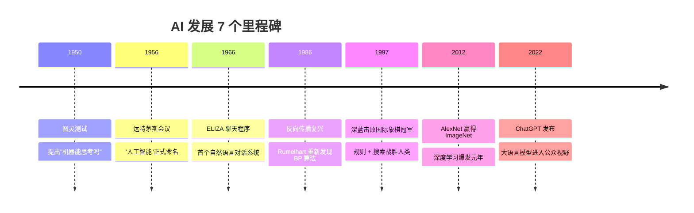

# 00: 人工智能导论 · 从图灵测试到通用人工智能

> **Bloom 层级**: Remember → Understand
> **建议学时**: 90 分钟
> **前置知识**: 无

## 学习目标
1. 识别人工智能发展的 4 个关键阶段和代表成果，了解三次技术浪潮的兴衰原因。
2. 解释 AI、机器学习 (ML)、深度学习 (DL) 之间的包含关系与核心差异。
3. 列举 AI 在不同行业（如教育、医疗、金融）的落地案例，特别是 A3 教育智能体的应用。
4. 辨认当前 AI 技术面临的伦理挑战（如偏见、隐私、安全）及技术局限性（如幻觉、灾难性遗忘）。
5. 掌握通过基础 Python 代码调用大模型 API 的方法。

## 0.1 什么是人工智能
**人工智能 (Artificial Intelligence, AI)** 是计算机科学的一个重要分支，旨在**制造能够表现出人类智能行为的机器**。
1956 年的达特茅斯会议上，John McCarthy 首次提出了这个术语。

一个系统被称为“智能”，通常需要具备以下五大核心能力：
| 能力 | 说明 | 示例 |
|------|------|------|
| **感知** | 通过传感器理解外部环境 | 人脸识别、语音转文字、自动驾驶视觉 |
| **推理** | 基于规则和知识得出结论 | 医学诊断专家系统、法律案情分析 |
| **学习** | 从经验和数据中自我改进性能 | 推荐系统、垃圾邮件过滤、AlphaGo |
| **规划** | 制定行动序列以达成长期目标 | 机器人路径规划、物流资源调度 |
| **语言** | 理解与生成自然语言 | ChatGPT、机器翻译系统、AI 助教 |

**弱 AI vs 强 AI**：
- **弱 AI (Narrow AI)**：当前所有的 AI 系统（包括最强的 GPT-4）都属于弱 AI，它们只能在特定任务上表现优异，无法泛化到未经过训练的领域。
- **强 AI (AGI, 通用人工智能)**：能够像人类一样跨领域思考、具备自我意识和常识推理能力的 AI。目前仍是科学界的远期目标。

## 0.2 AI 发展简史与三次浪潮
人工智能的发展并非一帆风顺，而是经历了三次波峰与波谷。



| 时期 | 技术核心 | 衰落或爆发的原因 |
|------|---------|----------------|
| **1956-1974 (第一次浪潮)** | 符号推理与搜索 | 计算能力严重不足，无法处理包含大量“常识”的复杂真实世界问题。 |
| **1980-1987 (第二次浪潮)** | 专家系统 | 知识库全靠人工手动输入，知识获取成为瓶颈，且系统维护成本极高。 |
| **2012-至今 (第三次浪潮)** | 深度学习与大模型 | 算力（GPU）、海量数据（互联网爆发）和算法（Transformer等）的三大要素同时成熟，促成了目前的繁荣。 |

## 0.3 AI 核心分支与包含关系
AI 并非一种单一技术，而是一个庞大的技术家族。
**包含关系**：`人工智能 (AI) ⊃ 机器学习 (ML) ⊃ 深度学习 (DL)`

| 分支 | 核心问题与代表模型 | 应用领域 |
|------|-------------------|----------|
| **机器学习 (ML)** | 从数据中自动学习规律。如 逻辑回归、XGBoost、SVM。 | 金融风控、房价预测、用户点击率预测。 |
| **深度学习 (DL)** | 利用多层神经网络进行特征提取。如 CNN、RNN、Transformer。 | 复杂的非结构化数据处理（图像、文本）。 |
| **自然语言处理 (NLP)** | 文本的理解与生成。如 BERT、GPT。 | 机器翻译、自动摘要、对话机器人。 |
| **计算机视觉 (CV)** | 图像与视频的处理。如 ResNet、YOLO。 | 自动驾驶、人脸识别、医学影像分析。 |
| **强化学习 (RL)** | 智能体在环境中通过试错学习策略。如 AlphaGo、PPO。 | 游戏 AI、机器人动作控制、大模型人类对齐。 |

## 0.4 教育智能体场景案例 (A3 系统)
AI 在各行各业都有广泛的落地。以我们的 **A3 个性化学习多智能体系统**为例：
传统的在线教育（如网课）是静态的，所有学生看一样的视频。而在 A3 系统中：
- **感知与 NLP**：系统能够理解学生用自然语言提出的含糊问题。
- **机器学习预警**：底层会运行机器学习模型（如决策树），根据学生的打卡和做题数据，预测其期末挂科概率。
- **大模型生成**：基于检索增强生成（RAG），大语言模型（LLM）充当虚拟助教，不仅回答问题，还能根据学生的错题自动生成一张结构化的 Markdown 思维导图。
这展示了 AI 如何将“千人一面”的教育转变为“千人千面”的因材施教。

## 0.5 常见误区
- **误区 1：人工智能就是深度学习，所有的 AI 问题都应该用神经网络解决。**
  - **为什么错**：深度学习只是 AI 的一个子集。在很多结构化表格数据（如 Excel 数据）的预测任务上，传统的机器学习模型（如随机森林、XGBoost）不仅训练速度快得多，而且精度往往超越深度学习，且具备更好的可解释性。
- **误区 2：AI 已经具备了像人一样的常识和思考能力。**
  - **为什么错**：目前哪怕是最强大的 GPT-4，本质上依然是一个基于概率的“文字接龙”机器。它通过海量数据预测下一个最可能出现的词，并没有真正理解词语背后的物理常识（这也是为什么 AI 画画有时会画出 6 根手指）。
- **误区 3：部署一个 AI 模型只需要把算法写好就行了。**
  - **为什么错**：在真实的 AI 工业落地中，算法模型代码只占整个系统的不到 5%。其余 95% 都是数据清洗、特征工程、模型监控、资源调度以及安全对齐（AI 安全）。

## 0.6 可运行示例：几行代码调用大语言模型 API
在 2010 年代，训练一个 AI 需要从头写复杂的数学公式。而在大模型时代，AI 的能力被封装成了 API 供开发者直接调用。以下是使用 Python 调用类似 OpenAI 接口的演示：

```python
# 注意：你需要安装 requests 库 (pip install requests)
import requests
import json

def ask_ai_tutor(question):
    """
    模拟调用大语言模型 API 充当 AI 助教
    """
    # 假设这是一个提供 LLM 服务的 API 端点
    api_url = "https://api.example.com/v1/chat/completions"
    api_key = "your_fake_api_key_here"
    
    headers = {
        "Content-Type": "application/json",
        "Authorization": f"Bearer {api_key}"
    }
    
    payload = {
        "model": "gpt-3.5-turbo",
        "messages": [
            {"role": "system", "content": "你是一个严谨的 AI 编程助教。"},
            {"role": "user", "content": question}
        ],
        "temperature": 0.7
    }
    
    print(f"学生提问: {question}")
    print("正在连接 AI 助教...")
    
    try:
        # 在真实环境中，取消下面的注释以发送真实网络请求
        # response = requests.post(api_url, headers=headers, json=payload, timeout=10)
        # result = response.json()['choices'][0]['message']['content']
        
        # 这里为了确保代码在离线环境下自包含运行，我们进行打桩模拟 (Mock)
        result = "人工智能（AI）旨在创造智能机器，而机器学习（ML）是实现 AI 的一种方法。DL 则是 ML 中使用多层神经网络的一个子集。"
        print(f"AI 助教回答: {result}")
    except Exception as e:
        print(f"API 调用失败: {e}")

if __name__ == "__main__":
    ask_ai_tutor("请用一句话解释 AI、机器学习和深度学习的关系。")
```

## 0.7 本章小结
1. AI 的发展经历了漫长的曲折，其核心目标是赋予机器感知、推理、学习和生成的智能。
2. 数据、算力和深度学习算法的突破共同造就了目前的第三次 AI 浪潮。
3. 机器学习是 AI 的核心手段，而自然语言处理（NLP）和计算机视觉（CV）是其最主要的两大应用领域。
4. 随着大模型技术的普及，AI 正在重塑教育（如 A3 智能体）、医疗、自动驾驶等千行百业，但同时也面临着“幻觉”和数据偏见等严峻的伦理技术挑战。

## 0.8 练习思考
1. **概念辨析**：请用你自己的话，向一个没有计算机背景的长辈解释“强人工智能”与“弱人工智能”的区别。
2. **场景推演**：如果让你设计一个帮助医生看 X 光片的 AI 系统，这属于 AI 的哪一个分支技术？如果模型出现了误判，在当前的 AI 伦理框架下，责任应该由谁来承担？
3. **技术瓶颈**：大语言模型（LLM）非常喜欢“一本正经地胡说八道”，这种现象在学术上被称为什么？你能想到什么机制（提示：可以查阅 RAG 技术）来缓解这个问题吗？
4. **动手实践**：尝试修改本章的代码示例，使其不仅能接收学生的提问，还能记录上下文历史，实现一个能够“连续对话”的 AI 助教雏形。

## 0.9 拓展阅读
- 人工智能的历史与哲学探讨：阅读经典书籍《人工智能：一种现代的方法》（Stuart Russell & Peter Norvig）的第一章。
- 大模型技术的发展脉络：检索并阅读论文 `Attention Is All You Need` (Vaswani et al., 2017)。
- AI 伦理与规范：了解欧盟最新颁布的《人工智能法案》（EU AI Act），看看它是如何根据风险等级对 AI 进行分级监管的。
