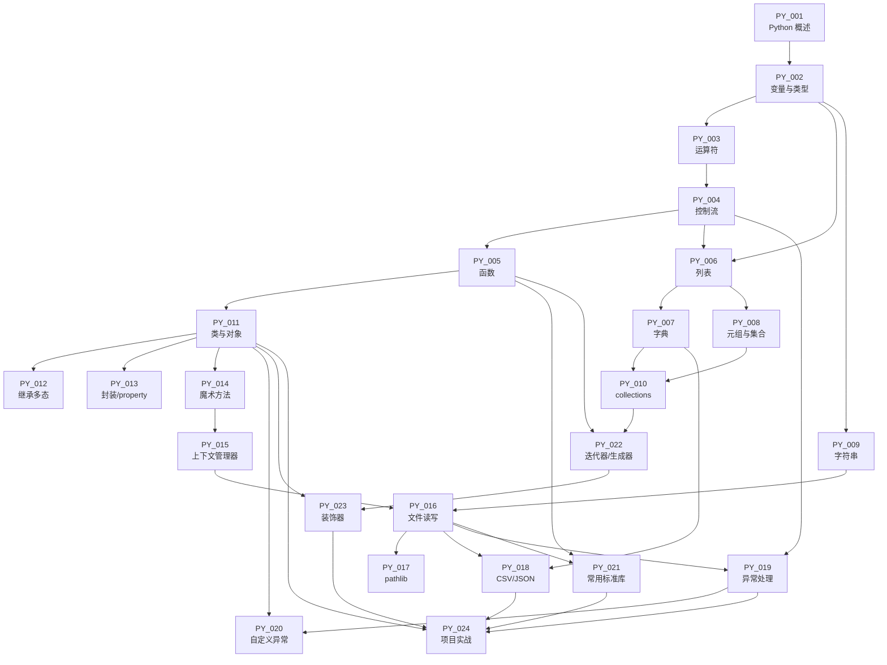

# Python 程序设计 课程知识库

> **版本**: v1-0712 · 2026-07-12
> **对标模板**: `knowledge_base/artificial_intelligence/` 人工智能导论课

## 一、课程简介

Python 是 2026 年 TIOBE 榜单常年稳居前 3 的工业级通用编程语言,其简洁的语法、强大的标准库与繁荣的 PyPI 生态,使其在人工智能、数据科学、Web 后端、自动化运维、金融量化与教育科研等领域占据主导地位。本课程以"从零到工程化"为主线,从环境搭建一路讲到综合项目实战,目标是让学习者既能写得出 hello world,也能独立完成一个结构清晰、可测试、可发布的 Python 命令行工具或数据处理项目。

本课程内容完全覆盖 `knowledge_base/knowledge_map.yaml` 中已定义的 24 个 Python 知识点(PY_001~PY_024),每个章节讲义均挂载到对应 KP,便于 A3 智学领航系统做 RAG 检索、自适应学习路径生成与教师端知识图谱可视化。

## 二、教学目标

完成本课程后,学习者应能:

1. **基础能力** — 独立搭建 Python 开发环境,熟练使用变量、控制流、函数与四种内置容器(列表/字典/元组/集合)解决一般编程问题。
2. **进阶能力** — 掌握字符串与正则、collections 高级容器、面向对象三大特性(封装/继承/多态)、魔术方法与运算符重载。
3. **工程能力** — 熟练使用文件 I/O、CSV/JSON 结构化数据、pathlib 路径处理、异常处理、常用标准库(os/sys/datetime/re/logging)完成真实业务模块。
4. **高级能力** — 深入理解迭代器协议与生成器的惰性计算、装饰器与闭包的工作原理,能设计可复用的中间件。
5. **实战能力** — 独立完成一个学生成绩管理命令行项目,覆盖项目结构规划、虚拟环境隔离、依赖管理、单元测试、打包发布全流程。

## 三、章节目录

| 章节 | 标题 | 关联 KP | 难度 | 学时 |
|------|------|---------|------|------|
| §00 | Python 语言概述与环境搭建 | PY_001 | 1 | 2h |
| §01 | 变量与数据类型 | PY_002, PY_003 | 1 | 5h |
| §02 | 控制流:条件与循环 | PY_004 | 2 | 4h |
| §03 | 函数定义与参数 | PY_005 | 2 | 4h |
| §04 | 列表、字典、元组与集合 | PY_006, PY_007, PY_008 | 2 | 10h |
| §05 | 字符串操作与正则入门 | PY_009 | 2 | 3h |
| §06 | collections 高级容器 | PY_010 | 3 | 3h |
| §07 | 类与对象 | PY_011 | 3 | 5h |
| §08 | 继承与多态 | PY_012 | 3 | 4h |
| §09 | 封装、property 与 dataclass | PY_013 | 3 | 3h |
| §10 | 魔术方法与上下文管理器 | PY_014, PY_015 | 3 | 7h |
| §11 | 文件读写与 pathlib | PY_016, PY_017 | 2 | 5h |
| §12 | CSV 与 JSON 结构化数据处理 | PY_018 | 2 | 3h |
| §13 | 异常处理与自定义异常 | PY_019, PY_020 | 3 | 5h |
| §14 | 常用标准库(os/sys/datetime/re/logging) | PY_021 | 2 | 4h |
| §15 | 迭代器与生成器 | PY_022 | 4 | 4h |
| §16 | 装饰器与闭包 | PY_023 | 4 | 4h |
| §17 | Python 项目实战:学生成绩管理系统 | PY_024 | 5 | 8h |

**总计**: 18 章节 / 24 知识点 / 84 学时 / ≈ 3 学分

## 四、知识点依赖图

## 五、考核方式

| 形式 | 占比 | 说明 |
|------|------|------|
| 平时练习 | 30% | 18 份章节练习,每章 ≥ 10 题 |
| 实验报告 | 30% | 5 个实验,提交代码 + 报告 |
| 期末项目 | 40% | 综合项目(对标 §17),独立完成 |

> 配套题库:`data/question_bank_python.json`(240 题,覆盖 24 KP,Bloom 六层全覆盖)

## 六、参考书目

1. 《Python 编程:从入门到实践》(Eric Matthes,人民邮电出版社) — 入门首选
2. 《流畅的 Python》(Luciano Ramalho,人民邮电出版社) — 进阶必读
3. 《Effective Python》(Brett Slatkin,机械工业出版社) — 90 个最佳实践
4. Python 官方文档:https://docs.python.org/3/
5. Real Python 在线教程:https://realpython.com/

## 七、与 A3 智学领航系统的对接

- 章节讲义直接挂载到 KP,作为 RAG 检索的源文档
- 240 题题库供 A3 智能出题 Agent 调度,每个 KP 自动生成 10 道差异化题目
- 章节练习与代码示例接入自适应学习路径(Path Planner Agent)
- 学生在代码沙箱中运行 `code_examples/*.py`,系统记录每题的运行结果与错误类型,驱动 BKT 掌握度更新

*本总纲对应任务书 `25-Python课程全量补齐任务书-0712.md` 第七节规范编写*
